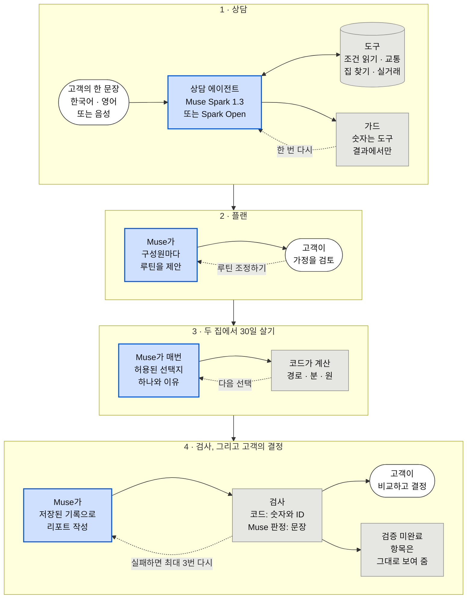

<h1 align="center">
  <picture>
    <source media="(prefers-color-scheme: dark)" srcset="briefs/img/ithaca-logo-light.svg">
    
  </picture>
</h1>

<h3 align="center">계약하기 전에, 그 집에서의 30일을 먼저 살아 보세요.</h3>

<p align="center"><b>다음 집을 먼저 살아 보는 에이전트</b><br>
가족 생활 시뮬레이션 · Muse 에이전트 플랜 · 음성 입력 · 방 사진 비전 · 근거를 검사한 리포트</p>

<p align="center">
  <a href="https://github.com/halo-sw/ithaca/actions/workflows/ci.yml"></a>
  
  <a href="#벤치마크와-평가"></a>
  <a href="#벤치마크와-평가"></a>
  <br>
  
  
  
  <a href="LICENSE"></a>
</p>

<p align="center">
  <a href="https://halo-sw.github.io/ithaca/?lang=ko"></a>
  &nbsp;
  <a href="https://github.com/halo-sw/ithaca/releases/download/demo-v9/ithaca-hackathon-final-en.mp4"></a>
  &nbsp;
  <a href="https://halo-sw.github.io/ithaca/?replay=seoul-couple&lang=ko"></a>
  &nbsp;
  <a href="README.md"></a>
  <br><sub>공개 데모는 9번째 수정본이에요. 영어 합성 내레이션과 자막이 있어요.</sub>
</p>

<p align="center">
  <a href="#제출-개요">개요</a> ·
  <a href="#0-빠르게-시작하기">빠르게&nbsp;시작하기</a> ·
  <a href="#1-프로젝트-소개">소개</a> ·
  <a href="#2-서비스-요약">요약</a> ·
  <a href="#3-문제-정의">문제</a> ·
  <a href="#4-muse-에이전트가-일하는-방식">Muse&nbsp;에이전트가&nbsp;일하는&nbsp;방식</a> ·
  <a href="#모델이-도는-곳">모델이&nbsp;도는&nbsp;곳</a> ·
  <a href="#5-주요-서비스-흐름">서비스&nbsp;흐름</a> ·
  <a href="#벤치마크와-평가">벤치마크</a> ·
  <a href="#6-결론">결론</a> ·
  <a href="#7-기대-효과와-다음-단계">다음&nbsp;단계</a>
</p>

## 제출 개요

<!-- Korean tables are HTML so label cells can carry nowrap; GitHub otherwise breaks Korean words mid-word in narrow columns. -->
<table>
<thead><tr><th>항목</th><th>내용</th></tr></thead>
<tbody>
<tr><td nowrap><b>해커톤</b></td><td>Meta Hackathon 2026 · 트랙: <b>Indie Developer</b> · 문제 주제: <b>Build for Your World</b></td></tr>
<tr><td nowrap><b>대회 기간에 만듦</b></td><td><a href="https://github.com/halo-sw/ithaca/commit/7fec53140d26cc100392126fa76029909c0ff1a3">2026년 10월 28일</a>부터 <b>Halo가 혼자</b> 처음부터 만들었어요. 제품 코드, 테스트, 파이프라인은 모두 <a href="briefs/"><code>briefs/</code></a>의 단계별 지시서를 받아 <b>Muse Code</b>가 작성했어요.</td></tr>
<tr><td nowrap><b>바로 써 보기</b></td><td>함께 쓰는 하루 한도 안에서 실시간 Muse가 도는 <a href="https://halo-sw.github.io/ithaca/?lang=ko">공개 앱</a> · 키 없이 재생되는 <a href="https://halo-sw.github.io/ithaca/?replay=seoul-couple&amp;lang=ko">기록된 한 달</a> · <a href="https://halo-sw.github.io/ithaca/?chat=I+work+at+Meta+HQ+in+Menlo+Park.+Two+of+us%2C+rent+up+to+%244%2C500+a+month.&amp;lang=en">Meta 본사 사례(영어)</a></td></tr>
<tr><td nowrap><b>데모 영상</b></td><td><a href="https://github.com/halo-sw/ithaca/releases/download/demo-v9/ithaca-hackathon-final-en.mp4">2분 53초, 영어 내레이션과 자막</a> (9번째 수정본)</td></tr>
<tr><td nowrap><b>Meta 모델</b></td><td><code>Muse Spark 1.3</code>(<code>api.meta.ai</code>): 상담, 플랜, 하루하루의 선택, 리포트와 근거 검사<br><code>Muse Spark Open</code>(Baseten): Spark 1.3 대신 고를 수 있는 모델<br><code>Muse Voice Transcribe 1.0</code>(<code>api.meta.ai</code>): 말을 고칠 수 있는 글로 받아 적기<br><code>Muse Image 1.0</code>(<code>api.meta.ai</code>): 기록 한 장면을 표시가 붙은 그림으로<br><code>SAM 3.1</code>(<code>api.meta.ai</code>): 방 사진에서 창 찾기<br><code>Muse Code</code>: 제품 코드 작성 · <a href="#모델이-도는-곳">모델이 도는 곳 ↓</a></td></tr>
<tr><td nowrap><b>평가</b></td><td>리포트 검사: 기록된 실행 <b>3개 모두</b> 첫 시도에 통과, 커버리지 100%<br>모델 일치도: Spark Open은 판단 지점 139곳 중 <b>120곳</b>(86%)에서 Spark 1.3과 같은 선택<br>통근: Meta 본사까지 실제 통근은 매물식 계산보다 평균 <b>28.7분</b> 더 걸려요<br><a href="#벤치마크와-평가">벤치마크와 평가 ↓</a></td></tr>
<tr><td nowrap><b>직접 실행</b></td><td><code>docker compose up --build</code> 뒤 <code>localhost:8080</code> 열기 · <a href="#0-빠르게-시작하기">빠르게 시작하기 ↓</a></td></tr>
</tbody>
</table>

## 0. 빠르게 시작하기

심사위원과 개발자를 위한 실행 안내예요. 어느 방법이든 공개 사이트와 같은 앱이 떠요.

| 방법 | 필요한 것 | 얻는 것 |
|---|---|---|
| **설치 없이** | 브라우저 | [공개 앱](https://halo-sw.github.io/ithaca/?lang=ko)에서 실시간 Muse(하루 한도 공유), 또는 키 없이 [기록된 한 달](https://halo-sw.github.io/ithaca/?replay=seoul-couple&lang=ko) 보기 |
| **[Docker](#docker로-실행하기)** | Docker | `localhost:8080`의 공개 빌드와 `localhost:8787`의 모델 중계 서버 |
| **[소스에서](#소스에서-실행하기)** | Node 22 | 공개 사이트가 켠 기능을 모두 켠 Vite 개발 서버 |
| **[데이터&nbsp;빌드](docs/development.md)** | Python 3.12, 원본 데이터 약&nbsp;6&nbsp;GB | OpenStreetMap·건물 자료로 지역 데이터 만들기(영어 안내) |

**키는 없어도 돼요.** 키가 없으면 헤더에 **규칙 모드**가 떠요. 그래도 숫자는 엔진이 모두 계산하고, 기록된 한 달도 끝까지 재생돼요. 내 `META_API_KEY`를 넣으면 상담, 플랜, 하루하루의 선택, 리포트 검사, 음성 입력이 Muse Spark 1.3과 Muse Voice로 돌고, 방 사진 창 찾기와 기록 그림은 SAM 3.1과 Muse Image를 불러요. Muse Spark Open은 내 Baseten 키가 있을 때만 돌아요.

### Docker로 실행하기

```bash
git clone https://github.com/halo-sw/ithaca.git && cd ithaca
cp .env.example .env      # 선택: META_API_KEY에 내 키 넣기
docker compose up --build
```

[http://localhost:8080](http://localhost:8080)을 열어요. 빌드할 때 공개 사이트가 쓰는 실행 데이터(약 130 MB, [`data-v1` 릴리스](https://github.com/halo-sw/ithaca/releases/tag/data-v1))를 내려받아요. CI가 PR마다 키 없이 이 두 컨테이너를 빌드하고 띄워 봐요. 중계 서버는 `DATA_BASE_URL`을 따로 정하지 않으면 공개 사이트에서 지역 데이터를 읽어요. 이 빌드도 공개 사이트처럼 방 사진 창 찾기(SAM 3.1)와 기록 그림(Muse Image)을 켜요.

### 소스에서 실행하기

```bash
git clone https://github.com/halo-sw/ithaca.git && cd ithaca
npm --prefix web ci
mkdir -p "$HOME/ithaca-data"
curl -L https://github.com/halo-sw/ithaca/releases/download/data-v1/runtime-data.tgz \
  | tar -xz -C "$HOME/ithaca-data"
set -a; . ./.env; set +a  # 선택: 내 키 불러오기 (.env.example 참고)
ITHACA_DATA_DIR="$HOME/ithaca-data/data" VITE_SAM_PHOTO=1 VITE_MUSE_IMAGE=1 npm run dev
```

[http://localhost:5173](http://localhost:5173)을 열어요. 개발 서버가 모델 요청을 직접 처리해서 중계 서버가 필요 없고, 데이터는 저장소 밖에 둬요.

**테스트**

```bash
npm test                  # JavaScript (위의 npm ci 다음에)
python3.12 -m venv .venv && .venv/bin/pip install -r requirements.txt
.venv/bin/pytest -q       # Python 파이프라인
```

직접 만든 지역 데이터가 있어야 하는 테스트는 새로 받은 저장소에서 스스로 건너뛰어요. CI에서도 같아요.

## 1. 프로젝트 소개

**집은 대부분의 가족에게 가장 큰 구매인데, 서둘러 정하는 경우가 많아요.** 사진 몇 장, 도면, 가격, 짧은 집 구경 한 번으로 몇 년의 생활이 정해져요. 한국에서는 집값이 오를 때마다 지금 안 사면 늦는다는 불안(FOMO)이 더해지고, 전세사기 때문에 매매 대신 고를 수 있던 전세마저 불안해졌어요. 그 집이 우리 가족의 생활에 어떻게 맞는지는 이사한 뒤에야 알게 돼요.

**Ithaca에서는 에이전트가 먼저 살아 봐요.** 우리 가족을 닮은 에이전트 가족이 후보 집 두 곳에서 같은 30일을 살아요. 출근하는 날과 재택하는 날, 볼일, 공원, 통학, 집에서 보내는 저녁, 출퇴근과 돈까지요. Muse Spark 1.3이 구성원마다 루틴을 짜고, 실제 지도에 있는 선택지 중에서 하루하루를 골라요. 경로, 시간, 비용은 코드가 모두 계산하고, 리포트는 보여 주기 전에 저장된 기록과 대조해 검사해요.

그다음 출퇴근만이 아니라 한 달 치 생활 전체를 나란히 비교하고, 사거나 계약하기 전에 집 구경에서 무엇을 확인할지 정해요. 결정은 끝까지 사용자가 해요.

**누구를 위한 건가요.** 첫 집을 구하는 사회초년생, 결혼을 앞둔 커플, 두 집 사이에서 고민하는 어린 자녀를 둔 가족, 그리고 살아 본 적 없는 도시로 옮기는 새 입사자예요. Caltrain 축에서 집을 찾는 Meta 신입이 그 예예요.

## 2. 서비스 요약

<table>
<thead><tr><th>입력하는 것</th><th>Ithaca가 돌려주는 것</th></tr></thead>
<tbody>
<tr><td nowrap>가족 구성원, 직장, 예산, 선호</td><td>지도 위 후보 집과 과거 실거래 참고 가격</td></tr>
<tr><td nowrap>고른 집 두 곳과 검토한 루틴</td><td>같은 가족이 같은 30일을 두 집에서 지낸 시뮬레이션</td></tr>
<tr><td nowrap>궁금한 점과 우선순위</td><td>생활 전체 비교: 시간(출퇴근, 집에서 보내는 저녁), 돈(매매·전세·월세의 월 비용, 세금과 대출 가정 포함), 걸어서 10분 안의 생활 편의, 이유가 저장된 선택, 근거와 연결된 리포트</td></tr>
</tbody>
</table>

30일 기록 옆에는 한국 집마다 전세 경고 신호와 공식 출처 확인 목록, 표시가 붙은 모의 손실 시나리오, 조건별로 대조한 지원 제도, 출처와 기간을 밝힌 공식 치안·학교 통계가 함께 나와요. 집의 비중은 사용자가 직접 정한 우선순위(**내 기준 점수**)로만 매겨요. Ithaca는 어느 집이 낫다고 정하지 않고, 전세가 안전하다고 판정하지도 않아요.

지금 시나리오는 잠실과 판교를 포함한 서울·경기 일부, 그리고 별도의 멘로파크 / Meta 본사 사례를 다뤄요. 플랜에는 일하는 어른, 재택하는 날, 아이, 나이 든 가족, 반려동물을 함께 넣을 수 있어요. 빠졌거나 아직 지원하지 않는 조건은 숨기지 않고 보여 줘요.

과거 실거래가는 참고 자료이지, 지금 나와 있는 매물이 아니에요. 미국 월세 입력에는 ZIP 코드 단위 추정값이 들어가요. 출처, 가정, 다루는 범위의 한계도 비교의 일부예요.

## 3. 문제 정의

**몇 년을 살 집을 살아 보지 않고 정해요.** 집은 대부분의 가족에게 인생에서 가장 큰 구매인데, 사진, 도면, 가격, 짧은 집 구경으로 정해요. 그 집이 사람마다의 하루에 어떻게 맞는지는 이사한 뒤에야 드러나요. 커플이라면 두 사람의 출퇴근, 출근하는 날과 재택하는 날, 볼일, 집에서 보내는 시간을 함께 따져야 하고, 가족이라면 통학 경로가 더해져요. 잘 맞지 않는 집은 매달 시간과 돈을 계속 쓰게 만들어요.

- **한국: 서두름, FOMO, 전세사기.** 2025년 6월 서울 아파트값은 한 주에 0.43% 올라 주간 기준 6년 9개월 만에 가장 크게 올랐어요(한국부동산원, [뉴시스](https://www.newsis.com/view/NISX20250627_0003230658)). 집값이 오를수록 더 늦기 전에 사야 한다는 압박이 커져요. 그렇다고 전세로 기다리는 것도 안전하지 않아요. 2023년 6월 전세사기피해자법 시행 이후 **피해자로 공식 인정된 사례는 누적 41,559건이고, 인정된 임차인의 75.9%가 40세 미만**(30대 50.7%, 20대 25.2%)이에요. 97.7%는 보증금 3억 원 이하예요(국토교통부 자료, [헤럴드경제, 2026-10-11](https://www.heraldk.com/article/2026101114382405541)). 하루 종일 동네를 옮겨 다녀도 결국 빨리 정하라는 압박으로 끝나기 쉬워요.
- **미국: 살아 보고 나서야 알아요.** 미국 주택 소유자의 45%가 지금 집을 산 것에 후회가 하나 이상 있어요([Bankrate, 2025년 5월](https://www.bankrate.com/press-releases/nearly-half-of-homeowners-have-at-least-one-regret-about-the-purchase-of-their-current-home/)). 최근 1년 안에 집을 산 사람 중 젊은 세대일수록 통근 거리와 동네를 더 후회해요([Realtor.com, 2025년 11월](https://www.stocktitan.net/news/NWS/realtor-com-as-market-cools-buyer-regret-does-grzvemhi8uiu.html)). 미국 시장은 느려져서(같은 조사에서 2025년 10월 매물이 시장에 머무는 기간 중앙값 63일), 그곳의 문제는 서두름보다 살아 보지 않고 정한다는 데 있어요.

**빠진 것은 먼저 살아 볼 방법이에요.** 길찾기는 한 번의 이동을, 매물 정보는 집 자체를 보여 줘요. 둘 다 가족의 일정, 볼일, 비용이 한 달 동안 어떻게 쌓이는지, 같은 조건에서 두 집이 어떻게 다른지는 보여 주지 않아요. Ithaca는 이것을 눈으로 보고 검토할 수 있는 비교로 바꾸고, 집 구경에 가져갈 질문으로 정리해요.

**하지 않는 것.** 30일 시뮬레이션이 임대차 계약을 보증하거나 전세사기를 막아 주지는 못해요. Ithaca는 공개 경고 신호, 공식 출처 확인 목록, 표시가 붙은 모의 손실 시나리오를 출퇴근, 돈, 30일 기록과 나란히 보여 줘요. 특정 전세나 집주인이 안전하다고 판정하지 않고, 집값을 전망하지 않고, 사라고 권하지 않아요. 공공 실거래, 건물, 교통 데이터는 입력일 뿐, 시뮬레이션한 한 달이 현실과 같다는 근거는 아니에요.

**만든 이유.** 저는 Halo이고, 신혼집을 구하고 있었어요. 전세사기 소식에 전세는 불안했고, 집값이 오르니 기다리는 것도 불안했어요. 두 사람의 생활 패턴까지 달라서 어느 집이든 판단하기 어려웠어요. 수면의 질, 출퇴근길 혼잡도, 동네마다의 특성은 이사한 뒤에야 마주쳐요. 이렇게 큰돈이 드는 결정이니, 계약하기 전에 먼저 살아 보고 싶었어요.

## 4. Muse 에이전트가 일하는 방식

**Muse는 루틴을 제안하고, 정해진 선택지 안에서 골라요. 그 결과는 코드가 계산해요. 리포트는 저장된 실행 기록과 대조해 검사해요.**

대화 하나가 위에서 아래로 이렇게 흘러가요. 파란 상자는 Muse, 회색 상자는 코드, 흰 상자는 고객이에요. 점선 화살표는 일을 되돌려 보내는 곳이에요.



코드: [중계 서버](relay/handler.js) · [상담 에이전트](web/src/consult/agent.js) · [도구](web/src/consult/tools.js) · [가드](web/src/consult/guards.js) · [가족 플랜](web/src/consult/life-plan.js) · [실시간 가족 루프](web/src/judge/household.js) · [브라우저 워커](web/src/sim-worker.js) · [리포트](web/src/consult/report.js) · [검사](web/src/verify/compare.js). 도식 원본: [docs/agent-workflow.ko.mmd](docs/agent-workflow.ko.mmd)

<table>
<thead><tr><th>역할</th><th>하는 일</th><th>확인할 수 있는 방법</th></tr></thead>
<tbody>
<tr><td nowrap>상담</td><td>Muse가 도구를 써서 가족 정보를 정리하고, 기록된 주택 데이터를 찾아요</td><td>직접 말한 입력과 빠진 정보를 구분해서 보여 줘요</td></tr>
<tr><td nowrap>플랜</td><td>Muse가 구성원마다 출근하는 날, 재택하는 날, 볼일, 지원하는 루틴을 제안해요</td><td>사용자가 가정을 검토해요. <b>루틴 조정하기</b>를 누르면 확정 전에 고칠 내용이 Muse에게 다시 가요</td></tr>
<tr><td nowrap>하루하루의 선택</td><td>선택할 때가 되면 Muse는 그 사람의 선호, 루틴, 최근 선택, 지도에 있는 선택지를 받아요</td><td>허용된 선택지 하나와 이유를 돌려줘요. 기록에는 선택지와, 모델이 골랐는지 기본 규칙으로 정했는지가 남아요</td></tr>
<tr><td nowrap>시뮬레이션</td><td>브라우저 워커가 정해진 일정을 적용하고 경로, 걸린 시간, 비용을 계산해요</td><td>값은 엔진과 그 입력에서 나와요. 배경 주민은 규칙을 따라요</td></tr>
<tr><td nowrap>리포트와 검사</td><td>Muse가 저장된 기록으로 리포트를 쓰고, 코드가 지원하는 숫자와 근거 ID를 검사해요. 별도의 Muse 호출이 검사 대상 문장을 인용된 이벤트와 대조해요</td><td>틀린 문장은 고치도록 돌려보내요. 의미 검사가 빠지거나 실패하면 <b>검증 미완료</b>로 남고, 지원하지 않는 항목은 통과로 세지 않아요</td></tr>
</tbody>
</table>

**기록된 선택 하나:** 공개된 판교 실행에서, 재택하는 날 배우자의 선택지는 공원 산책과 집에 있기 두 가지였어요. Muse는 공원을 고르고 “저녁 산책 루틴을 즐기기 좋은 시간”이라는 이유를 남겼어요(영어 기록은 “Matches evening park walk routine on remote workday”). 걷는 시간 5.1분은 엔진이 계산했어요. 시뮬레이션에서 관찰한 선택일 뿐, 실제 사람이 그렇게 한다는 근거는 아니에요. [선택, 선택지, 실행 기록(영어)](docs/recording-v9.md#the-choice-shown-in-the-video)

### 모델이 도는 곳

**브라우저**에서는 화면, 3D 재생, 시뮬레이션 워커가 돌아가요. 실행 중 모델 호출은 Vercel(또는 로컬 Docker)의 **중계 서버**가 해요. 서비스 키는 중계 서버의 환경 변수에만 있어요. 사용자가 자기 키를 넣으면, 그 키는 그 사용자의 요청에만 실려 가요.

| 모델 | 하는 일 | 도는 곳 | 근거 |
|---|---|---|---|
|  **Muse Spark 1.3** | 상담, 플랜, 하루하루의 선택, 리포트와 근거 검사 | 중계 서버 → Meta&nbsp;API | [코드](web/src/judge/providers.js) · [기록된 한 달(영어)](docs/recording-v9.md) |
|  **Muse Spark Open** | Spark 1.3 대신 고를 수 있는 모델 | 중계 서버 → Baseten | [실제 호출](docs/evidence/muse-spark-open-2026-10-31.json) · [비교](docs/model-comparison.ko.md) |
|  **Muse Voice Transcribe 1.0** | 말을 고칠 수 있는 글로 받아 적기 | 브라우저 마이크 → 중계 서버 → Meta&nbsp;API | [코드](web/src/consult/voice.js) |
|  **Muse Image 1.0** | 기록된 활동 하나를 그림으로 그리기 | 중계 서버 → Meta&nbsp;API | [코드](web/src/consult/diary-image.js) · [실제 호출](docs/evidence/muse-image-2026-11-03.json) |
| **SAM 3.1** | 넣은 방 사진에서 창 찾기 | 브라우저 → 중계 서버 → Meta&nbsp;API | [코드](web/src/consult/windows.js) · [실제 호출](docs/evidence/sam-3.1-2026-11-03.json) |
|  **Muse Code** | 제품 코드, 테스트, 파이프라인 작성 | 개발자 컴퓨터, 개발할 때만 | [지시문](briefs/) · [규칙](AGENTS.md) |

API 경로: Meta `api.meta.ai/v1/` 아래 `chat/completions`(Spark 1.3), `asr/transcribe`(Voice), `images/generations`(Image), `responses`(SAM) · Baseten `inference.baseten.co/v1/chat/completions`(Spark Open). Muse Code는 실행 중에 부르는 엔드포인트가 없어요.

Muse Image가 그린 그림에는 “**Muse Image 일러스트 · 실제 장소 사진이 아니에요**”라는 표시가 붙어요. 집을 찍은 사진이 아니에요. SAM은 창 상자와 그 상자가 사진에서 차지하는 비율만 알려 줘요. 실제 창 크기나 채광 성능은 말하지 않아요. 공개한 호출 기록에는 그림으로 그린 시험용 방을 썼어요. 이 두 기능은 30일 비교의 근거와 별개예요.

앱은 **“Muse가 제안한 플랜”**, **“Muse가 고르는 중”**, 기록된 선택의 출처로 에이전트가 한 일을 보여 줘요. 대표로 공개한 한 달은 **Spark 1.3**으로 돌렸어요. 화면에서 Spark Open을 고를 수 있다고 해서, 그 실행을 Spark Open이 만든 것은 아니에요. 사람과 오케스트레이션이 맡은 일은 방향 잡기, 지시문, 검사, 발표 준비였고, 구현은 Muse Code가 했어요. [전체 구조](docs/architecture.ko.md) · [검증 규칙](docs/verification.ko.md) · [모델 근거(영어)](docs/evidence/README.md)

## 5. 주요 서비스 흐름

1. **가족을 알려 주세요.** 함께 사는 사람, 예산, 가는 곳, 선호를 글로 쓰거나 말로 해요.
2. **집 두 곳을 골라요.** 후보 집, 실거래 참고 가격, 지도가 다루는 범위를 살펴봐요.
3. **플랜을 검토하고 고쳐요.** 구성원마다 제안된 루틴을 읽어요. **루틴 조정하기**로 조건을 바꾸고, Muse가 고친 플랜을 검토한 뒤 확정해요.
4. **한 달을 돌려요.** Muse가 허용된 선택지 중에서 고르고, 그 결과는 코드가 계산해요. 실시간 실행은 몇 분 걸릴 수 있어요. 화면에 진행 상황이 보이고, 기본 규칙으로 대신한 경우도 함께 보여요.
5. **비교를 살펴봐요.** 비용, 출퇴근, 출처 표시, 실제 리포트 검사 과정을 열어 봐요. 저장된 선택의 이동 과정을 3D로 따라가요.
6. **실제 집 구경을 준비해요.** 차이점과 남은 질문으로 무엇을 확인할지 정해요. 어떤 집으로 할지는 사용자가 정해요.

**왜 30일인가요?** 약 4주 동안 출근하는 날, 재택하는 날, 주말, 볼일이 두 집에서 같은 검토 조건으로 되풀이돼요. 화면에서는 **처음 7일**과 **전체 기간**을 비교해요. 날이 늘어도 새로 알게 되는 것이 적은 경우도 그대로 보여 줘요. 30일은 비교를 위해 정한 기간이지, 검증된 최소 기간이나 예측이 아니에요. 월 주거비는 별도의 금융 가정으로 계산해요.

### 공개된 실행이 보여 주는 것

예시로 만든 판교 커플 한 쌍, 저장된 실행 하나: **`cmw0nibca873f`**. 아래 표는 v9 영상과 [같은 한 달 재생(영어)](https://halo-sw.github.io/ithaca/?replay=pangyo-reviewed-month&lang=en)에 나오는 값이에요.

| 항목 | A 집 | B 집 |
|---|---:|---:|
| 편도 출퇴근 평균 | 4.8분 | 23.9분 |
| 월 주거비 + 기록된 교통비 | ₩509,790 | ₩1,023,917 |
| 과거 실거래 면적 구간 | 25–35 m² | 55–65 m² |
| Muse가 한 선택 / 기본 규칙으로 대신한 선택 | 70 / 0 | 63 / 2 |

저장된 리포트 상태는 **통과**예요. 리포트가 기록과 맞는지 본 내부 검사이지, 현실에서 정확하다는 뜻은 아니에요. 실거래 면적 구간은 정확한 집 크기가 아니에요. 역 기준 직장 위치, 대출 조건, 관리비는 분명히 밝힌 가정이에요. [입력, 계산, 한계(영어)](docs/recording-v9.md) · [기계가 읽을 수 있는 근거](docs/evidence/recording-v9.json)

**따로 돌린 4인 가족 실행**에는 학교급별 통학 경로가 기록돼 있어요. 중학교 경로가 없는 집은 없는 그대로 남겨요. 학교 배정이나 입학은 추측하지 않아요. [가족 실행 근거(영어)](docs/recording-v9.md#separate-four-person-family)

### 벤치마크와 평가

모든 결과는 이 저장소의 파일로 다시 만들 수 있어요. 어느 것도 현실에서의 정확도를 잰 것은 아니에요. 그건 7번의 현장 연구에서 할 일이에요.

<table>
<thead><tr><th>평가</th><th>조건</th><th>결과</th><th>근거</th></tr></thead>
<tbody>
<tr><td nowrap><b>리포트 검사</b></td><td>기록된 실행 3개(판교 커플, 서울 예비부부, Meta 본사), 실시간 Muse Spark 1.3</td><td><b>3개 모두 첫 시도에 통과</b>, 필수·가중 커버리지 100%. 29k 단계 전 첫 서울 실행은 4번 만에 통과</td><td nowrap><a href="docs/verification.ko.md">검증</a> · <a href="web/public/recorded/">기록</a></td></tr>
<tr><td nowrap><b>모델 일치도</b></td><td>Spark 1.3과 Spark Open, 같은 가족, 각 154개 판단</td><td>함께 만난 판단 지점 139곳 중 <b>120곳에서 같은 선택</b>(86%). 둘 다 가드 대체 0건. 호출당 3.7초와 2.7초</td><td nowrap><a href="docs/model-comparison.ko.md">비교</a></td></tr>
<tr><td nowrap><b>매물식 통근<br>계산과 비교</b></td><td>기록된 실행 3개의 집 17곳, 시드 10개, 규칙 기반</td><td>Meta 본사: 실제 통근이 <b>26.0–31.6분 더 걸려요</b>(평균 28.7분). 대부분 역에서 회사까지 마지막 구간과 열차 대기예요. 판교: 0.2–2.6분 더 걸려요</td><td nowrap><a href="docs/baseline-commute.ko.md">기준 비교</a></td></tr>
<tr><td nowrap><b>공개한 한 달</b></td><td>실행 <code>cmw0nibca873f</code>, 집 두 곳</td><td><b>Muse 선택 133개</b>, 표시된 기본 규칙 대체 2개, 리포트 통과</td><td nowrap><a href="docs/recording-v9.md">녹화 v9(영어)</a></td></tr>
<tr><td nowrap><b>테스트</b></td><td>PR마다 CI</td><td><b>JS 3,765개</b> 통과(42개 건너뜀)<br><b>Python 289개</b> 통과(18개 건너뜀)<br>Docker compose 실행 확인</td><td nowrap><a href="https://github.com/halo-sw/ithaca/actions/workflows/ci.yml">CI</a></td></tr>
</tbody>
</table>

두 모델의 일치도는 정확도 점수가 아니에요. 리포트 검사 통과는 리포트가 자기 실행 기록과 맞는다는 뜻이에요. 매물식 계산은 관행을 따라 우리가 만든 기준이지, 실제 매물 문구가 아니에요.

## 6. 결론

Ithaca는 집 선택이 매일의 생활에 남기는 결과를 눈으로 보고 따져 볼 수 있게 해요. 검토한 가족 플랜, 저장된 선택, 계산된 장단점, 근거와 연결된 리포트로요. 이 프로토타입은 실제 모델 호출과 공공 데이터 입력으로 그 흐름을 보여 줘요.

얻을 수 있는 건 더 잘 준비한 집 구경과 더 분명한 비교예요. 최종 결정은 가족이 해요.

## 7. 기대 효과와 다음 단계

기대하는 효과는 **집을 비교할 때 머리로 따져야 할 일이 줄고, 루틴이 안 맞는 점을 더 일찍 발견하고, 시간과 돈에 대해 더 분명하게 이야기하는 것**이에요. 아직 검증할 목표이지, 사용자에게서 측정한 결과가 아니에요.

<table>
<thead><tr><th>다음 단계</th><th>검증할 것</th></tr></thead>
<tbody>
<tr><td nowrap>거주자 10–20명과 현장 연구</td><td>모델이 계산한 이동과 비용을 실제 루틴과 비교해요. 오차와 함께, 이 비교가 사람들이 던지는 질문을 바꾸는지 기록해요</td></tr>
<tr><td nowrap>경로와 데이터 범위 넓히기</td><td>빠진 목적지, 직장 위치 정밀도, 교통 가정을 개선해요. 풀리지 않은 입력은 계속 보이게 둬요</td></tr>
<tr><td nowrap>더 많은 가족 조건</td><td>지원한다고 말하기 전에 통학 경로 데이터와 서로 맞춰야 할 조건을 검증해요. 학교 입학, 소음, 채광은 한계를 분명히 남겨요</td></tr>
<tr><td nowrap>사진 기반 도움</td><td>실제 치수나 환경에 대한 판단을 더하기 전에, 실제 방 사진으로 창 찾기를 평가해요</td></tr>
</tbody>
</table>

우리 가족 정보로 시작해서 가정을 살펴보고, 그 결과로 계약 전에 더 좋은 질문을 해 보세요.

---

[구조](docs/architecture.ko.md) · [기능](docs/features.ko.md) · [플랜과 30일 기간(영어)](docs/household-planning.md) · [만든 과정](docs/build-log.ko.md) · [로컬 설정(영어)](docs/development.md) · [녹화 대본(영어)](docs/demo-script.md)

코드: [MIT](LICENSE). 데이터, 이미지, 글꼴은 각자의 라이선스를 따라요. 자세한 내용은 [ATTRIBUTION.md](ATTRIBUTION.md)에 있어요.
