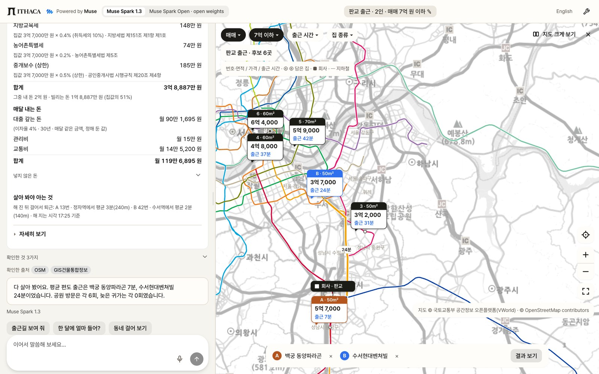
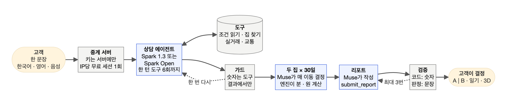
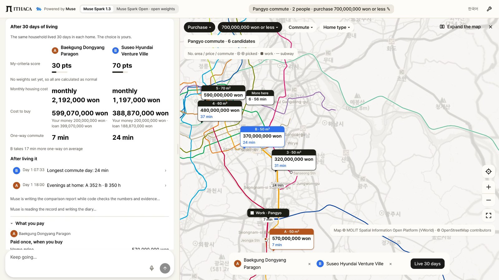
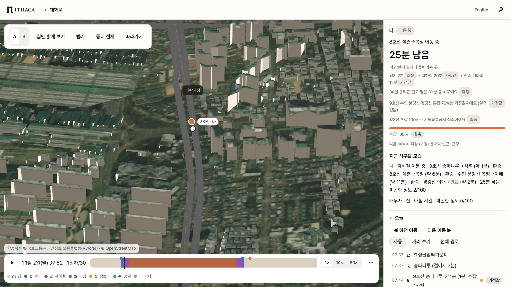
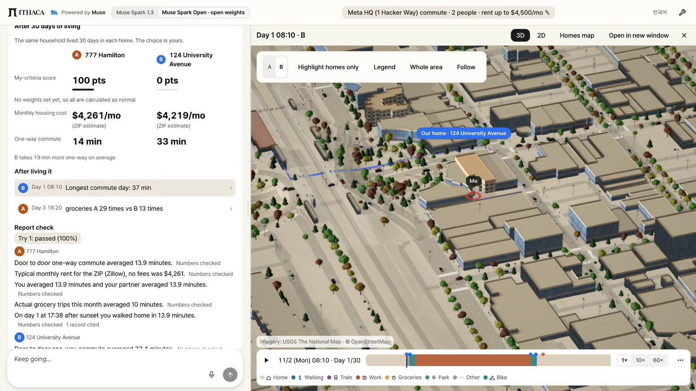

<p align="center"></p>

**문제.** 집은 사진 몇 장과 한 번의 집 구경으로 정하고, 그 집이 우리 생활에 맞는지는 이사한 뒤에야 알게 돼요. 미국 주택 소유자의 45%는 지금 집을 산 것에 후회가 하나 이상 있다고 답했어요([Bankrate, 2025년 5월](https://www.bankrate.com/press-releases/nearly-half-of-homeowners-have-at-least-one-regret-about-the-purchase-of-their-current-home/)). 한국에서는 2023년 6월 전세사기피해자법 시행 이후 피해자로 인정된 사례가 41,559건이고, 인정된 임차인의 75.9%가 40세 미만이에요([헤럴드경제, 2026-10-11](https://www.heraldk.com/article/2026101114382405541)).

**누구를 위한 건가요.** 첫 집을 구하는 사회초년생, 결혼을 앞둔 커플, 두 집 사이에서 고민하는 어린 자녀를 둔 가족, 살아 본 적 없는 도시로 옮기는 새 입사자예요.

**Ithaca가 하는 일.** 우리 가족을 닮은 AI 가족이 후보 집마다 30일을 먼저 살아 봐요. 하루하루의 선택은 Muse Spark가 지도에 있는 선택지 중에서 하고, 경로·시간·비용은 코드가 계산해요. 리포트의 모든 문장은 보여 주기 전에 검사해요.

| 잰 것 | 기준(매물식 계산) | Ithaca | 근거 |
|---|---|---|---|
| 편도 출퇴근, Meta 본사 후보 5곳(기차 구간이 없는 1곳은 뺐어요) | 5.1–18.1분: 역까지 직선거리를 분속 80m로 걸은 시간 + 시간표상 탑승 시간 | 문에서 문까지 33.4–44.1분, 평균 +28.7분. 차이는 대부분 멘로파크역에서 본사까지 마지막 구간(자전거로 약 22분)과 열차 대기(3.8–7.5분)예요 | [출퇴근 비교](docs/baseline-commute.ko.md) |
| 편도 출퇴근, 판교 후보 12곳 | 2.9–50.0분 | 4.8–52.2분, 평균 +1.0분. 시나리오가 직장을 판교역에 두었고, 한국은 승강장 대기를 아직 계산하지 않아요 | [출퇴근 비교](docs/baseline-commute.ko.md) |
| 리포트 속 숫자 | — | 숫자마다 엔진 값과 대조해요. 틀린 리포트는 Muse에게 최대 3번 돌려보내고, 그래도 안 되면 확인할 질문이 사용자에게 가요 | [검증](docs/verification.ko.md) |

**▶ [최종 데모(2분 53초, 영어)](https://github.com/halo-sw/ithaca/releases/download/demo-v9/ithaca-hackathon-final-en.mp4)** · **[바로 써 보기](https://halo-sw.github.io/ithaca/?lang=ko)** · [기록된 한 달, 키 없이 보기](https://halo-sw.github.io/ithaca/?replay=seoul-couple&lang=ko) · [English README](README.md) · 해커톤 기간에 만들었어요. 첫 커밋은 2026-10-28이에요.

> 상태(2026-11-03): 해커톤 출품작이에요. 해커톤 기간은 2026-10-27 → 11-05이고, 그 전에 만든 코드는 없어요. *준비 중*이라고 적힌 항목은 아직 만들지 않았어요. 다음 단계는 거주자 10–20명이 실제로 겪은 것과 시뮬레이션한 한 달을 비교하는 현장 연구예요.

<p align="center"><a href="https://github.com/halo-sw/ithaca/releases/download/demo-v9/ithaca-hackathon-final-en.mp4"></a><br><sub>▶ <a href="https://github.com/halo-sw/ithaca/releases/download/demo-v9/ithaca-hackathon-final-en.mp4"><b>최종 데모</b></a> (2분 53초, 영어 음성·자막) · 검토한 판교 커플 한 실행 · 별도 4인 가족 · <a href="https://github.com/halo-sw/ithaca/releases/tag/demo-v9">영상·근거</a></sub></p>

<p align="center"><b>Meta AI로 만들었어요:</b> Meta Model API (<code>api.meta.ai</code>) · Muse Spark 1.3 · Muse Spark Open · Muse Code · Muse Voice</p>

<p align="center">
  
  
  
  <a href="https://github.com/halo-sw/ithaca/actions/workflows/ci.yml"></a>
  <a href="LICENSE"></a>
</p>

<p align="center">
  <a href="#무엇인가요">무엇인가요</a> ·
  <a href="#써-보기">써 보기</a> ·
  <a href="#meta로-만들었어요">Meta로 만들었어요</a> ·
  <a href="#숫자를-믿을-수-있는-이유">숫자를 믿을 수 있는 이유</a> ·
  <a href="#갤러리">갤러리</a> ·
  <a href="#내-컴퓨터에서-실행">내 컴퓨터에서 실행</a> ·
  <a href="#한계">한계</a> ·
  <a href="#더-보기">더 보기</a>
</p>

## 최신 실행과 최종 영상

**[최종 2분 53초 영어 데모](https://github.com/halo-sw/ithaca/releases/download/demo-v9/ithaca-hackathon-final-en.mp4)** · [같은 한 달 기록 재생](https://halo-sw.github.io/ithaca/?replay=pangyo-reviewed-month&lang=en) · [영상·근거 릴리스](https://github.com/halo-sw/ithaca/releases/tag/demo-v9)

판교 예시 커플의 한 실행 `cmw0nibca873f`를 입력부터 결과까지 따라가요. 평균 편도 통근은 **4.8분 대 23.9분**, 가정한 대출·관리비와 기록된 교통비를 합친 월 비용은 **₩509,790 대 ₩1,023,917**예요. 가격 참조의 실거래 면적 구간은 **25–35 대 55–65m²**이며, 실제 매물의 정확한 전용면적이나 호가가 아니에요.

기록에는 **Muse 선택 133개와 명시된 기본 규칙 대체 2개**가 있어요. 저장된 보고서 상태는 **pass**예요. 실패 장면을 연출하거나 다른 가구 결과를 섞지 않았어요. 4인 가족 확장은 별도 실행 `cmw0opz1800db`이며 초등·중등 지도 경로를 가정해요. A 집의 중학교 경로는 데이터에 없어 22일을 이용 불가로 남겼으며, B 집에는 두 학교급 경로가 있어요. 학교 배정·통학구역은 추론하지 않아요.

[입력·수치 정의·실제 결과·한계](docs/recording-v9.md) · [근거 목록](docs/evidence/recording-v9.json) · [검토 가능한 생활 계획과 30일의 이유](docs/household-planning.md). 공개 웹과 API를 배포한 뒤 녹화했어요. 아래 갤러리는 따로 표시된 과거 예시예요.

## 무엇인가요

**문제.** 몇 년을 살 집을 살아 보지 않고 정해요. 집은 대부분의 사람에게 인생에서 가장 큰 구매인데, 사진 몇 장과 한 번의 집 구경으로 정해요. 한국만의 문제도 아니에요.

- **한국: 같은 문제에 서두름과 전세사기가 더해져요.** 2025년 6월 서울 아파트값은 한 주에 0.43% 올라 주간 기준 6년 9개월 만에 가장 크게 올랐어요(한국부동산원, [뉴시스](https://www.newsis.com/view/NISX20250627_0003230658)). 2023년 6월 전세사기피해자법 시행 이후 **피해자로 공식 인정된 사례는 누적 41,559건이고, 인정된 임차인의 75.9%가 40세 미만**(30대 50.7%, 20대 25.2%)이에요. 97.7%는 보증금 3억 원 이하예요(국토교통부 자료, [헤럴드경제, 2026-10-11](https://www.heraldk.com/article/2026101114382405541)).
- **미국: 살아 보고 나서야 알아요.** 미국 주택 소유자의 45%가 지금 집을 산 것에 후회가 하나 이상 있어요. 이유는 예상보다 큰 유지비와 숨은 비용 42%, 너무 작은 집 21%, 높은 대출 상환금 16%, 나쁜 위치 14% 순이에요([Bankrate, 2025년 5월](https://www.bankrate.com/press-releases/nearly-half-of-homeowners-have-at-least-one-regret-about-the-purchase-of-their-current-home/)). 최근 1년 안에 집을 산 사람 중 Z세대는 후회가 없는 비율이 27%뿐이고, 젊은 세대일수록 통근 거리와 동네를 더 후회해요([Realtor.com, 2025년 11월](https://www.stocktitan.net/news/NWS/realtor-com-as-market-cools-buyer-regret-does-grzvemhi8uiu.html)). 세입자는 집 구경조차 건너뛰기도 해요. 41%가 집을 직접 보지 않고 계약할 의향이 있어요([Apartments.com, 2025년 2분기](https://www.apartments.com/grow/learning-center/renter-search-survey-q2-2025)). 반대로 미국 시장은 느려졌고(2025년 10월 매물이 시장에 머무는 기간 중앙값 63일, 같은 Realtor.com 조사) 후회도 그만큼 줄었어요. 그래서 미국의 문제는 서두름이 아니라 살아 보지 않고 정한다는 점이에요.

30일 생활 시뮬레이션이 전세사기를 막지는 못해요. 피해는 주로 다세대(28.3%), 오피스텔(21.0%), 다가구(18.8%) 임차인에게서 일어나요. Ithaca는 계약 전에 위험을 미리 보게 도와요. 전세 경고 신호를 출퇴근, 돈, 30일 기록과 나란히 보여 줘요.

**누구를 위한 건가요.** 첫 집을 구하는 사회초년생, 결혼을 앞둔 커플, 두 집 사이에서 고민하는 어린 자녀를 둔 가족, 그리고 살아 본 적 없는 도시로 옮기는 새 입사자예요. Caltrain 축에서 집을 찾는 Meta 신입이 그 예예요.

**Ithaca가 하는 일.** Muse가 구성원별 출근·재택·등교·심부름·선호를 검토 가능한 생활 계획으로 만들어요. 확인한 계획으로 **후보 두 집에서 30일을 비교**하면서, 지도에 있는 선택지 중 무엇을 고르는지 이유와 함께 저장해요. 경로·시간·비용은 코드가 계산해요. 결과에서 특정 선택을 열어 그 순간을 3D로 따라갈 수 있어요. 고정 일정과 배경 주민은 규칙으로 처리하고, 실제 모델 선택과 기본 규칙 대체는 구분해서 표시해요. 목적은 계약 전에 직접 확인할 차이를 찾는 것이에요. [생활 계획과 30일의 이유](docs/household-planning.md).

**측정한 것.**

| 주장 | 결과 | 근거 |
| --- | --- | --- |
| 리포트의 숫자는 모델이 아니라 엔진에서 나와요 | 리포트 문장의 숫자는 모두 엔진 값과 대조해요. 숫자가 틀리거나 근거 기록이 없는 문장은 반려되고, 고객이 보기 전에 다시 써요(최대 3번) | [검증](docs/verification.ko.md) |
| 리포트는 고객이 보기 전에 검증해요 | 기록된 서울 신혼부부 실행 한 건에서 첫 시도에 체크리스트 커버리지 100%로 통과했어요. 현실 정확도나 다음 실행의 통과 보장이 아니에요 | [검증](docs/verification.ko.md) |
| 오픈 웨이트 모델도 같은 선택을 해요 | 두 모델이 같이 만난 결정 139번 중 120번(86%) Muse Spark Open이 Muse Spark 1.3과 같은 선택을 했어요 | [모델 비교](docs/model-comparison.md) |

**해커톤 기간에 만들었어요.** 첫 커밋은 2026-10-28이에요. 제품 코드는 [`briefs/`](briefs/)의 단계별 지시서로 Muse Code가 한 줄도 빠짐없이 썼어요.

**지금 되는 곳.** 서울·경기 동남부 11개 지역(국토교통부 실거래가)과 멘로파크 Meta 본사 주변 Caltrain 노선이에요.

**다섯 단계로 이렇게 작동해요.**

| | 단계 | 일어나는 일 | 상태 |
|---|---|---|---|
| 1 | **내 말로 상황 말하기** | "맞벌이 예비부부, 판교 출근, 연봉 6천·5천, 모은 돈 2억, 7억 이하로 50㎡ 이상 집 사기". 상담 에이전트가 이 말을 가족 프로필로 정리해요. 고객이 말한 값에는 "내가 말한 값", 빈칸에는 "물어볼 값"이 붙어요. | 완료(글자·음성 입력) |
| 2 | **실제 후보 집 받기** | 서울·경기 동남부 11개 지역의 실거래가에서 후보를 찾아요. 이동 시간은 운영사 시간표로 계산해요. 후보는 지하철 노선, 직장, 출퇴근 시간과 함께 지도에 보여요. | 완료 |
| 3 | **가족이 30일 동안 살아 보기** | Muse가 구성원별 일정·선호를 해석한 플랜을 먼저 보여 줘요. 고객이 가정과 미확인 항목을 확인한 후 같은 시작일·시드로 두 집을 각각 30일 실행해요. 여러 시드의 벤치마크는 별도 실험이며 이 실행과 섞지 않아요. | 완료 |
| 4 | **보여 주기 전에 리포트 검증하기** | 에이전트가 만든 체크리스트와 리포트를 정답 기준으로 채점해요. 숫자는 엔진 값과 맞아야 하고, 문장마다 시뮬레이션 사건을 근거로 달아야 해요. 통과하지 못하면 최대 3번 에이전트에게 돌려보내고, 그래도 안 되면 고객에게 물어봐요. 시도와 반려 이유는 도는 동안 채팅에 보여요. | 완료(채점기·숫자 검사·Muse 판정자·재시도 루프·검증 과정 화면) |
| 5 | **근거를 보며 비교하기** | 시간, 피곤한 정도, 매매·전세·월세 비용, 전세 위험 신호, 지원 제도, 공식 치안·교육 통계를 고객이 정한 우선순위로만 비교해요. 집마다 0~100 **내 기준 점수**를 보여 줘요. 고객이 정한 비중으로 계산한 주관적인 점수이고, 계산식은 한 번 누르면 보여요. | 완료 |

<p align="center">
  
</p>

<p align="center"><sub>판교 출근 예비부부가 집을 사는 경우, 한국어 문장 그대로 Muse Spark 1.3이 실행한 화면: 왼쪽은 살 때 한 번에 내는 돈과 매달 내는 돈, "살아 봐야 아는 것", 오른쪽은 담은 두 집. 운영 빌드, 2026-11-02.</sub></p>

**만든 이유.** 저는 Halo이고, 신혼집을 구하고 있었어요. 전세사기 소식에 두 사람의 생활 패턴까지 달라서 집 구하기가 정말 어려웠고, 이직 같은 변화가 생길 때마다 살아 보고 나서야 마주치는 것들이 많았어요. 수면의 질, 출퇴근길 혼잡도, 동네마다의 특성은 미리 알 수 없으니, 계약하기 전에 먼저 시뮬레이션을 돌려 보고 싶었어요.

## 써 보기

나에게 맞는 줄을 고르세요. 링크는 모두 공개 사이트로 열려요. 설치할 것도, 준비할 키도 없어요.

| 이런 걸 하고 싶어요 | 여기서 시작 | 이렇게 돼요 |
|---|---|---|
| **먼저 전체를 구경하고 싶어요** | [기록된 한 달 보기](https://halo-sw.github.io/ithaca/?replay=pangyo-reviewed-month&lang=ko) · 영어: [Watch the recorded month](https://halo-sw.github.io/ithaca/?replay=pangyo-reviewed-month&lang=en) | 실제 Muse Spark 1.3 대화를 재생해요. 지도 위 후보, 2곳 담기, 집마다 30일, 대조를 마친 일기까지 나와요. 키나 실시간 모델 없이 재생돼요. |
| **서울·경기에서 회사 가까운 집을 찾고 싶어요** | [첫 화면](https://halo-sw.github.io/ithaca/?lang=ko)에 한 문장으로 쓰거나 [예시](https://halo-sw.github.io/ithaca/?chat=%ED%8C%90%EA%B5%90%EB%A1%9C+%EC%B6%9C%EA%B7%BC%ED%95%98%EB%8A%94+%EC%8B%A0%EC%9E%85%2C+%EC%97%B0%EB%B4%89+4%EC%B2%9C%2C+%EB%AA%A8%EC%9D%80+%EB%8F%88+5%EC%B2%9C%2C+%EC%A0%84%EC%84%B8+2%EC%96%B5+%EC%9D%B4%ED%95%98&lang=ko)로 시작 | Muse 실시간이에요. 11곳의 실거래로 후보를 찾고, 고른 두 곳에서 30일을 살아 봐요. [단계별 안내 ↓](#처음-써-보기) |
| **Meta 본사(멘로파크)로 출근해요** | [Meta 본사 출근으로 해 보기](https://halo-sw.github.io/ithaca/?chat=I+work+at+Meta+HQ+in+Menlo+Park.+Two+of+us%2C+rent+up+to+%244%2C500+a+month.&lang=en) | 영어로 Muse 실시간이 돌아요. 1 Hacker Way 근처 실제 아파트, Zillow ZIP 월세 추정, 자전거·걷기 시간이 나와요. |
| **이미 본 매물이 있어요** | [매물 글 붙여 넣기](https://halo-sw.github.io/ithaca/?chat=&listing=1&lang=ko) → **읽어 보기** | 글에 적힌 값만 읽어요. 그 가격이 지난 1년 실거래 중 어디쯤인지 보여 주고, C집으로 비교에 넣을 수 있어요. |
| **말로 하고 싶어요** | 입력창의 마이크 | Muse Voice가 말을 받아 입력창에 적어요. 보내기를 눌러야 보내져요. |
| **동네를 3D로 둘러보고 싶어요** | [둘러보기 투어](https://halo-sw.github.io/ithaca/?mode=sim&scenario=demo-two-homes&tour=demo&lang=ko) | 가족이 하루를 보내는 3D 동네를 따라가요. |
| **내 컴퓨터에서 돌려 보고 싶어요** | [내 컴퓨터에서 실행 → Docker](#내-컴퓨터에서-실행) | `localhost:8080`에서 같은 앱이 떠요. Meta API 키가 없으면 **규칙 모드**로 돌고, 숫자는 그때도 엔진이 계산해요. |
| **코드를 고치거나 데이터를 다시 만들고 싶어요** | [내 컴퓨터에서 실행 → 소스에서](#내-컴퓨터에서-실행) | Python 파이프라인, 시뮬레이션 스크립트, Vite 개발 서버를 써요. |

실시간 대화는 하루 Muse 한도를 함께 써요. 한도를 넘거나 중계 서버가 멈추면 머리글에 **규칙 모드**가 뜨고, 대화에서도 알려 줘요.

### 처음 써 보기

1. **한 문장으로 말해요.** 누가 살지, 어디로 출근하는지, 예산을 적어요. 예: *"판교로 출근하는 신입, 연봉 4천, 모은 돈 1억, 4억 이하 집을 사고 싶어"*. 기본은 집을 사는 경우(매매)예요. 전세·월세는 말하면 그걸로 찾아요. 빠진 값은 칩(*누구와?*, *매매가 상한?*)으로 떠요. 눌러서 채우거나 건너뛰면 돼요.
2. **후보를 봐요.** 카드와 지도 핀에 실거래 중간값과 집에서 회사까지 걸리는 시간이 나와요. 핀과 카드에는 같은 시간이 나와요.
3. **두 곳을 담아요.** 카드 두 개에서 **담기**를 누르거나 *"1번, 2번 담아 줘"*라고 말해요.
4. **살아 보게 해요.** *"두 집에서 살아 봐 줘"*라고 말해요. 가족이 집마다 30일을 살고, 확인하는 과정이 대화에 차례로 나와요.
5. **결과를 읽어요.** 내 기준 점수, 한 달 주거비, 출퇴근 시간이 나란히 나오고, 대조를 마친 일기와 *살아 봐야 아는 것*이 이어져요. 어느 집이 낫다고 정해 주지 않아요. 고르는 건 고객님이에요.
6. **더 물어봐요.** 예: *"밤 10시 이후 귀가를 보여 줘"*. 내 기준(중요도)을 바꾸거나, 일기 문장이 가리키는 순간을 3D로 열어 볼 수도 있어요.

지금 다루는 곳: 서울 성동 · 송파 · 강남 · 강동 · 위례, 판교 · 성남 · 정자 · 분당 · 미금 · 수지, 그리고 미국 멘로파크예요.

## 에이전트 흐름

대화 한 번이 왼쪽에서 오른쪽으로 이렇게 흘러요. 파란 칸은 Muse Spark, 회색 칸은 코드예요. 점선은 검사에서 걸려 다시 돌려보내는 길이에요.

<p align="center"></p>

코드: [중계 서버](relay/handler.js) · [상담 에이전트](web/src/consult/agent.js) · [도구](web/src/consult/tools.js) · [가드](web/src/consult/guards.js) · [30일 살아 보기](web/src/judge/run.js) · [리포트](web/src/consult/report.js) · [검증](web/src/verify/compare.js). Spark Open이 바쁘면 Spark 1.3이 대신 답하고, 답에 그렇게 표시돼요. 차트 원본: [docs/agent-workflow.ko.mmd](docs/agent-workflow.ko.mmd) (Mermaid).

## Meta로 만들었어요

모델마다 맡은 일이 하나씩이고, 숫자는 모델이 만들지 않아요. Meta API 주소와 키는 [`web/src/judge/providers.js`](web/src/judge/providers.js) 한 곳에서 정해요. 호출은 OpenAI 방식 chat completions를 `fetch`로 하고, 키는 서버 환경 변수에서만 읽어요([`.env.example`](.env.example) 참고).

| 모델 | 여기서 하는 일 | 코드 · 증거 |
|---|---|---|
|  **Muse Spark 1.3** | 구성원별 검토 가능한 생활 계획, 실제 일상 선택과 이유, 보고서 작성·의미 검사 | [계획 생성](web/src/consult/life-plan.js) · [실제 일상 선택](web/src/judge/household.js) · [보고서 검사](web/src/verify/compare.js) · [과거 CLI 평가](scenarios/decisions/compare-1029/) |
|  **판정자 Spark 1.3** | 리포트 문장을 인용한 기록과 대조, 글 쓴 호출과 따로 | [`report.js`](web/src/consult/report.js) · [`compare.js`](web/src/verify/compare.js) · [검증](docs/verification.ko.md) |
|  **Muse Spark Open** | 상단 모델 전환으로 대화에서 바로 실행, 1.3과 139곳 중 120곳 같은 선택 | [`providers.js`](web/src/judge/providers.js) · [실제 호출 3건](docs/evidence/muse-spark-open-2026-10-31.json) · [비교](docs/model-comparison.ko.md) |
|  **Muse Code** | 단계별 지시서로 제품 코드와 테스트를 모두 작성 | [`briefs/`](briefs/) |
|  **Voice Transcribe 1.0** | 글 대신 말로 입력(한국어·영어) | [`voice.js`](web/src/consult/voice.js) |
| SAM 3.1 | 매물 사진에서 창문 면적 | *준비 중* |

엔드포인트: Meta `https://api.meta.ai/v1` (`muse-spark-1.3`, `muse-voice-transcribe-1.0`) · Baseten `https://inference.baseten.co/v1` (`meta-models/muse-spark-open-1026`).

서버 키는 `META_API_KEY`에서 읽어요(`MODEL_API_KEY`도 대신 쓸 수 있어요). 기본 주소는 [`providers.js`](web/src/judge/providers.js)의 상수 `META_API_BASE`, `BASETEN_API_BASE`이고, [`relay/handler.js`](relay/handler.js)도 같은 상수를 내보내요.

Spark Open은 Baseten이 공개한 그대로 서빙해요. 서빙된 두 모델을 비교했을 뿐, 어느 쪽도 파인튜닝하지 않았어요.

**Spark 1.3과 Spark Open.** 같은 가족으로 돌렸을 때 둘 다 판단 154개에 모두 답했고 가드 대체는 0건이었어요. 같은 판단 지점 139곳 중 120곳(86 %)에서 같은 선택을 했어요. 전체 표: [docs/model-comparison.ko.md](docs/model-comparison.ko.md).

**Muse Code가 썼어요.** 제품 코드, 테스트, 파이프라인 스크립트는 한 줄도 빠짐없이 Muse Code(muse-spark-1.3 에이전트 모드)가 [`briefs/`](briefs/)의 단계별 지시서를 받아 작성했어요. 방향은 사람이 정했고, 화면은 모두 사람이 확인했어요. Claude(Anthropic)는 진행을 도왔어요. 지시서를 쓰고, 테스트를 돌리고, 커밋을 했기 때문에 커밋마다 `Co-Authored-By: Claude` 줄이 붙어 있어요. Muse가 쓰지 않은 파일은 두 종류예요. 영어 문구 표(Claude가 작성)와 검증 기준표(팀이 작성)예요. 자세한 내용은 [AGENTS.md](AGENTS.md)에 있어요.

**코드는 어디 있나요.** 앱·엔진·상담 에이전트는 [`web/src/`](web/src/), 테스트는 [`web/tests/`](web/tests/)에 있어요. 키를 지키는 중계 서버는 [`relay/`](relay/), Python 데이터 파이프라인은 [`pipeline/`](pipeline/), 시나리오와 기록된 실행은 [`scenarios/`](scenarios/)에 있어요. 폴더 구조와 도식: [docs/architecture.ko.md](docs/architecture.ko.md).

## 숫자를 믿을 수 있는 이유

에이전트가 한 일은 고객에게 보여 주기 전에 코드가 검사해요.

| 주장 | 숫자 | 자세히 |
|---|---|---|
| 숫자는 모델이 만들지 않아요 | 모든 분·원은 결정적 엔진이 계산하고, 도구 결과에 없는 숫자를 쓴 답은 반려돼요 | [검증](docs/verification.ko.md) |
| 모델이 바뀌어도 판단이 같아요 | Spark 1.3과 Spark Open이 같은 판단 지점 **139곳 중 120곳(86 %)** 에서 같은 선택 | [모델 비교](docs/model-comparison.ko.md) |
| 가드가 실제 실행에서 버텨요 | 모델마다 판단 **154개 모두** 답함, 가드 대체 **0건** | [모델 비교](docs/model-comparison.ko.md) |
| 일기 문장을 검사해요 | 문장마다 실행 기록의 사실을 인용해야 하고, 기록에 없는 숫자는 돌려보내 다시 쓰게 해요. 2026-10-31 실제 영어 실행(판교, 집 2곳): 일기 8문장 모두 기록과 일치(1번 고쳐 씀) | [검증](docs/verification.ko.md) |
| 테스트 | JavaScript·Python 검사와 프로덕션 빌드, PR과 main 푸시마다 CI | [CI](https://github.com/halo-sw/ithaca/actions/workflows/ci.yml) |

- **들어오는 길은 하나.** 비교 리포트는 `submit_report` 도구로만 고객에게 가요. 채팅 에이전트는 이 도구를 볼 수 없고, 리포트가 통과하거나, 고객이 확인하거나, 미지원으로 표시되기 전에는 `open_panel("result")`가 거절돼요.
- **통과 기준.** 두 집 모두 실패 0개, *필수* 항목을 모두 다루고, 가중 커버리지 80% 이상(*필수* 3점, *권장* 1점). 통과하지 못하면 실패한 문장마다 한 줄씩 이유를 붙여 최대 3번 Muse에게 돌려보내요. 그래도 안 되면 채팅에 남은 질문과 **확인했어요**, **다시 검증하기** 버튼을 보여 줘요.
- **모르는 건 모른다고 해요.** 엔진이 아직 근거를 댈 수 없는 항목(소음, 채광, 수납, 하자, 아침 동선)은 미지원으로 보여 주고 통과로 치지 않아요. 구성원의 실제 조건에 해당하는 검사를 조합해요. 학교 목적지 미확인, 돌봄 동행 등 미지원 조건은 그대로 보여 줘요. 의미 판정 호출 실패·누락·형식 오류는 미검증이며 PASS로 바꾸지 않아요. 계산된 사실은 별도로 확인할 수 있어요.

상태: 완료, 화면에도 보여요(채점기·숫자 검사는 16a–16b 단계, `submit_report`·Muse 판정자·두 집 루프·검증 과정 화면은 29j1–29k3 단계). 2026-11-01 실제 실행(서울 신혼부부, 실제 Muse Spark 1.3): 첫 실행은 네 번 만에 통과했고, 반려 이유 덕분에 우리 쪽 버그 3개를 찾았어요(엔진이 모르는 구성원 id, 숫자 없는 문장을 다룸으로 침, 이동 수단이 빠진 걷기 기록을 판정자에게 보냄). 후속 기록 한 건은 첫 시도에 체크리스트 커버리지 100%로 통과했고, 문장마다 엔진이 확인한 숫자나 인용 기록이 붙었어요. 이는 관측된 한 실행이며 현실 정확도나 향후 통과 보장이 아니에요.

검사마다 어떻게 돌아가는지, 도식과 함께: [docs/verification.ko.md](docs/verification.ko.md).

## 갤러리

<table>
  <tr>
    <td width="50%"></td>
    <td width="50%"></td>
  </tr>
  <tr>
    <td><sub><b>한 문장으로, 아니면 기록된 한 달로 시작해요.</b> 입력창 하나와 바로 해 보는 세 가지 길(키 없이 재생되는 기록된 한 달, Meta 본사 실시간, 서울 실시간), 그리고 실행에서 나온 숫자(후보 6곳 찾는 데 14초, 두 집 30일 사는 데 85초, 일기 8문장 모두 대조).</sub></td>
    <td><sub><b>답부터 보여 줘요.</b> 두 집에서 30일씩 산 뒤: 고객이 정한 비중으로 계산한 내 기준 점수(비중을 정하기 전엔 모두 보통), 월 주거비, 편도 출근 시간을 나란히 보여 주고, 그다음 살아 보니 장면과 대조한 일기가 이어져요. 어느 집이 낫다고 말하지 않아요.</sub></td>
  </tr>
  <tr>
    <td></td>
    <td></td>
  </tr>
  <tr>
    <td><sub><b>한 사람을 따라가요.</b> 건축물대장 자료와 항공사진으로 만든 3D 동네에서 송파나루→석촌→복정→이매→판교로 출근하는 나를 따라가요. 걷기·지하철·환승마다 측정인지 가정값인지 따로 붙고, 혼잡도는 어느 노선이 실측인지 말해요. 집 건물, 경로, 높이가 실제 자료와 얼마나 맞는지는 <a href="docs/3d-fidelity.ko.md">3D 충실도 점검</a>에 있어요.</sub></td>
    <td><sub><b>폰에서도.</b> 대화와 지도·집 두 탭: 기록과 대조한 일기, "살아 봐야 아는 것"과 출처, 카드와 같은 출근 시간을 보여 주는 지도 핀.</sub></td>
  </tr>
  <tr>
    <td colspan="2"></td>
  </tr>
  <tr>
    <td colspan="2"><sub><b>두 나라, 같은 엔진.</b> 멘로파크 Meta 본사를 오픈 웨이트 모델 Muse Spark Open으로: 30일 결과, 1차에 통과한 리포트 검증, 3D 동네. 운영 빌드, 2026-11-02.</sub></td>
  </tr>
</table>

모든 이미지는 2026-10-31~11-01에 실행 중인 앱을 실제 GPU(Apple M4 Max, Metal)로 캡처했고, [`briefs/img/`](briefs/img/)에 있어요.

## 내 컴퓨터에서 실행

**가장 빠른 방법: Docker.** 키가 없어도 돼요.

```bash
cp .env.example .env    # 선택: 실제 Muse를 쓰려면 META_API_KEY를 채워요 (MODEL_API_KEY도 돼요)
docker compose up       # 웹 http://localhost:8080, 중계 서버 :8787
```

- 공개 사이트와 같은 정적 사이트를 만들고, [`data-v1` 릴리스](https://github.com/halo-sw/ithaca/releases/tag/data-v1)의 미리 만든 데이터를 넣어요.
- 키가 없으면 머리글에 **규칙 모드**가 뜨고, 대화에서도 한 번 알려 줘요. 숫자는 그대로 엔진이 계산해요.
- 루트에서 `npm test`를 실행하면 JS 테스트가 돌아요.

<details>
<summary><b>소스에서 직접</b> (Node 20 이상, Python 3.12, 원본 데이터 약 6 GB)</summary>

```bash
# 1. Python 파이프라인
python3.12 -m venv .venv && .venv/bin/pip install -r requirements.txt
# data/raw/에 south-korea-latest.osm.pbf(Geofabrik)를,
# data/raw/buildings/<region>/에 GIS건물통합정보 shapefile을 넣어요 (ATTRIBUTION.md 참고)
.venv/bin/python -m pipeline build --all
.venv/bin/python -m pipeline.validate --all

# 2. 시뮬레이션 실행
cd web && npm install && cd ..
node web/scripts/simulate.mjs --scenario scenarios/demo-two-homes.json --home both --out data/build/sim/
node web/scripts/money.mjs   --scenario scenarios/demo-two-homes.json --out data/build/sim/

# 3. 앱 (상담 에이전트와 실시간 판단에는 서버 환경에 Meta API 키가 필요해요)
cd web && META_API_KEY=... npm run dev
```

자주 쓰는 주소(`/?mode=sim&scenario=demo-two-homes` 뒤에 붙여요):

| 주소 | 보여 주는 것 |
|---|---|
| `&tour=demo` | 3분 안내 투어 |
| `&home=A&day=1&t=07:52&follow=1` | 출근길 따라가기 (8호선 구간) |
| `&tab=money` | 생활비 |
| `&tab=listings&fill=example` | 매물 확인(예시라고 표시한 예시 포함) |
| `&tab=money&share=1` | 결과 카드 |
| `&tab=criteria` | 기준 |

`/`는 대화로 시작하는 첫 화면이고, `/?area=seongsu&shot=3&time=18:30`은 동네 둘러보기예요.

원본 데이터와 빌드 데이터는 커밋하지 않아요. 위 스크립트로 다시 만들 수 있어요. 실거래 CSV, 공공주택 스냅샷, 지하철 혼잡도 파일은 운영자가 직접 받아 로컬에만 둬요. 각 데이터의 이용 조건 때문이에요.

</details>

## 한계

**일부러 하지 않는 것.** 집값 전망은 하지 않아요(집값 변화는 고객이 고른 시나리오로만, 가정값이라고 표시해요). 사라/사지 말라, 계약하라/하지 말라고 조언하지 않아요. 대출이나 지원 제도를 받을 수 있다고 판정하지 않아요. 특정 집이나 집주인이 "안전/위험"하다고 판정하지 않아요. 치안이나 학교를 하나의 점수로 묶지 않고, 주민 구성을 분석하지 않고, 기본 "최고의 집" 순위를 매기지 않고(점수는 고객이 정한 비중으로 계산한 주관적인 내 기준 점수 하나뿐이에요), 직선거리로 출퇴근 시간을 말하지 않아요. 가정한 값은 가정값이라고 밝혀요. 법률·금융 자문이 아니에요.

**알려진 문제.**
- 출근·재택·자녀·고령 구성원·반려동물 조건을 조합한 구성원별 생활 계획을 지원해요. 실제 Muse 응답으로 예시 7종의 계획을 확인했으며, 한 달 전체 실행 7건이나 현장 검증을 뜻하지는 않아요. 소음·택배·수납·엘리베이터 대기는 미지원이고, 학교급에 맞춘 지도 경로는 배정 학교·통학구역을 확정하지 않아요.
- 신분당선은 공개 혼잡도 데이터가 없어서 70%라는 가정값을 밝히고 써요.
- Apple GPU(ANGLE Metal)에서 `?q=high`가 검게 나와요. 앱이 이를 감지해서 medium으로 바꿔요.
- 일부 급여 공제율과 보유 비용(취득세, 중개수수료, 재산세…)은 `needs_confirmation`으로 표시돼 있어요. 공식 페이지로 채우기 전까지는 "아직 계산에 넣지 않은 것"에 보여 줘요.
- 성남시 범죄 통계는 시 단위이고 서울은 구 단위예요. 숫자마다 단위를 함께 보여 줘요.
- 공공주택 공고 API에는 마감일 항목이 없어서 "최근 공고"로 보여 주고 원문 링크를 달아요.

**후속 작업:** 실제 거주자 비교, 매물 사진의 방·창 측정, 검증된 학교 배정 자료, 엘리베이터 대기·층간소음 같은 사건이에요. 현재 시연한 기능으로 주장하지 않아요. Spark Open 선택과 복합 가구 생활 계획은 제품에 있으며, 주 데모의 한 달은 Spark 1.3으로 실행했어요.

## 더 보기

- [구조](docs/architecture.ko.md): 폴더 구조, 시스템 지도, 채팅 한 번의 흐름, 한 문장에서 검증된 비교까지
- [기능 자세히](docs/features.ko.md): 제품의 영역별 기능과 그 뒤의 데이터
- [검증 자세히](docs/verification.ko.md): 체크리스트, 두 가지 검사, 통과 기준, 다시 쓰기 순환
- [매물식 vs 문에서 문까지 출퇴근](docs/baseline-commute.ko.md): 녹화된 세 실행의 후보 집 전부, 차이와 그 이유
- [Spark 1.3과 Spark Open](docs/model-comparison.ko.md): 모델 표와 나란히 돌린 결과
- [작업 기록](docs/build-log.ko.md): 마감까지의 계획, 결과 예시, Muse가 만든 모든 단계
- [`briefs/`](briefs/): Muse Code 단계마다 지시서 하나와 결과 하나. 규칙은 [`AGENTS.md`](AGENTS.md)

<details>
<summary><b>데이터 출처</b></summary>

<br>

OpenStreetMap(ODbL, Geofabrik 경유) · GIS건물통합정보와 건축물대장(국토교통부 / VWorld / 건축HUB) · 국토교통부 실거래가 공개시스템 · 서울교통공사 지하철혼잡도정보(공공누리 3유형)와 역간 소요시간 · 경찰청 범죄 발생 지역별 통계(2025) · 주택도시기금 상품 페이지(nhuf.molit.go.kr, 2026-10-29 확인) · 공식 전세 체크리스트 사이트(인터넷등기소, 정부24, HUG 안심전세포털, 국세청). 자세한 이용 조건은 [`ATTRIBUTION.md`](ATTRIBUTION.md)에 있어요.

</details>

## 라이선스

코드는 [MIT](LICENSE)예요. 데이터, 사진, 폰트는 각자의 라이선스를 따르고, [`ATTRIBUTION.md`](ATTRIBUTION.md)에 정리돼 있어요.

이전 이름은 `homeless-society-sim`이에요.
