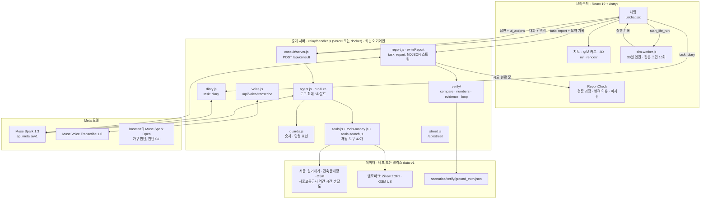
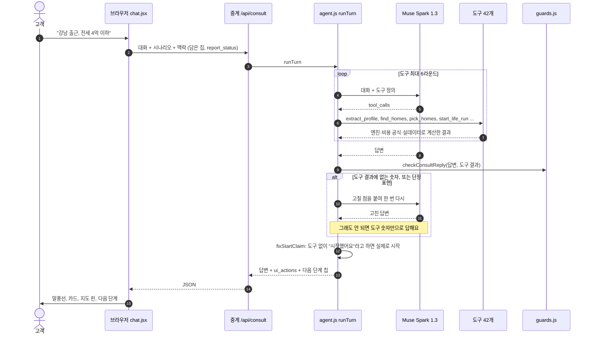
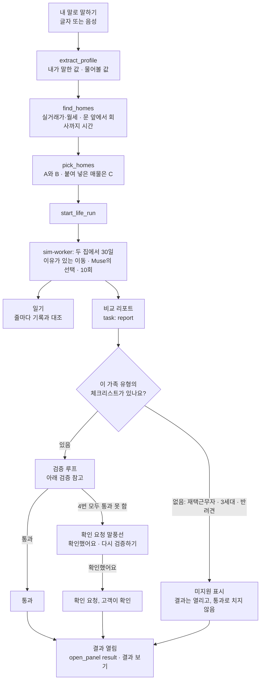
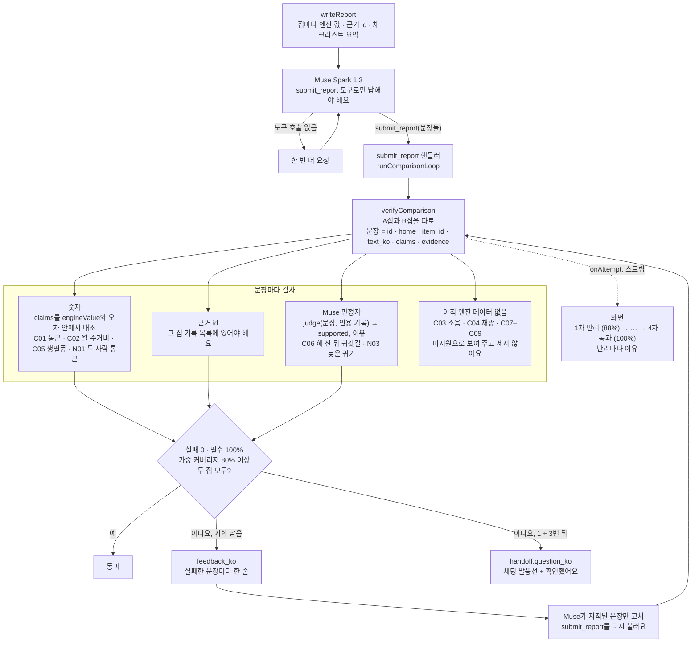

<p align="center"></p>

<p align="center"><sub>(이전 이름 homeless-society-sim)</sub></p>

<p align="center"><b>The Pre-living Agent for Your Next Home</b><br><i>“We walk the odyssey. You just come home.”</i></p>

<p align="center"><b>Meta AI로 만들었어요:</b> Meta Model API (<code>api.meta.ai</code>) · Muse Spark 1.3 · Muse Spark Open · Muse Code · Muse Voice</p>

<p align="center"><b>계약하기 전에, 그 집에서 먼저 살아 보세요.</b><br>AI 가족이 후보 집마다 30일을 먼저 살아 보고, 매물 사진과 지도, 30분짜리 집 구경으로는 안 보이는<br>"살아 봐야 아는 문제"를 찾아내요.</p>

<p align="center">
  
  
  
  
  
  <a href="https://github.com/halo-sw/ithaca/actions/workflows/ci.yml"></a>
  <a href="LICENSE"></a>
</p>

<p align="center">
  <a href="https://halo-sw.github.io/ithaca/"></a>
  &nbsp;
  <a href="#빠른-시작"></a>
  &nbsp;
  <a href="briefs/"></a>
  &nbsp;
  <a href="README.md"></a>
</p>

<p align="center"><sub>공개 사이트: <a href="https://halo-sw.github.io/ithaca/">https://halo-sw.github.io/ithaca/</a> — Muse와 VWorld 지도는 키를 서버에만 두는 작은 중계 서버를 거쳐요. 중계 서버를 못 쓰면 대화는 규칙 모드로 답하고 그렇게 표시해요.</sub></p>

<p align="center">
  <a href="#요약">요약</a> ·
  <a href="#시작하기">시작하기</a> ·
  <a href="#프로젝트-개요">프로젝트 개요</a> ·
  <a href="#meta-ai-사용">Meta AI 사용</a> ·
  <a href="#구조">구조</a> ·
  <a href="#이렇게-작동해요">작동 방식</a> ·
  <a href="#갤러리">갤러리</a> ·
  <a href="#하는-일">하는 일</a> ·
  <a href="#meta-모델">Meta 모델</a> ·
  <a href="#검증">검증</a> ·
  <a href="#muse가-만들었어요">Muse가 만든 과정</a> ·
  <a href="#빠른-시작">빠른 시작</a> ·
  <a href="#한계">한계</a> ·
  <a href="#앞으로">앞으로</a>
</p>

## 요약

- **무엇인가요.** 계약하기 전에 AI 가족이 후보 집 두 곳에서 30일씩 먼저 살아 보고, 살아 봐야 아는 것을 보여 줘요. 날마다의 출퇴근, 돈, 해 진 뒤 귀갓길 같은 것들이에요.
- **누구를 위한 건가요.** 첫 자취 집을 구하는 사회초년생, 결혼을 앞둔 커플, 두 집 사이에서 고민하는 어린 자녀를 둔 가족.
- **어떻게 작동하나요.**  **Muse Spark 1.3**이 대화를 이끌고 가족의 일상 선택을 이유와 함께 해요. **Muse Voice**가 말을 받아 적어요. 시간과 돈은 결정적 엔진이 1분, 1원까지 계산하고, 일기 문장은 보여 주기 전에 하나하나 실행 기록과 대조해요.
- **써 보기.** <https://halo-sw.github.io/ithaca/>를 여세요(브라우저 언어가 한국어가 아니면 영어로 시작, `?lang=ko`로 한국어). 상황별로 어디서 시작하면 되는지는 [시작하기](#시작하기)에 정리했어요.
  - **기록된 한 달 보기**는 2026-10-31에 기록한 실제 Muse Spark 1.3 대화를 키 없이 재생해요. Meta 본사 출근, 1 Hacker Way 근처 실제 아파트, 2곳 담기, 집마다 30일, 일기까지 보여 줘요.
  - **Meta 본사 출근으로 해 보기**는 실시간으로 돌아가요. 실제 아파트 6곳이 항공사진, Zillow ZIP 월세 추정, 자전거·걷기 분과 함께 지도에 떠요. *"1번이랑 2번 담아 줘"* → *"두 집에서 살아 봐 줘"* 라고 써 보세요(마이크를 눌러 말해도 돼요).
  - 키는 필요 없어요. 사이트가 중계 서버로 Muse를 불러요. Muse를 못 쓰면 머리글에 **규칙 모드**가 뜨고 대화에서도 알려 주며, 숫자는 그때도 엔진이 계산해요. 로컬에서는 `docker compose up`으로 같은 앱이 돌아가요([빠른 시작](#빠른-시작)).
- **누가 만들었나요.**  제품 코드와 테스트는 한 줄도 빠짐없이 **Muse Code**가 단계별 지시서를 받아 작성했어요([Muse가 만들었어요](#muse가-만들었어요)).
- **코드는 어디 있나요.** 앱·엔진·상담 에이전트는 [`web/src/`](web/src/), 테스트는 [`web/tests/`](web/tests/)에 있어요. 키를 지키는 중계 서버는 [`relay/`](relay/), Python 데이터 파이프라인은 [`pipeline/`](pipeline/), 시나리오와 기록된 실행은 [`scenarios/`](scenarios/)에 있어요. Meta API 주소와 키는 [`web/src/judge/providers.js`](web/src/judge/providers.js) 한 곳에서 정해요([Meta AI 사용](#meta-ai-사용)).

**한눈에 보기**

| 주장 | 숫자 | 자세히 |
|---|---|---|
| 숫자는 모델이 만들지 않아요 | 모든 분·원은 결정적 엔진이 계산하고, 도구 결과에 없는 숫자를 쓴 답은 반려돼요 | [검증](#검증) |
| 모델이 바뀌어도 판단이 같아요 | Spark 1.3과 Spark Open이 같은 판단 지점 **139곳 중 120곳(86 %)** 에서 같은 선택 | [Meta 모델](#meta-모델) |
| 가드가 실제 실행에서 버텨요 | 모델마다 판단 **154개 모두** 답함, 가드 대체 **0건** | [Meta 모델](#meta-모델) |
| 일기 문장을 검사해요 | 문장마다 실행 기록의 사실을 인용해야 하고, 기록에 없는 숫자는 돌려보내 다시 쓰게 해요. 2026-10-31 실제 영어 실행(판교, 집 2곳): 일기 8문장 모두 기록과 일치(1번 고쳐 씀) | [검증](#검증) |
| 테스트 | JavaScript **2,403**개, Python **266**개, PR과 main 푸시마다 CI | [CI](https://github.com/halo-sw/ithaca/actions/workflows/ci.yml) |

<p align="center">
  
</p>

<p align="center"><sub>강남 출근, 실제 Muse Spark 1.3 대화를 재생한 화면: 왼쪽은 기록과 대조한 일기와 "살아 봐야 아는 것", 오른쪽은 지하철 노선 위 후보 6곳의 전세 가격과 출근 시간. 실제 GPU 캡처, 2026-10-31.</sub></p>

## 시작하기

나에게 맞는 줄을 고르세요. 링크는 모두 공개 사이트로 열려요. 설치할 것도, 준비할 키도 없어요.

| 이런 걸 하고 싶어요 | 여기서 시작 | 이렇게 돼요 |
|---|---|---|
| **먼저 전체를 구경하고 싶어요** | [기록된 한 달 보기](https://halo-sw.github.io/ithaca/?replay=seoul-couple&lang=ko) · 영어: [Watch a recorded month](https://halo-sw.github.io/ithaca/?replay=menlo-month&lang=en) | 실제 Muse Spark 1.3 대화를 재생해요. 지도 위 후보, 2곳 담기, 집마다 30일, 대조를 마친 일기까지 나와요. 키나 실시간 모델 없이 재생돼요. |
| **서울·경기에서 회사 가까운 집을 찾고 싶어요** | [첫 화면](https://halo-sw.github.io/ithaca/?lang=ko)에 한 문장으로 쓰거나 [예시](https://halo-sw.github.io/ithaca/?chat=%ED%8C%90%EA%B5%90%EB%A1%9C+%EC%B6%9C%EA%B7%BC%ED%95%98%EB%8A%94+%EC%8B%A0%EC%9E%85%2C+%EC%97%B0%EB%B4%89+4%EC%B2%9C%2C+%EB%AA%A8%EC%9D%80+%EB%8F%88+5%EC%B2%9C%2C+%EC%A0%84%EC%84%B8+2%EC%96%B5+%EC%9D%B4%ED%95%98&lang=ko)로 시작 | Muse 실시간이에요. 11곳의 실거래로 후보를 찾고, 고른 두 곳에서 30일을 살아 봐요. [단계별 안내 ↓](#처음-써-보기) |
| **Meta 본사(멘로파크)로 출근해요** | [Meta 본사 출근으로 해 보기](https://halo-sw.github.io/ithaca/?chat=I+work+at+Meta+HQ+in+Menlo+Park.+Two+of+us%2C+rent+up+to+%244%2C500+a+month.&lang=en) | 영어로 Muse 실시간이 돌아요. 1 Hacker Way 근처 실제 아파트, Zillow ZIP 월세 추정, 자전거·걷기 시간이 나와요. |
| **이미 본 매물이 있어요** | [매물 글 붙여 넣기](https://halo-sw.github.io/ithaca/?chat=&listing=1&lang=ko) → **읽어 보기** | 글에 적힌 값만 읽어요. 그 가격이 지난 1년 실거래 중 어디쯤인지 보여 주고, C집으로 비교에 넣을 수 있어요. |
| **말로 하고 싶어요** | 입력창의 마이크 | Muse Voice가 말을 받아 입력창에 적어요. 보내기를 눌러야 보내져요. |
| **동네를 3D로 둘러보고 싶어요** | [둘러보기 투어](https://halo-sw.github.io/ithaca/?mode=sim&scenario=demo-two-homes&tour=demo&lang=ko) | 가족이 하루를 보내는 3D 동네를 따라가요. |
| **내 컴퓨터에서 돌려 보고 싶어요** | [빠른 시작 → Docker](#빠른-시작) | `localhost:8080`에서 같은 앱이 떠요. Meta API 키가 없으면 **규칙 모드**로 돌고, 숫자는 그때도 엔진이 계산해요. |
| **코드를 고치거나 데이터를 다시 만들고 싶어요** | [빠른 시작 → 소스에서](#빠른-시작) | Python 파이프라인, 시뮬레이션 스크립트, Vite 개발 서버를 써요. |

실시간 대화는 하루 Muse 한도를 함께 써요. 한도를 넘거나 중계 서버가 멈추면 머리글에 **규칙 모드**가 뜨고, 대화에서도 알려 줘요.

### 처음 써 보기

1. **한 문장으로 말해요.** 누가 살지, 어디로 출근하는지, 예산을 적어요. 예: *"판교로 출근하는 신입, 연봉 4천, 모은 돈 5천, 전세 2억 이하"*. 빠진 값은 칩(*누구와?*, *보증금 상한?*)으로 떠요. 눌러서 채우거나 건너뛰면 돼요.
2. **후보를 봐요.** 카드와 지도 핀에 실거래 중간값과 집에서 회사까지 걸리는 시간이 나와요. 핀과 카드에는 같은 시간이 나와요.
3. **두 곳을 담아요.** 카드 두 개에서 **담기**를 누르거나 *"1번, 2번 담아 줘"*라고 말해요.
4. **살아 보게 해요.** *"두 집에서 살아 봐 줘"*라고 말해요. 가족이 집마다 30일을 살고, 확인하는 과정이 대화에 차례로 나와요.
5. **결과를 읽어요.** 내 기준 점수, 한 달 주거비, 출퇴근 시간이 나란히 나오고, 대조를 마친 일기와 *살아 봐야 아는 것*이 이어져요. 어느 집이 낫다고 정해 주지 않아요. 고르는 건 고객님이에요.
6. **더 물어봐요.** 예: *"밤 10시 이후 귀가를 보여 줘"*. 내 기준(중요도)을 바꾸거나, 일기 문장이 가리키는 순간을 3D로 열어 볼 수도 있어요.

지금 다루는 곳: 서울 성동 · 송파 · 강남 · 강동 · 위례, 판교 · 성남 · 정자 · 분당 · 미금 · 수지, 그리고 미국 멘로파크예요.

## 프로젝트 개요

**만든 이유.** 저는 직장인 Halo이고, 신혼집을 구하고 있었어요. 전세사기 소식에 두 사람의 생활 패턴까지 달라서 집 구하기가 정말 어려웠고, 이직 같은 변화가 생길 때마다 살아 보고 나서야 마주치는 것들이 많았어요. 수면의 질, 출퇴근길 혼잡도, 동네마다의 특성은 미리 알 수 없으니, 계약하기 전에 먼저 시뮬레이션을 돌려 보고 싶었어요.

**문제.** 사람들은 인생에서 가장 비싼 결정을 사진 몇 장과 30분짜리 집 구경으로 해요. 한국의 사회초년생, 결혼을 앞둔 커플, 어린 자녀가 있는 가족에게는 가장 위험한 결정이기도 해요. 전세사기 피해자의 약 75%가 20·30대예요(2025년 3월 보도, 국토교통부 자료 인용). 이사해 본 사람이라면 누구나 살아 보고 나서야 그 집을 제대로 알게 된 경험이 있어요.

**아이디어.** AI 가족이 먼저 들어가 살아요. 내 상황을 말하고, 실거래가에서 후보 집을 고르면, 가족이 실제 동네를 옮긴 3D 모형 위에서 A집과 B집에 각각 30일을 나란히 살아요. 일상의 선택은 Muse Spark가 하고 이유를 남겨요. 시간과 돈은 결정적 엔진이 1분, 1원까지 세요. 그다음 고객이 정한 우선순위로만 두 집을 비교하고, 모든 숫자에 출처나 "가정값" 표시를 붙여요. 앱은 보여 주고 설명할 뿐이고, 결정은 고객이 해요.

> 상태(2026-10-31): 개발 중이에요. 해커톤 기간은 2026-10-27 → 11-05이고, 첫 커밋은 2026-10-28이에요. 해커톤 이전에 만든 코드는 없어요. *준비 중*이라고 적힌 항목은 아직 만들지 않았어요.

## Meta AI 사용

모든 호출은 모듈 하나, [`web/src/judge/providers.js`](web/src/judge/providers.js)를 거쳐요. OpenAI 방식 chat completions를 `fetch`로 부르고, 키는 서버 환경 변수에서만 읽어요([`.env.example`](.env.example) 참고).

| 모델 | 엔드포인트 | 여기서 하는 일 | 코드 | 증거 |
|---|---|---|---|---|
|  **Muse Spark 1.3** (`muse-spark-1.3`) | `https://api.meta.ai/v1` | 가구의 일상 선택과 이유, 도구를 부르는 상담 에이전트 | [`judge/run.js`](web/src/judge/run.js) → [`providers.js`](web/src/judge/providers.js) `complete`, [`consult/agent.js`](web/src/consult/agent.js) → `completeWithTools` | [실제 호출 3건](docs/evidence/muse-spark-1.3-2026-10-31.json), [기록된 판단 154개](scenarios/decisions/compare-1029/) |
|  **Muse Spark Open** (`meta-models/muse-spark-open-1026`) | `https://inference.baseten.co/v1` (Baseten) | 같은 가구 판단, 스위치 하나 `--provider baseten` | 같은 모듈 | [실제 호출 3건](docs/evidence/muse-spark-open-2026-10-31.json), Spark 1.3과 139곳 중 120곳 같은 선택 |
|  **Muse Code** (`muse-spark-1.3` 에이전트 모드) | Muse Code CLI | 단계별 지시서를 받아 이 저장소의 제품 코드와 테스트를 모두 작성 | — | [`briefs/`](briefs/) (단계마다 지시서 + 결과) |
|  **Muse Voice Transcribe 1.0** (`muse-voice-transcribe-1.0`) | `https://api.meta.ai/v1/asr/transcribe` | 대화창에서 글 대신 말로 입력(한국어·영어 자동 인식). 받아 적은 글은 입력창에 들어가고 고객이 확인한 뒤 보내요 | 중계 서버 `/api/voice/transcribe`를 거쳐 [`consult/voice.js`](web/src/consult/voice.js) | — |
| SAM 3.1 | — | 매물 사진에서 창문 면적 | *준비 중* | — |

서버 키는 `META_API_KEY`에서 읽어요(`MODEL_API_KEY`도 대신 쓸 수 있어요). 기본 주소는 [`providers.js`](web/src/judge/providers.js)의 상수 `META_API_BASE`, `BASETEN_API_BASE`이고, [`relay/handler.js`](relay/handler.js)도 같은 상수를 내보내요.

Spark Open은 Baseten이 공개한 그대로 서빙해요. 서빙된 두 모델을 비교했을 뿐, 어느 쪽도 파인튜닝하지 않았어요.

## 구조

```text
ithaca/
├── pipeline/          Python: OSM 추출, 건축물대장 결합, 보행 그래프, 지하철망, 지형, 3D 상자
├── web/
│   ├── src/engine/    순수 JS 생활 엔진: 일과, 이유가 있는 이동, 짝지은 30일 실행(결정적, 시드 고정)
│   ├── src/judge/     Muse 호출: 판단 프롬프트, 숫자 가드, 정확히 다시 보기 위한 기록
│   ├── src/consult/   상담 에이전트: 도구 호출(extract_profile, find_homes, pick_homes, start_life_run …), 답변 가드, 음성 받아쓰기
│   ├── src/verify/    보고서 검사: 정답 체크리스트, 숫자 주장, 재시도 루프
│   ├── src/money/     급여, 매매·전세·월세 공식, 실거래가 로더, 공공임대
│   ├── src/transit/   운영사 시간표와 구간 분
│   ├── src/render/    three.js 장면: 외벽, 지형, 도로, 나무, 차량, 보행자, 열차
│   ├── src/ui/        React 19 + Astryx(Meta 디자인 시스템)
│   ├── scripts/       CLI: simulate, money, judge, 정적 서버
│   └── tests/         node:test 묶음
├── relay/             키를 브라우저에 보내지 않는 서버: /api/consult, /api/voice/transcribe, 지도 타일(Vercel 또는 docker compose)
├── scenarios/         커밋된 가구·집·기록된 Muse 판단
├── tests/             파이프라인 Python 테스트
├── Dockerfile, docker-compose.yml, package.json, .env.example
└── briefs/            Muse Code 단계마다 지시서 + 결과
```

### 시스템 지도

각 부분이 어디서 돌아가는지 보여 줘요. 브라우저는 모델 키를 갖지 않아요. Muse 호출은 모두 중계 서버를 거쳐요.



### 에이전트 흐름: 채팅 한 번

대화는 브라우저가 갖고 있어요. 중계 서버는 한 턴을 돌리고, 답변과 함께 지도를 옮기거나 카드를 열거나 살아 보기를 시작하는 화면 동작(`ui_actions`)을 돌려줘요.



### 한 문장에서 검증된 비교까지



**말로 정리한 흐름**
1. **조건 정리.** 브라우저가 대화를 `/api/consult`(개발 서버 또는 중계 서버)로 보내요. 에이전트가 도구와 함께 Muse를 부르고, 도구 결과는 `web/src/engine`과 `web/src/money`가 계산해요.
2. **숫자 검사.** 답변 가드(`web/src/consult/guards.js`)는 도구 결과에 없는 숫자가 든 답을 돌려보내요.
3. **30일 살아 보기.** 엔진이 브라우저 워커(`web/src/sim-worker.js`)에서 두 집을 함께 돌려요.
4. **일기.** Muse가 실행 기록으로 일기를 쓰고, `web/src/consult/diary.js`가 줄마다 그 기록과 대조해요.
5. **검증된 비교.** Muse는 두 집 비교를 `submit_report` 도구로만 낼 수 있어요. 코드와 Muse 판정자가 확인하고, 통과하거나, 고객이 확인 요청에 답하거나, 미지원 가족 유형일 때만 결과가 열려요([검증](#검증) 참고).
6. **가구 판단.** Muse는 판단 CLI(`web/scripts/judge.mjs`)로 가구의 선택을 내리고, 기록된 파일로 똑같이 다시 볼 수 있어요.

루트에서 `npm test`는 JS 테스트를, `npm run test:py`는 Python 테스트를 돌려요. CI는 PR마다, 그리고 main에 푸시할 때마다 둘 다 돌려요.

## 이렇게 작동해요

| | 단계 | 일어나는 일 | 상태 |
|---|---|---|---|
| 1 | **내 말로 상황 말하기** | "맞벌이 예비부부, 강남 출근, 전세 4억 이하, 59㎡ 이상". 상담 에이전트가 이 말을 가족 프로필로 정리해요. 고객이 말한 값에는 "내가 말한 값", 빈칸에는 "물어볼 값"이 붙어요. | 완료(글자·음성 입력) |
| 2 | **실제 후보 집 받기** | 서울·경기 동남부 11개 지역의 실거래가에서 후보를 찾아요. 이동 시간은 운영사 시간표로, 공공임대는 LH·마이홈 API로 찾아요. 후보는 지하철 노선, 직장, 출퇴근 시간과 함께 지도에 보여요. | 완료 |
| 3 | **가족이 30일 동안 살아 보기** | 실제 도보 경로를 따라 출근하고, 장을 보고, 공원을 걷고, 병원에 가요. 두 집에서 동시에요. 같은 조건으로 10번씩 돌려서, 두 집의 차이가 운이 아니라 집 때문에 생긴 것인지 확인해요. | 완료 |
| 4 | **보여 주기 전에 리포트 검증하기** | 에이전트가 만든 체크리스트와 리포트를 정답 기준으로 채점해요. 숫자는 엔진 값과 맞아야 하고, 문장마다 시뮬레이션 사건을 근거로 달아야 해요. 통과하지 못하면 최대 3번 에이전트에게 돌려보내고, 그래도 안 되면 고객에게 물어봐요. 시도와 반려 이유는 도는 동안 채팅에 보여요. | 완료(채점기·숫자 검사·Muse 판정자·재시도 루프·검증 과정 화면) |
| 5 | **근거를 보며 비교하기** | 시간, 피곤한 정도, 매매·전세·월세·공공임대 비용, 전세 위험 신호, 지원 제도, 공식 치안·교육 통계를 고객이 정한 우선순위로만 비교해요. 집마다 0~100 **내 기준 점수**를 보여 줘요. 고객이 정한 비중으로 계산한 주관적인 점수이고, 계산식은 한 번 누르면 보여요. | 완료 |

## 갤러리

<table>
  <tr>
    <td width="50%"></td>
    <td width="50%"></td>
  </tr>
  <tr>
    <td><sub><b>한 문장으로, 아니면 기록된 한 달로 시작해요.</b> 입력창 하나와 바로 해 보는 세 가지 길(키 없이 재생되는 기록된 한 달, Meta 본사 실시간, 서울 실시간), 그리고 실행에서 나온 숫자(후보 6곳 찾는 데 14초, 두 집 30일 사는 데 85초, 일기 8문장 모두 대조).</sub></td>
    <td><sub><b>답부터 보여 줘요.</b> 두 집에서 30일씩 산 뒤: 고객이 정한 비중으로 계산한 내 기준 점수(비중을 정하기 전엔 모두 보통), 월 주거비, 편도 출근 시간을 나란히 보여 주고, 그다음 살아 보니 장면과 대조한 일기가 이어져요. 어느 집이 낫다고 말하지 않아요.</sub></td>
  </tr>
  <tr>
    <td></td>
    <td></td>
  </tr>
  <tr>
    <td><sub><b>한 사람을 따라가요.</b> 건축물대장 자료로 만든 3D 동네에서 신분당선 강남→판교로 가는 나를 따라가요. 이 장면이 결과에 어떻게 들어가는지(오늘 출근 44분 = 걷기 14분 + 지하철 26분 + 기다림 4분), 실측·가정 혼잡도, 그날의 이동이 함께 보여요.</sub></td>
    <td><sub><b>폰에서도.</b> 대화와 지도·집 두 탭: 기록과 대조한 일기, "살아 봐야 아는 것"과 출처, 카드와 같은 출근 시간을 보여 주는 지도 핀.</sub></td>
  </tr>
  <tr>
    <td colspan="2"></td>
  </tr>
  <tr>
    <td colspan="2"><sub><b>두 나라, 같은 엔진.</b> 영어로 본 Menlo Park: 왼쪽은 대조한 일기, "Only living there tells you", 출처 Zillow ZORI·OSM (US)·USGS, 오른쪽은 Meta 본사 주변 $4,261 후보 6곳과 11~13분 출근 시간.</sub></td>
  </tr>
</table>

모든 이미지는 2026-10-31에 실행 중인 앱을 실제 GPU(Apple M4 Max, Metal)로 캡처했고, [`briefs/img/`](briefs/img/)에 있어요.

## 하는 일

| 영역 | 하는 일 | 근거 |
|---|---|---|
| **3D 동네** | 건물 윤곽, 높이, 층수, 단지, 도로, 지형, 공원, 나무를 역세권 60곳에 세우고, 건물 10,971동의 이동 경로 지도도 만들어요. 차, 사람, 열차는 규칙으로 움직여서 타임라인을 앞뒤로 옮겨도 어긋나지 않아요. | OpenStreetMap, 건축물대장·GIS건물통합정보, 지형 타일 |
| **30일 생활** | 성인 2명과 시뮬레이션 이웃 60명(시뮬레이션 주민이라고 표시)이 실제 도보 경로에서 살아요. 같은 시드를 넣으면 바이트 단위까지 같은 결과가 나와요. | 결정적 엔진, [`scenarios/criteria/kr-default.json`](scenarios/criteria/kr-default.json) |
| **Muse의 선택** | 판단 지점마다 엔진이 선택지를 내놓으면 Muse가 하나를 고르고 이유를 남겨요. 한 실행에서 Muse는 198번 판단했고, 그중 50번은 규칙 기본값과 다르게 골랐어요. 도구 결과에 없는 숫자가 답에 들어가면 검사 장치가 거절해요. | Muse Spark 1.3 |
| **출퇴근** | 집마다 출퇴근 경로를 따로 계산해요. 걷기, 노선별 탑승(운영사 시간표), 환승, 걷기 순서예요. 피곤한 정도는 역·방향·30분 단위로 실측한 혼잡도로 계산해요. | 서울교통공사 역간 소요시간·혼잡도 |
| **돈** | 연봉으로 실수령액을 구하고, 같은 면적의 최근 12개월 실거래로 매매·전세·월세·공공임대 각각 매달 집에 드는 돈을 계산해요. 교통비는 거리 비례로 계산하고, 걸어서 하는 출퇴근도 세고, 대출에는 한도를 둬요. | 국토교통부 실거래가 |
| **5~20년 동안 살 만한가** | 총지출, 이자, 묶이는 돈, 기회비용, 금리 시험, DSR을 보여 줘요. 집값 변화는 고객이 고른 시나리오로만 보여 주고 "가정 시나리오, 전망 아님"이라고 붙여요. | 고객 입력, 공개한 계산식 |
| **전세 안전 점검** | 전세가율, 건축물대장 신호, 링크가 달린 공식 6단계 체크리스트, 보증금을 돌려받지 못하는 모의 시뮬레이션을 보여 줘요. 신호와 다음 할 일만 알려 주고 판정하지 않아요. | 실거래가, 건축물대장, 인터넷등기소, HUG |
| **지원 제도** | 버팀목, 디딤돌, 신혼부부·청년·신생아 상품의 조건을 고객 숫자와 하나씩 비교하고, 공식 링크와 확인 날짜를 붙여요. "받을 수 있어요"라고 판정하지 않아요. | 주택도시기금 상품 페이지(2026-10-29 확인) |
| **실제 매물 확인** | 매물 글을 붙여 넣으면 글에 있는 값만 뽑아서, 그 가격이 지난 1년 실거래 중 어디쯤인지 보여 줘요. 누르면 C집으로 넣어 살아 볼 수 있어요. | 실거래가. 민간 매물 사이트는 수집하지 않아요 |
| **살아 봐야 아는 것** | 결과 아래에, 매물 정보로는 알 수 없는 것을 30일 기록에서 세어 보여 줘요. 해 진 뒤 걸어서(또는 자전거로) 귀가한 횟수·평균 시간·거리·출발지(직장이나 역)와 그달 해 지는 시각, 지하철 출근길에 앉아서 간 날(혼잡도를 잰 구간만), 밤 10시 이후 귀가. 기록에 할 말이 있을 때만 줄이 생겨요. | 실행 기록의 이동·실측 혼잡도, 서울·Menlo Park 일몰표 |
| **상담 에이전트** | 도구 20개 이상을 가진 떠 있는 대화창이에요. 조건을 정하고, 돌리고, 비교하고, 설명하고, 출처를 달고, 이야기하는 장면으로 3D 화면을 옮겨요. | Muse Spark 1.3 |
| **쉬운 말** | 숫자마다 일상 한국어로 뜻을 적고 "어떻게 계산했나요?"를 달아요. 화면에 설명 없는 전문 용어가 있으면 테스트가 잡아내요. | [`docs/copy-guide.md`](docs/copy-guide.md) |

## Meta 모델

모델마다 맡은 일이 하나씩 있어요. 숫자는 절대 모델이 만들지 않아요.

| 모델 | 제품에서 맡은 일 | 상태 |
|---|---|---|
| **Muse Spark 1.3** | 가족의 일상 선택과 이유, 상담 에이전트, 그리고 이 레포를 작성한 코딩 에이전트(Muse Code) | 완료 |
| **Muse Spark Open** (Baseten의 `meta-models/muse-spark-open-1026`) | 오픈 웨이트 모델로 같은 가족 판단을 해요. 스위치 하나로 바꿔요(`--provider meta\|baseten`). 아래에 Spark 1.3과 비교했어요 | 완료(비교) |
| **판정자 역할의 Muse Spark 1.3** | 리포트 문장과 그 문장이 인용한 시뮬레이션 기록을 나란히 읽고, 뒷받침하는지와 이유를 답해요. 리포트를 쓰는 호출과는 따로 불러요 | 완료 |
| **Muse Voice Transcribe 1.0** | 말로 시작하기: 마이크를 누르고 가족과 직장을 말하면 받아 적은 글이 입력창에 들어가요. 저절로 보내지는 않아요 | 완료 |
| SAM 3.1 | 매물 사진과 도면에서 방 크기와 창 면적을 재요 | *준비 중* |

## 검증

에이전트가 만든 결과는 고객에게 보여 주기 전에 코드가 먼저 확인해요.



- **정답 기준.** [`scenarios/verify/ground_truth.json`](scenarios/verify/ground_truth.json)은 가족 유형마다 꼭 다뤄야 할 항목 목록이에요. 공통 9개(통근·통학 시간, 월 주거비 총액, 소음은 *필수*, 채광, 생필품 접근성, 귀갓길 안전, 수납, 하자, 아침 동선은 *권장*)와 유형별 5~6개로 되어 있어요.
- **들어오는 길은 하나.** 비교 리포트는 `submit_report` 도구로만 고객에게 가요. 채팅 에이전트는 이 도구를 볼 수 없고, 리포트가 통과하거나, 고객이 확인하거나, 미지원으로 표시되기 전에는 `open_panel("result")`가 거절돼요.
- **두 가지 검사.** *결정적* 항목(통근 시간, 원·달러 월 주거비, 생필품까지 시간, 두 사람 각자의 통근)은 엔진이 계산한 값과 정해 둔 오차 안에서 맞아야 해요. *판정* 항목은 그 집 실행 기록을 근거로 달아야 하고, Muse가 따로 판정자로 불려 문장과 인용 기록을 나란히 읽고 `supported`와 이유를 답해요. 지금 엔진 이동 기록으로 뒷받침되는 판정 항목은 2개예요. 해 진 뒤 귀갓길(C06: `dark_walk`, `late_home`)과 늦은 귀가(N03: `late_home`)예요.
- **통과 기준.** 두 집 모두 실패 0개, *필수* 항목을 모두 다루고, 가중 커버리지 80% 이상(*필수* 3점, *권장* 1점). 통과하지 못하면 실패한 문장마다 한 줄씩 이유를 붙여 최대 3번 Muse에게 돌려보내요. 그래도 안 되면 채팅에 남은 질문과 **확인했어요**, **다시 검증하기** 버튼을 보여 줘요.
- **과정을 그대로 보여 줘요.** 시도가 끝날 때마다 채팅에 바로 떠요. `1차 반려 (88%) → 2차 반려 (88%) → 3차 반려 (88%) → 4차 통과 (100%)`, 반려 아래에는 이유가 붙어요(예: 인용 기록에 이동 수단이 없어서 판정자가 "걸어서"를 받아 주지 않음, 출발 시각이 기록과 다름). 문장마다 숫자 확인, 근거 n개, 확인 필요 태그가 붙어요.
- **한 일만 말해요.** 에이전트가 30일 살아 보기를 시작하는 도구를 부르지 않고 "시작했어요"라고 답하면, 그 말을 잡아내고 실제로 시작시켜서 말과 화면이 어긋나지 않게 해요.
- **모르는 건 모른다고 해요.** 엔진이 아직 근거를 댈 수 없는 항목(소음, 채광, 수납, 하자, 아침 동선)은 미지원으로 보여 주고 통과로 치지 않아요. 신혼부부, 미취학 자녀 가족, 사회초년생 1인 가구는 검증된 비교를 받아요. 1인 재택근무자, 3세대 가족, 반려견 가구는 리포트용 모델을 부르지 않고, 결과에 미지원 표시를 달아 열어요.
- **실제 거주자 비교** *(준비 중)*. 실제 거주자 10~20명의 집과 살아 보고 알게 된 불편을 시뮬레이터 결과와 비교해서 일치율을 낼 거예요.

상태: 완료, 화면에도 보여요(채점기·숫자 검사는 16a–16b 단계, `submit_report`·Muse 판정자·두 집 루프·검증 과정 화면은 29j1–29k3 단계). 2026-11-01 실제 실행(서울 신혼부부, 실제 Muse Spark 1.3): 첫 실행은 네 번 만에 통과했고, 반려 이유 덕분에 우리 쪽 버그 3개를 찾았어요(엔진이 모르는 구성원 id, 숫자 없는 문장을 다룸으로 침, 이동 수단이 빠진 걷기 기록을 판정자에게 보냄). 29k 단계 뒤에는 같은 가족이 첫 시도에 100%로 통과하고, 문장마다 엔진이 확인한 숫자나 인용 기록이 붙어요.

## Muse가 만들었어요

<p></p>

이 레포의 제품 코드, 테스트, 파이프라인 스크립트는 한 줄도 빠짐없이 **Muse**(`muse-spark-1.3`, Muse Code 에이전트 모드)가 작성했어요. 사람은 방향을 정하고 모든 화면을 확인했어요. 조율은 **Claude (Anthropic)**가 맡았어요. 단계별 지시서 작성, 데이터 내려받기, 테스트 실행, 실제 GPU 캡처, git 작업을 했어요. GitHub 기여자 목록에 `claude`가 보이는 것도 이 때문이에요. 커밋을 Claude가 만들어서 커밋마다 `Co-Authored-By: Claude` 줄이 붙고, 커밋 메시지에는 그 코드를 만든 Muse 지시서가 적혀 있어요(`Written by Muse (Muse Spark) from briefs/…`). 단계마다 지시서와 결과 기록이 [`briefs/`](briefs/)에 있고, 규칙은 [`AGENTS.md`](AGENTS.md)에 있어요. Muse가 쓰지 않은 파일도 밝혀 둬요. 영어 문구표 `web/src/i18n/en.js`·`en-table.js`·`en-words.js`는 Claude가 쓴 번역 내용이에요(번역 엔진 `translate.js`는 Muse 작성). 검증 정답 `scenarios/verify/ground_truth.json`과 기준 채점기 `tools/verify_checklist.py`는 팀이 Muse 채점기를 확인하려고 직접 만들었어요.

| 층 | 위치 | 내용 |
|---|---|---|
| 데이터 파이프라인(Python) | `pipeline/` | OSM 추출, 건축물대장 결합, 도보 그래프, 지역, 지하철망, 지형과 장면 상자 |
| 생활 엔진(JS, 순수 함수) | `web/src/engine/` | 생활 규칙, 판단, 원인이 붙은 이동, 짝 실행, 돈 흐름, 기준 불러오기 |
| Muse 판단 층 | `web/src/judge/` | 판단 프롬프트, 숫자 검사, 똑같이 다시 재생하기 위한 판단 기록 |
| 상담 에이전트 | `web/src/consult/` | Meta API로 보내는 OpenAI 방식 도구 호출. 서버에서만 실행해서 키가 브라우저에 가지 않아요 |
| 돈과 가격 | `web/src/money/` | 급여 표, 계약 형태별 계산식, 실거래 불러오기, 공공임대 연결 |
| 대중교통 | `web/src/transit/` | 운영사 시간표, 구간별 탑승 시간, 요금 |
| 3D 장면과 움직임 | `web/src/render/`, `web/src/scene/`, `web/src/motion/` | three.js 0.170: PBR 외벽, 지형, 도로, 나무, 규칙으로 움직이는 차·사람·열차 |
| 화면 | `web/src/ui/` | React 19 + **Astryx**(Meta의 디자인 시스템) |

**같은 가족으로 비교한 Spark 1.3과 Spark Open**(2026-10-29, `reasoning_effort` low, 파일은 [`scenarios/decisions/compare-1029/`](scenarios/decisions/compare-1029/)):

| | Spark 1.3 | Spark Open |
|---|---|---|
| 판단 수(A + B) | 154번, 모두 답함, 검사 탈락 0 | 154번, 모두 답함, 검사 탈락 0 |
| 같은 판단 지점에서 같은 선택 | 139번 중 120번(86%) | |
| 규칙 기본값과 다른 선택(154번 중) | 75 | 72 |
| 호출당 평균 응답 시간 | 3.7초 | 2.7초 |
| 출력 토큰(A + B) | 14만 | 9.6만 |

둘이 다르게 고른 곳은 대부분 퇴근길에 어느 가게에 들를지였어요(19번 중 15번). 생각 길이를 제한하지 않으면 Spark Open은 154번 중 116번에서 2,000토큰을 생각하는 데 다 써 버렸어요. `reasoning_effort: low`로 두니 모두 답했어요.

## 빠른 시작

**가장 빠른 방법: Docker.** 키가 없어도 돼요.

```bash
cp .env.example .env    # 선택: 실제 Muse를 쓰려면 META_API_KEY를 채워요 (MODEL_API_KEY도 돼요)
docker compose up       # 웹 http://localhost:8080, 중계 서버 :8787
```

- 공개 사이트와 같은 정적 사이트를 만들고, [`data-v1` 릴리스](https://github.com/halo-sw/ithaca/releases/tag/data-v1)의 미리 만든 데이터를 넣어요.
- 키가 없으면 머리글에 **규칙 모드**가 뜨고, 대화에서도 한 번 알려 줘요. 숫자는 그대로 엔진이 계산해요.
- 루트에서 `npm test`를 실행하면 JS 테스트가 돌아요.

**소스에서 직접.** 필요한 것: Node 20 이상, Python 3.12, 원본 데이터용 디스크 약 6GB.

```bash
# 1. Python 파이프라인
python3.12 -m venv .venv && .venv/bin/pip install -r requirements.txt
# data/raw/에 south-korea-latest.osm.pbf(Geofabrik)를,
# data/raw/buildings/<region>/에 GIS건물통합정보 shapefile을 넣어요 (ATTRIBUTION.md 참고)
.venv/bin/python -m pipeline build --all
.venv/bin/python -m pipeline.validate --all

# 2. 시뮬레이션 실행
cd web && npm install && cd ..
node web/scripts/simulate.mjs --scenario scenarios/demo-two-homes.json --home both --out data/build/sim/
node web/scripts/money.mjs   --scenario scenarios/demo-two-homes.json --out data/build/sim/

# 3. 앱 (상담 에이전트와 실시간 판단에는 서버 환경에 Meta API 키가 필요해요)
cd web && META_API_KEY=... npm run dev
```

자주 쓰는 주소(`/?mode=sim&scenario=demo-two-homes` 뒤에 붙여요):

| 주소 | 보여 주는 것 |
|---|---|
| `&tour=demo` | 3분 안내 투어 |
| `&home=A&day=1&t=08:50&follow=1` | 출근길 따라가기 |
| `&tab=money` | 생활비 |
| `&tab=listings&fill=example` | 매물 확인(예시라고 표시한 예시 포함) |
| `&tab=money&share=1` | 결과 카드 |
| `&tab=criteria` | 기준 |

`/`는 대화로 시작하는 첫 화면이고, `/?area=seongsu&shot=3&time=18:30`은 동네 둘러보기예요.

원본 데이터와 빌드 데이터는 커밋하지 않아요. 위 스크립트로 다시 만들 수 있어요. 실거래 CSV, 공공주택 스냅샷, 지하철 혼잡도 파일은 운영자가 직접 받아 로컬에만 둬요. 각 데이터의 이용 조건 때문이에요.

## 한계

**일부러 하지 않는 것.** 집값 전망은 하지 않아요(집값 변화는 고객이 고른 시나리오로만, 가정값이라고 표시해요). 사라/사지 말라, 계약하라/하지 말라고 조언하지 않아요. 대출이나 지원 제도를 받을 수 있다고 판정하지 않아요. 특정 집이나 집주인이 "안전/위험"하다고 판정하지 않아요. 치안이나 학교를 하나의 점수로 묶지 않고, 주민 구성을 분석하지 않고, 기본 "최고의 집" 순위를 매기지 않고(점수는 고객이 정한 비중으로 계산한 주관적인 내 기준 점수 하나뿐이에요), 직선거리로 출퇴근 시간을 말하지 않아요. 가정한 값은 가정값이라고 밝혀요. 법률·금융 자문이 아니에요.

**알려진 문제.**
- 시나리오가 있는 가족 유형은 2개뿐이에요. 엔진에 아직 소음, 택배, 수납, 엘리베이터 대기 같은 사건이 없어서 해당 체크리스트 항목은 "미지원"으로 보여요.
- 신분당선은 공개 혼잡도 데이터가 없어서 70%라는 가정값을 밝히고 써요.
- Apple GPU(ANGLE Metal)에서 `?q=high`가 검게 나와요. 앱이 이를 감지해서 medium으로 바꿔요.
- 일부 급여 공제율과 보유 비용(취득세, 중개수수료, 재산세…)은 `needs_confirmation`으로 표시돼 있어요. 공식 페이지로 채우기 전까지는 "아직 계산에 넣지 않은 것"에 보여 줘요.
- 성남시 범죄 통계는 시 단위이고 서울은 구 단위예요. 숫자마다 단위를 함께 보여 줘요.
- 공공주택 공고 API에는 마감일 항목이 없어서 "최근 공고"로 보여 주고 원문 링크를 달아요.

## 앞으로

마감: 2026-11-05 11:00(한국 시간).

**이번 제출에 넣을 것**

| 날짜 | 계획 |
|---|---|
| 10-30 ✓ | 검증 루프(16), 내 기준 점수 앞에 보여 주기, 그림 같은 화면, 고객이 고른 집 끝까지 + 후보 지도(17–18) |
| 10-31 ✓ | 영어 화면, 심사용 기록된 한 달 재생, Menlo Park(Meta 본사) 집, 음성 입력, "살아 봐야 아는 것", 링크 미리보기 |
| 11-01 → 11-02 | 검증 화면, 데모 영상 초안 |
| 11-03 | 마무리, 밤에 기능 동결 |
| 11-04 | 3분 영상, README 마무리 |
| 11-05 | 오전 9시까지 제출 |

**준비 중** (이번 제출에는 넣지 않아요): 매물 사진·도면에서 방과 창 재기(SAM 3.1), Spark Open으로 움직이는 가족 에이전트, 실제 거주자 비교, 엘리베이터 대기·층간소음 같은 생활 사건, 재택근무자·3세대·반려견 가구 시나리오.

<details>
<summary><b>결과 예시</b> (데모 부부, 입력은 임시값)</summary>

<br>

| | A집 · 잠실 레이크팰리스 59.97㎡ | B집 · 판교 백현마을 84.82㎡ |
|---|---|---|
| 실거래 중간값(최근 12개월) | 매매 26.5억 / 전세 9.8억 / 월세 4억 + 200만 | 매매 25.2억 / 전세 9.5억 / 월세 4.5억 + 200만 |
| 전세로 살면 매달 집에 드는 돈 | 260만 원 | 250만 원 |
| 월급에서 집에 나가는 비율 | 36% | 35% |
| 보증금이 집값의 몇 %인지(전세가율) | 37% | 37.7% |
| 출근 방법(직장은 판교역 근처, 가정값) | 걷기 → 2호선 → 신분당선 → 걷기 | 걷기 |
| 30일 동안 지하철 탄 시간 | 44시간 | 0 |
| 30일 동안 걸은 시간 | 27.8시간 | 38.0시간 |
| 회사 도착할 때 피곤한 정도(공개한 모델, 0–100) | 25.3 | 5.7 |
| 가장 붐빈 구간 | 2호선 93%(실측) | — |
| 30일 동안 저녁에 집에 있던 시간(18–24시) | 323시간 | 343시간 |
| 30일 동안 공원 / 장보기 | 10 / 33 | 26 / 17 |

가정한 입력: 세전 연봉 6,000만·5,000만 원, 현금 2억 원, 대출 금리. 화면에도 모두 가정값이라고 표시해요. 이 숫자는 15단계 이전 값이에요. 15단계부터는 같은 면적끼리 비교하고 걸어서 하는 출퇴근도 세요. 표는 차이를 보여 줄 뿐이고, 무엇이 더 중요한지는 고객이 정해요.

</details>

<details>
<summary><b>진행 기록</b> (Muse가 단계별로 만든 것)</summary>

<br>

| 단계 | Muse가 만든 것 | 지시서 → 결과 |
|---|---|---|
| 1–2 | 데이터 파이프라인, 3D 장면, 건축물대장 조회 | [`briefs/01…02b`](briefs/) |
| 3 | 결정적 30일 생활 엔진 | [`03-RESULT`](briefs/03-RESULT.md) |
| 4 | Muse 판단 층(실제 판단 198번, 숫자 검사) | [`04-RESULT`](briefs/04-RESULT.md) |
| 5 | Astryx 화면, 상담 에이전트, PBR 렌더링 | [`05a`](briefs/05a-RESULT.md), [`05b`](briefs/05b-RESULT.md) |
| 6 | 연봉 기반 생활비, 실거래가, 공공임대 | [`06-RESULT`](briefs/06-RESULT.md) |
| 7 | 지금 카드, 원인, 강조, 기준, 그림자 수정 | [`07-RESULT`](briefs/07-RESULT.md) |
| 8 | 이동 화면, 이동 경로 지도, 혼잡도 피로(+8b/8c 수정) | [`08-RESULT`](briefs/08-RESULT.md) |
| 9a | 상황별 시작, 고객 우선순위, 공식 치안·교육 통계 | [`09a-RESULT`](briefs/09a-RESULT.md) |
| 9b | 살 만한가 계산, 전세 안전 점검, 모의 보증금 손실, 지원 제도 | [`09b-RESULT`](briefs/09b-RESULT.md) |
| 9c | 집마다 다른 출퇴근, 탑승을 하나의 이동으로, 차분한 카드 | [`09c-RESULT`](briefs/09c-RESULT.md) |
| 10 | 쉬운 말, 떠 있는 Astryx 에이전트, 매물 확인, 공공 공고, 공유 카드, 데모 투어 | [`10-RESULT`](briefs/10-RESULT.md) |
| 10b | 수정: React 스냅숏 반복, 투어 NaN, 렌더 연기 테스트 | [`10-RESULT`](briefs/10-RESULT.md#stage-10b--whole-ui-react-loop--tour-nan-muse) |
| 11–11b | 에이전트 창 위치, 잘리지 않는 글자, A/B 숫자가 있는 공유 카드, 색 표, 탑승 바탕 지도 | [`11-RESULT`](briefs/11-RESULT.md) |
| 12a–12a2 | 11개 지역, 고객 숫자, 실제 후보 집, 9개 노선 시간표 기반 탑승 시간 | [`12a`](briefs/12a-RESULT.md), [`12a2`](briefs/12a2-RESULT.md) |
| 12b | 질문으로 시작하기, 대화, 집 미리보기, 하루 타임라인 | [`12b-RESULT`](briefs/12b-RESULT.md) |
| 13d–13e | 겹치지 않는 배치, 안내형 입력, 후보 카드, 서울·경기 지도 | [`13d`](briefs/13d-RESULT.md), [`13e`](briefs/13e-RESULT.md) |
| 14–14b | 역세권 60곳의 지형, 도로, OSM 나무. 규칙으로 움직이는 차·사람·열차 | [`14`](briefs/14-RESULT.md), [`14b`](briefs/14b-RESULT.md) |
| 15 | 엔진 정확도: 10번 짝 실행, 가구 공통 생활비, 걷는 출퇴근 포함, 거리 비례 요금, 같은 면적 비교, 대출 한도 | [`15 지시서`](briefs/15-engine-integrity.md) |
| 16a–16b | 내장 검증: Python과 같은 체크리스트 채점, 문 앞→회사 엔진 값으로 숫자 검사, 재시도 루프 | [`16a-RESULT`](briefs/16a-RESULT.md) |
| 17–17d | Ithaca 이름, 내 기준 점수 앞에, 순간 기록, 그림 같은 화면(따뜻한 빛·윤곽선·불 켜진 밤·시간대별 밝기) | [`17-RESULT`](briefs/17-RESULT.md) |
| 18–18g | 고객이 고른 집 끝까지(자기 돈 계산·점수·공유 카드), 막히지 않는 흐름, 읽기 쉬운 결과, 하나로 통일한 출퇴근 숫자, 실제 선로가 그려진 후보 지도 | [`18-RESULT`](briefs/18-RESULT.md) |
| 19–19j | UI 전면 개편: 대화·지도 두 칸과 지도 위 실행 버튼 하나, 도로와 가격 말풍선이 있는 밝은 지도, 한눈에 보이는 후보 줄, A·B 표 결과 카드, 크기 고정 열차 표시, 나·배우자 이름, 세 단계를 보여 주는 첫 화면, 클릭을 막던 투명 창·순간 링크·소수 분 표시 수정 | [`19a`](briefs/19a-chat-layout.md) … [`19j`](briefs/19j-float-remain.md) |
| 20a–20g | 사용자 피드백으로 3D 화면 다시 만들기: 카메라를 움직여도 우글거리지 않게(원래 해상도, 계단 없애기, 한 겹 도로), 건물·단지·생활 장소 이름표와 건축물대장 카드, 이 장면이 결과에 어떻게 들어가는지("오늘 출근 44분 = 걷기 14분 + 지하철 26분 + 기다림 4분"), 저장하지 않는 개발 서버 중계로 VWorld 항공사진을 땅과 지붕에 입히고 출처 표시, 따라가면서 확대·회전, 동네 전체·따라가기 버튼, 길과 목적지 표시, 지금 장면 먼저인 패널, 정수 분 | [`20a`](briefs/20a-no-shimmer.md) … [`20g`](briefs/20g-wheel-delta.md) |
| 21a–21c | 처음 온 사용자가 자기 문장으로 끝까지 쓸 수 있게: 강남역으로 읽기(으로 먼저), 집 유형(오피스텔) 반영, 말한 건 다시 묻지 않고 한 번에 한 질문, 회사 위치 없이는 실행하지 않음(역 자동완성 또는 출근 안 해요), 틀린 "같아요" 제거, 보이는 숫자로 출퇴근 문장, 지번 이름 읽기 쉽게, 지도 말풍선 겹침 없음·역 이름·가까운 후보에 맞춘 확대 | [`21a`](briefs/21a-first-user-flow.md) … [`21c`](briefs/21c-map-fit.md) |
| 22a–22c | GitHub Pages 공개 사이트: 공개 경로를 따르는 데이터 주소와 링크, /api 호출 없는 정적 모드(모델·VWorld 키는 브라우저에 가지 않음), 실행 데이터는 Release 파일로 배포(커밋 안 함), 배포용 빌드에서 채팅 계산 worker가 묶이지 않던 버그 수정 | [`22a`](briefs/22a-github-pages.md) … [`22c`](briefs/22c-chat-worker-build.md) |
| 23–25 | 모든 키를 서버에만 두는 중계 서버(Vercel 또는 docker compose), 영어 화면(번역 핵심, 문장 통째 번역, 단위), 밝은 바탕 지도 | [`23a`](briefs/23a-relay.md) … [`25a`](briefs/25a-map-basemap.md) |
| 26a–26z2 | Menlo Park Meta 본사 주변 미국 지역: 장면, 실제 집, 대화 검색, 엔진의 자전거 출퇴근, 미국 지도 출처·높이, 폰 화면, 항공사진 썸네일, Ithaca 이름, 영어 Muse 답 | [`26a`](briefs/26a-us-area.md) … [`26z2`](briefs/26z2-phone-tray.md) |
| 27a–27j2 | 대화 중심: 실시간으로 답하는 에이전트, Muse가 쓰는 일기, 지도 핀, 동네 장면, 도구 호출이 실패해도 Muse가 다시 이어 가기 | [`27a`](briefs/27a-chat-first.md) … [`27j2`](briefs/27j2-reply-counter.md) |
| 28a–28g | 디자인 토큰, Powered by Muse, 랜딩 페이지 | [`28a`](briefs/28a-design-doc.md) … [`28g`](briefs/28g-landing-finish.md) |
| 29a1–29a14 | 심사 경로: 키 없이 재생되는 기록된 한 달, 영어 신뢰 점검, 랜딩의 바로 해 보기, 미국 출처(Zillow ZORI, OSM US), 답에서 내부 id 숨기기, 카드와 같은 지도 핀 시간, 링크 미리보기 | [`29a1`](briefs/29a1-english-trust.md) … [`29a14`](briefs/29a14-og-image.md) |
| 29b–29b2 | 중계 서버를 거치는 Muse Voice Transcribe 1.0 음성 입력 | [`29b`](briefs/29b-voice-input.md), [`29b2`](briefs/29b2-mic-style.md) |
| 29c1–29c1d | "살아 봐야 아는 것": 해 진 뒤 걷거나 자전거로 귀가, 앉아서 간 출근, 늦은 귀가 | [`29c1`](briefs/29c1-life-events.md) … [`29c1d`](briefs/29c1d-dark-bike.md) |
| 29g1–29g3, 29m1 | 거짓 "시작했어요" 막기, 재생할 때 지도 데이터 불러오기, 이름 붙은 주소 상수와 `META_API_KEY` | [`29g1`](briefs/29g1-start-claim-guard.md), [`29g2`](briefs/29g2-replay-map-data.md), [`29m1`](briefs/29m1-meta-api-key.md) |
| 29h1–29h5 | 채팅 여백, 대화 안에 이어지는 다음 단계 칩, 같은 ZIP 월세는 한 번만, 거리 사진 먼저·출처 표시, 머리글 말줄임 없애기 | [`29h1`](briefs/29h1-chat-insets.md) … [`29h5`](briefs/29h5-street-credit-fit.md) |
| 29k1–29k3 | 진짜 숫자로만 통과하는 리포트(엔진과 맞는 구성원 id, 숫자 없는 문장 막기, 기록에 이동 수단·장면, 덧붙임 없애기), 모든 집 ZIP 월세가 같으면 지도 핀은 출근 시간 먼저 | [`29k1`](briefs/29k1-report-members-no-empty-pass.md), [`29k2`](briefs/29k2-pins-commute-first-check-tags.md), [`29k3`](briefs/29k3-report-no-padding.md) |
| 29L1–29L6 | 3D 화면과 지도 다듬기: 경로는 길 위에(가려진 부분은 점선), 항공 장애등은 해 진 뒤에만, 라벨은 실제 글자 폭으로 재서 화면 안·사람 위가 아닌 곳에, 폰에 맞는 도구 줄·출처·타임라인, 영어 건물 이름은 이름답게(Daeha Building, Donga Palace Villa), VWorld 바탕지도 위 역 이름 중복 없애기, 영어 리포트 라벨 | [`29L1`](briefs/29L1-scene-route-beacons-night-follow.md), [`29L2`](briefs/29L2-scene-chrome-labels-phone-en.md), [`29L2b`](briefs/29L2b-no-ellipsis-station-pin.md), [`29L2c`](briefs/29L2c-label-paint-box-en-names.md), [`29L2d`](briefs/29L2d-today-list-en.md), [`29L3`](briefs/29L3-map-station-labels-obstacles.md), [`29L4`](briefs/29L4-report-english-labels.md), [`29L5`](briefs/29L5-basemap-names-today-badge.md), [`29L6`](briefs/29L6-en-building-names-label-width-phone-header.md) |
| 29j1–29j4 | 검증된 비교: C06·N03을 엔진 이동 기록으로 뒷받침, Muse 판정자, 두 집 검증 루프를 도는 `submit_report`, 반려 이유까지 보이는 검증 과정 화면, 확인 요청과 미지원 | [`29j1`](briefs/29j1-verify-core-judge.md) … [`29j4`](briefs/29j4-report-voice-reasons.md) |
| 30a–30h | Docker 작업 환경, 키 없을 때 솔직한 규칙 모드, Docker CI, 랜딩의 심사 버튼, 테마 모듈 | [`30a`](briefs/30a-docker-workspace.md) … [`30h`](briefs/30h-theme-module.md) |
| 31a–31n | 대화 위계와 지도: 마커, 조작 버튼, 필터, 후보 탭, 누르기 판정, 폰 다듬기, 지도 맞춤 | [`31a`](briefs/31a-chat-hierarchy.md) … [`31n`](briefs/31n-map-fit-chrome.md) |

</details>

<details>
<summary><b>데이터 출처</b></summary>

<br>

OpenStreetMap(ODbL, Geofabrik 경유) · GIS건물통합정보와 건축물대장(국토교통부 / VWorld / 건축HUB) · 국토교통부 실거래가 공개시스템 · 공공주택 데이터 API(LH · 마이홈) · 서울교통공사 지하철혼잡도정보(공공누리 3유형)와 역간 소요시간 · 경찰청 범죄 발생 지역별 통계(2025) · 주택도시기금 상품 페이지(nhuf.molit.go.kr, 2026-10-29 확인) · 공식 전세 체크리스트 사이트(인터넷등기소, 정부24, HUG 안심전세포털, 국세청). 자세한 이용 조건은 [`ATTRIBUTION.md`](ATTRIBUTION.md)에 있어요.

</details>

## 라이선스

코드는 [MIT](LICENSE)예요. 데이터, 사진, 폰트는 각자의 라이선스를 따르고, [`ATTRIBUTION.md`](ATTRIBUTION.md)에 정리돼 있어요.
