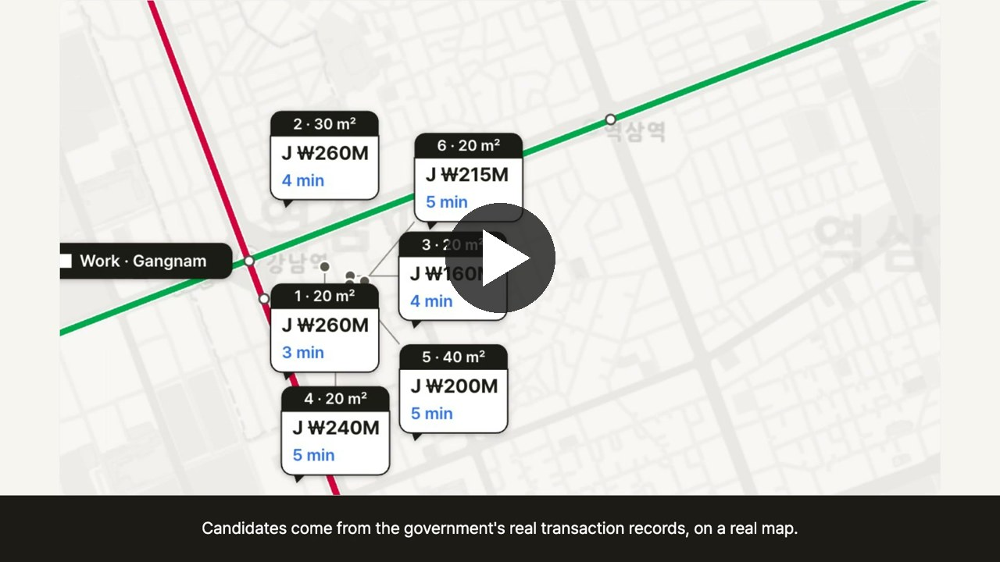
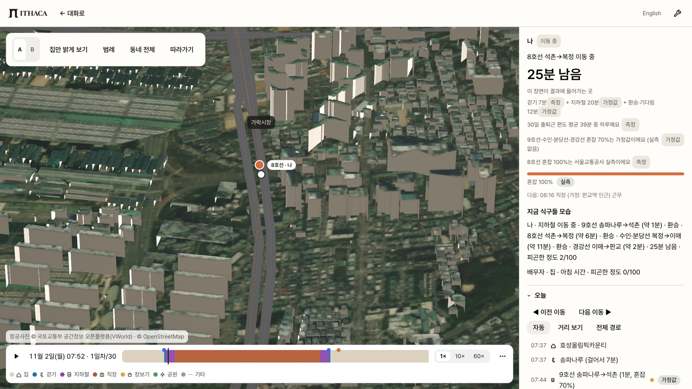

<p align="center"></p>

<p align="center"><i>“We walk the odyssey. You just come home.”</i></p>

<p align="center">Before you sign, an AI household lives 30 days in each of your two candidate homes.<br>Then you see what a listing photo, a map and a 30-minute viewing never show: the commute day by day, the money, the walk home after dark.</p>

<p align="center"><a href="https://github.com/halo-sw/ithaca/releases/download/demo-video/ithaca-demo.mp4"></a><br><sub>▶ <a href="https://github.com/halo-sw/ithaca/releases/download/demo-video/ithaca-demo.mp4"><b>Demo video</b></a> (about 2 min, narrated, mp4) · Seoul scenario, English UI, a real run with Muse Spark 1.3 · <a href="https://github.com/halo-sw/ithaca/releases/tag/demo-video">release page</a></sub></p>

<p align="center"><b>Built with Meta AI:</b> Meta Model API (<code>api.meta.ai</code>) · Muse Spark 1.3 · Muse Spark Open · Muse Code · Muse Voice</p>

<p align="center">
  <a href="https://halo-sw.github.io/ithaca/"></a>
  &nbsp;
  <a href="https://halo-sw.github.io/ithaca/?replay=menlo-month&lang=en"></a>
  &nbsp;
  <a href="README.ko.md"></a>
</p>

<p align="center">
  
  
  
  <a href="https://github.com/halo-sw/ithaca/actions/workflows/ci.yml"></a>
  <a href="LICENSE"></a>
</p>

<p align="center">
  <a href="#what-it-is">What it is</a> ·
  <a href="#try-it">Try it</a> ·
  <a href="#built-with-meta">Built with Meta</a> ·
  <a href="#why-you-can-trust-the-numbers">Why trust the numbers</a> ·
  <a href="#gallery">Gallery</a> ·
  <a href="#run-it-locally">Run it locally</a> ·
  <a href="#limits">Limits</a> ·
  <a href="#more">More</a>
</p>

## What it is

**The problem.** People make the most expensive decision of their lives from a few photos and a 30-minute viewing. For a first-job worker, a couple about to marry or a young family in Korea, that decision is also the riskiest: about 75 % of the victims of deposit fraud (전세사기) are in their 20s and 30s (press report of March 2025 citing Ministry of Land data). Everyone who has moved knows the feeling of finding out what a home is really like only after moving in.

**The idea.** An AI household moves in first. Tell it about your life, pick candidate homes from real transactions, and the household lives 30 days in home A and home B, side by side, in a 3D model of the real neighbourhood. Muse Spark makes the household's everyday choices and explains each one. A deterministic engine counts every minute and every won. The app then compares the two homes on the customer's own priorities, with a source or an "assumption" label on every number. It shows, explains and lets you decide. It never decides for you.

**Who it is for.** First-job workers renting their first place, couples about to marry, and families with young children choosing between two homes.

**How it works, in five steps.**

| | Step | What happens | Status |
|---|---|---|---|
| 1 | **Say it in your own words** | "맞벌이 예비부부, 판교 출근, 연봉 6천·5천, 모은 돈 2억, 7억 이하로 50㎡ 이상 집 사기" (a two-income engaged couple, Pangyo commute, salaries ₩60M and ₩50M, ₩200M saved, buying a home of 50 m² or more for ₩700M or less). The consult agent turns this into a household profile. Every value the customer said is marked "내가 말한 값", and every gap is marked "물어볼 값". | built (text and voice) |
| 2 | **Get real candidate homes** | Candidates come from real transactions in 11 areas of south-east Seoul and Gyeonggi, with ride times from the operator's schedule and public rentals from the LH · 마이홈 API. They appear on a map with the subway lines, the workplace and the commute minutes. | built |
| 3 | **The household lives there for 30 days** | The household commutes, shops, walks in the park and visits clinics on the real walking graph, in both homes at once. Runs are paired over 10 seeds, so the gap between homes comes from the homes and not from chance. | built |
| 4 | **The report is checked before you see it** | The agent's checklist and report are scored against a ground-truth checklist. Numbers must match the engine, and every sentence must cite a simulation event. A failed report goes back to the agent up to 3 times, then to the customer. Each try and its reason show in the chat while it runs. | built (scorer, claim checks, Muse judge, retry loop, on-screen timeline) |
| 5 | **Compare with evidence** | Time, fatigue, money for 매매 / 전세 / 월세 / public rental, 전세 warning signs, support programmes, official safety and education figures, all weighted by the customer's own priorities. Each home gets a 0–100 **내 기준 점수**: a subjective score from the customer's own weights, with the formula one tap away. | built |

<p align="center">
  
</p>

<p align="center"><sub>Meta HQ in Menlo Park, replayed from a real Muse Spark 1.3 session: the checked diary and "Only living there tells you" on the left, six candidates with ZIP rent and door-to-work minutes on the map. Real GPU capture, 2026-10-31.</sub></p>

**Why I built this.** I'm Halo, an office worker, and I have been looking for a home to start married life in. Between the deposit-fraud news and two people with very different daily routines, it was hard, and every change, like a new job, brings things you only meet after moving in. I can't know in advance how well I'll sleep, how crowded my commute will be, or what a neighbourhood is really like, so I wanted to simulate it first.

> Status (2026-10-31): work in progress. The hackathon runs 2026-10-27 → 11-05. The first commit is 2026-10-28, and nothing here predates the hackathon. Items marked *coming soon* are not built yet.

## Try it

Pick the row that sounds like you. Every link opens the live site: nothing to install and no key to bring.

| You want to… | Start with | What you get |
|---|---|---|
| **See the whole thing first** | [Watch a recorded month](https://halo-sw.github.io/ithaca/?replay=menlo-month&lang=en) · Korean: [기록된 한 달 보기](https://halo-sw.github.io/ithaca/?replay=seoul-couple&lang=ko) | A real Muse Spark 1.3 session replayed: homes on the map, two picked, 30 days in each, the checked diary. Plays without a key or a live model. |
| **Find a home near your work in Seoul / Gyeonggi** | Type one sentence on the [landing page](https://halo-sw.github.io/ithaca/?lang=ko), or start from an [example](https://halo-sw.github.io/ithaca/?chat=%ED%8C%90%EA%B5%90%EB%A1%9C+%EC%B6%9C%EA%B7%BC%ED%95%98%EB%8A%94+%EC%8B%A0%EC%9E%85%2C+%EC%97%B0%EB%B4%89+4%EC%B2%9C%2C+%EB%AA%A8%EC%9D%80+%EB%8F%88+5%EC%B2%9C%2C+%EC%A0%84%EC%84%B8+2%EC%96%B5+%EC%9D%B4%ED%95%98&lang=ko) | Live Muse. Candidates from real transactions in 11 areas, then 30 days in the two you pick. [Step by step ↓](#your-first-live-session) |
| **Commute to Meta HQ in Menlo Park** | [I work at Meta HQ](https://halo-sw.github.io/ithaca/?chat=I+work+at+Meta+HQ+in+Menlo+Park.+Two+of+us%2C+rent+up+to+%244%2C500+a+month.&lang=en) | Live Muse in English: real apartments near 1 Hacker Way, Zillow ZIP rent estimates, bike and walk minutes. |
| **Check a listing you already found** | [Paste a listing](https://halo-sw.github.io/ithaca/?chat=&listing=1&lang=en), then tap **Read it** | Only the values in the text are read. You see where the price sits among last year's real deals, and the home can join the comparison as home C. |
| **Talk instead of typing** | The microphone in the chat box | Muse Voice writes what you said into the box. Nothing is sent until you send it. |
| **Look around a neighbourhood in 3D** | [Guided tour](https://halo-sw.github.io/ithaca/?mode=sim&scenario=demo-two-homes&tour=demo) | The 3D neighbourhood with a household moving through its day. |
| **Run it on your own computer** | [Run it locally → Docker](#run-it-locally) | The same app at `localhost:8080`. Without a Meta API key it runs in **Rule mode**; the engine still computes every number. |
| **Change the code or rebuild the data** | [Run it locally → From source](#run-it-locally) | Python pipeline, simulation scripts and the Vite dev server. |

The live chat shares a daily Muse limit. When it runs out, or the relay is down, the header shows **Rule mode** and the chat says so.

### Your first live session

1. **Say it in one sentence**: who lives there, where you work, and your budget. For example *"판교로 출근하는 신입, 연봉 4천, 모은 돈 1억, 4억 이하 집을 사고 싶어"* (a first-job worker in Pangyo, ₩40M salary, ₩100M saved, buying for ₩400M or less). Buying is the default; say jeonse, monthly rent or public rental to search those instead. Anything missing shows up as a chip (*Who with?*, *Purchase price limit?*). Tap one to fill it in, or skip it.
2. **Read the candidates.** Each card and map pin shows the median of real deals and the door-to-work minutes. The pins show the same minutes as the cards.
3. **Save two.** Tap **Pick** on two cards, or say *"1번, 2번 담아 줘"* (*"Save 1 and 2"*).
4. **Let them live there.** Say *"두 집에서 살아 봐 줘"* (*"Live in both homes"*). The household lives 30 days in each home, and the chat shows each check while it runs.
5. **Read the result.** It shows your own 내 기준 점수, the monthly cost, the commute side by side, the checked diary, and *Only living there tells you*. No winner is named; the choice is yours.
6. **Ask more.** For example *"밤 10시 이후 귀가를 보여 줘"*. You can also set your own weights, or open the 3D view at the moment a sentence talks about.

Covered today: Seoul 성동 · 송파 · 강남 · 강동 · 위례 and 판교 · 성남 · 정자 · 분당 · 미금 · 수지, plus Menlo Park in the US.

## Built with Meta

Each model has one job, and numbers never come from a model. The Meta API base URL and key are defined once, in [`web/src/judge/providers.js`](web/src/judge/providers.js). Calls use OpenAI-style chat completions over `fetch`, and keys come from the server environment only (see [`.env.example`](.env.example)).

| Model | Endpoint | What it does here | Code | Evidence |
|---|---|---|---|---|
|  **Muse Spark 1.3** (`muse-spark-1.3`) | `https://api.meta.ai/v1` | The household's everyday choices with reasons; the consult agent with tool calls | [`judge/run.js`](web/src/judge/run.js) → [`providers.js`](web/src/judge/providers.js) `complete`; [`consult/agent.js`](web/src/consult/agent.js) → `completeWithTools` | [3 real calls](docs/evidence/muse-spark-1.3-2026-10-31.json), [154 recorded decisions](scenarios/decisions/compare-1029/) |
|  **Muse Spark 1.3 as a judge** | `https://api.meta.ai/v1` | Reads each report sentence next to the simulation records it cites and answers supported or not, with a reason; a separate call from the writer | [`consult/report.js`](web/src/consult/report.js) `makeJudge` → [`verify/compare.js`](web/src/verify/compare.js) | [Verification](docs/verification.md) |
|  **Muse Spark Open** (`meta-models/muse-spark-open-1026`) | `https://inference.baseten.co/v1` (Baseten) | The same household decisions; one switch `--provider baseten` | same module | [3 real calls](docs/evidence/muse-spark-open-2026-10-31.json), 120 of 139 same choices as Spark 1.3 |
|  **Muse Code** (agent mode on `muse-spark-1.3`) | Muse Code CLI | Wrote every line of product code and every test in this repository from stage briefs | — | [`briefs/`](briefs/) (brief + result per stage) |
|  **Muse Voice Transcribe 1.0** (`muse-voice-transcribe-1.0`) | `https://api.meta.ai/v1/asr/transcribe` | Speak instead of typing in the chat (Korean and English, detected automatically); the transcript goes into the box for the customer to check | [`consult/voice.js`](web/src/consult/voice.js) via the relay `/api/voice/transcribe` | — |
| SAM 3.1 | — | Window area from listing photos | *coming soon* | — |

The server key is read from `META_API_KEY` (`MODEL_API_KEY` still works as a fallback); the base URLs are named constants, `META_API_BASE` and `BASETEN_API_BASE`, in [`providers.js`](web/src/judge/providers.js) and re-exported by [`relay/handler.js`](relay/handler.js).

Spark Open is served by Baseten as published. We compare the two served models; we did not fine-tune either one.

**Spark 1.3 vs Spark Open.** On the same household, both answered all 154 decisions with 0 guard fallbacks, and they made the same choice at 120 of 139 shared decision points (86 %). Full table: [docs/model-comparison.md](docs/model-comparison.md).

**Written by Muse Code.** Every line of product code, every test and every pipeline script was written by Muse Code (agent mode on muse-spark-1.3) from the stage briefs in [`briefs/`](briefs/). A human set the direction and checked every screen. Claude (Anthropic) helped orchestrate: it wrote briefs, ran tests and made the commits, so each commit carries a `Co-Authored-By: Claude` line. Two kinds of file are not Muse's: the English phrase tables (written by Claude) and the verification ground truth (written by the team). Details are in [AGENTS.md](AGENTS.md).

**Where the code is.** The app, engine and consult agent are in [`web/src/`](web/src/) (tests in [`web/tests/`](web/tests/)). The key-holding relay is in [`relay/`](relay/), the Python data pipeline in [`pipeline/`](pipeline/), and scenarios and recorded runs in [`scenarios/`](scenarios/). Folder map and diagrams: [docs/architecture.md](docs/architecture.md).

## Why you can trust the numbers

The agent's work is checked by code before the customer sees it.

| Claim | Number | Where |
|---|---|---|
| Numbers never come from the model | Every minute and won is computed by the deterministic engine; replies with a number not in the tool results are rejected | [Verification](docs/verification.md) |
| Muse's choices are stable across models | Spark 1.3 and Spark Open made the same choice at **120 of 139** shared decision points (**86 %**) | [Model comparison](docs/model-comparison.md) |
| Guards hold on real runs | **154 of 154** decisions answered per model, **0** guard fallbacks | [Model comparison](docs/model-comparison.md) |
| Diary sentences are checked | Each sentence must cite a fact of the run; lines with an unrecorded number are sent back and rewritten. Live English run on 2026-10-31 (Pangyo, 2 homes): all 8 diary sentences matched the record, after 1 rewrite | [Verification](docs/verification.md) |
| Tested | **2,614** JavaScript and **266** Python tests, CI on every pull request and push to main | [CI](https://github.com/halo-sw/ithaca/actions/workflows/ci.yml) |

- **One way in.** The comparison reaches the customer only through the `submit_report` tool. The chat agent never sees that tool, and `open_panel("result")` is refused until the report has passed, been confirmed by the customer, or been marked 미지원.
- **Pass rule.** Zero failures, every *must* item covered, and weighted coverage ≥ 80 % (*must* weighs 3, *should* 1), in both homes. A failed report goes back to Muse with one line per failed sentence, up to 3 times. Then the customer gets the open question in the chat with **확인했어요** and **다시 검증하기**.
- **Honest gaps.** An item the engine cannot back yet (noise, daylight, storage, defects, the morning rush) is shown as 미지원 and never counted as a pass. Newlywed couples, families with a young child and single first-jobbers get the checked comparison. For remote workers, three-generation families and dog owners the result opens with a 미지원 label and no model call is made for the report.

Status: built and on screen (stages 16a–16b for the scorer and claim checks, 29j1–29k3 for `submit_report`, the Muse judge, the two-home loop and the on-screen timeline). Live runs on 2026-11-01, Seoul newlywed couple, real Muse Spark 1.3: the first run took four tries, and its rejection reasons exposed three of our own bugs (member ids the engine did not know, a number-free sentence counted as covered, walking records sent to the judge without their mode). After stage 29k the same household passes on the first try at 100 %, every sentence carrying an engine-checked number or a cited record.

How each check works, with the diagram: [docs/verification.md](docs/verification.md).

## Gallery

<table>
  <tr>
    <td width="50%"></td>
    <td width="50%"></td>
  </tr>
  <tr>
    <td><sub><b>Start with a sentence, or watch a recorded month.</b> One input, and three ways to try it now: a recorded month that plays without a key, Meta HQ live, Seoul live, with the run's own numbers (14 seconds to find 6 homes, 85 seconds to live 30 days in two, 8/8 diary sentences checked).</sub></td>
    <td><sub><b>The answer first.</b> After 30 days in each home: the customer's own 내 기준 점수 (computed with every weight at 보통 until they set their own), monthly housing cost and the one-way commute side by side, then moments and the checked diary. No winner is named.</sub></td>
  </tr>
  <tr>
    <td></td>
    <td></td>
  </tr>
  <tr>
    <td><sub><b>Follow one person.</b> A 3D neighbourhood built from building-register data and the aerial photo, following one commuter from Songpanaru via Seokchon, Bokjeong and Imae to Pangyo. Walking, subway and transfers each carry their own measured or assumed tag, and crowding says which line was measured. How well the home building, route and heights match the records: <a href="docs/3d-fidelity.md">3D fidelity check</a>.</sub></td>
    <td><sub><b>On a phone.</b> Chat and Map &amp; homes as two tabs: the checked diary, “Only living there tells you” and its sources, and map pins that show the same door-to-work minutes as the cards.</sub></td>
  </tr>
  <tr>
    <td colspan="2"></td>
  </tr>
  <tr>
    <td colspan="2"><sub><b>Two countries, one engine.</b> Seoul, in Korean: an engaged couple working in Pangyo buys a home. What they pay once at purchase and every month on the left; six homes to buy, one per neighbourhood, with real-transaction prices and commute minutes on the right.</sub></td>
  </tr>
</table>

Every image is a real GPU capture (Apple M4 Max, Metal) of the running app on 2026-10-31 and 11-01, saved in [`briefs/img/`](briefs/img/).

## Run it locally

**Fastest: Docker.** No key is needed.

```bash
cp .env.example .env    # optional: fill in META_API_KEY for live Muse (MODEL_API_KEY also works)
docker compose up       # web on http://localhost:8080, relay on :8787
```

- The image builds the same static site as the public one and adds the prebuilt runtime data from the [`data-v1` release](https://github.com/halo-sw/ithaca/releases/tag/data-v1).
- Without a key, the header shows **Rule mode** and the chat says so once. The engine still computes every number.
- `npm test` at the root runs the JS tests.

<details>
<summary><b>From source</b> (Node 20+, Python 3.12, about 6 GB of raw data)</summary>

```bash
# 1. Python pipeline
python3.12 -m venv .venv && .venv/bin/pip install -r requirements.txt
# put south-korea-latest.osm.pbf (Geofabrik) in data/raw/ and the
# GIS건물통합정보 shapefiles in data/raw/buildings/<region>/  (see ATTRIBUTION.md)
.venv/bin/python -m pipeline build --all
.venv/bin/python -m pipeline.validate --all

# 2. Simulation runs
cd web && npm install && cd ..
node web/scripts/simulate.mjs --scenario scenarios/demo-two-homes.json --home both --out data/build/sim/
node web/scripts/money.mjs   --scenario scenarios/demo-two-homes.json --out data/build/sim/

# 3. App (the consult agent and live decisions need a Meta API key in the server environment)
cd web && META_API_KEY=... npm run dev
```

Useful URLs (add to `/?mode=sim&scenario=demo-two-homes`):

| URL | Shows |
|---|---|
| `&tour=demo` | 3-minute guided tour |
| `&home=A&day=1&t=07:52&follow=1` | Follow the commute (the Line 8 leg) |
| `&tab=money` | Living costs |
| `&tab=listings&fill=example` | Check a listing, with a labelled example |
| `&tab=money&share=1` | Result card |
| `&tab=criteria` | Criteria |

`/` opens the chat entry, and `/?area=seongsu&shot=3&time=18:30` is a scenic tour.

Raw and built data are never committed; the scripts above regenerate them. Real-transaction CSVs, the public-housing snapshot and the subway congestion file are fetched by the operator and stay local, as their terms require.

</details>

## Limits

**What it deliberately does not do.** No price forecasts (price paths appear only as customer-chosen scenarios labelled as assumptions). No buy-or-don't-buy or sign-or-don't-sign advice. No eligibility verdicts for loans or support programmes. No "safe / unsafe" verdict on a property or landlord. No composite safety or school-quality score, no demographic profiling, no default "best home" ranking (the only score is the customer's own subjective 내 기준 점수) and no straight-line commute claims. When a value is assumed, the app says so. Nothing here is legal or financial advice.

**Known issues.**
- Only two household types have full scenarios. The engine has no events yet for noise, deliveries, storage or elevator waits, so those checklist items show as 미지원.
- 신분당선 has no public congestion data, so it uses a stated 70 % assumption.
- `?q=high` renders black on Apple GPUs (ANGLE Metal). The app detects this and falls back to medium.
- Some payroll rates and ownership costs (취득세, 중개수수료, 재산세…) are marked `needs_confirmation` and listed as "아직 계산에 넣지 않은 것" until filled from official pages.
- 성남시 crime statistics are city-level, while Seoul's are district-level. The app shows the level next to every figure.
- Public-housing notices have no deadline field in the API, so the app lists "recent notices" and links to the original.

**Coming soon** (not in this submission): measuring rooms and windows from listing photos and floor plans (SAM 3.1), household agents on Spark Open, a field study with real residents, life events such as elevator waits and noise between floors, and scenarios for remote workers, three-generation families and dog owners.

## More

- [Architecture](docs/architecture.md): folder map, system map, one chat turn, and the path from one sentence to a checked comparison
- [Features in detail](docs/features.md): every area of the product and the data behind it
- [Verification in detail](docs/verification.md): the checklist, the two kinds of check, the pass rule and the retry loop
- [Spark 1.3 vs Spark Open](docs/model-comparison.md): the model table and the side-by-side run
- [Build log](docs/build-log.md): the plan to the deadline, an example output and every Muse stage
- [`briefs/`](briefs/): one brief and one result per Muse Code stage; rules in [`AGENTS.md`](AGENTS.md)

<details>
<summary><b>Data sources</b></summary>

<br>

OpenStreetMap (ODbL, via Geofabrik) · GIS건물통합정보 and 건축물대장 (국토교통부 / VWorld / 건축HUB) · 국토교통부 실거래가 공개시스템 · 공공주택 데이터 API (LH · 마이홈) · 서울교통공사 지하철혼잡도정보 (공공누리 3유형) and interstation times · 경찰청 범죄 발생 지역별 통계 (2025) · 주택도시기금 product pages (nhuf.molit.go.kr, checked 2026-10-29) · official 전세 checklist sites (인터넷등기소, 정부24, HUG 안심전세포털, 국세청). Full terms are in [`ATTRIBUTION.md`](ATTRIBUTION.md).

</details>

## License

Code: [MIT](LICENSE). Data, photos and fonts keep their own licences, listed in [`ATTRIBUTION.md`](ATTRIBUTION.md).

Formerly `homeless-society-sim`.
