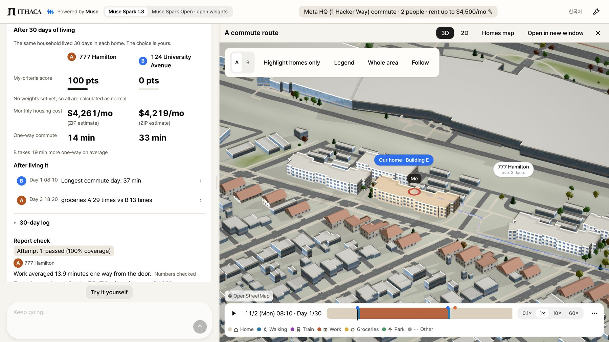
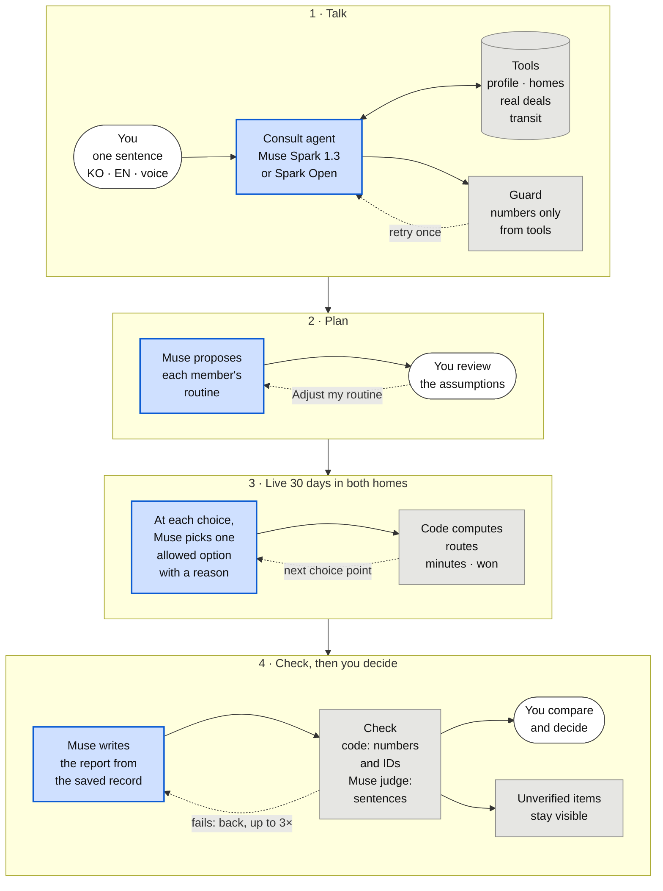
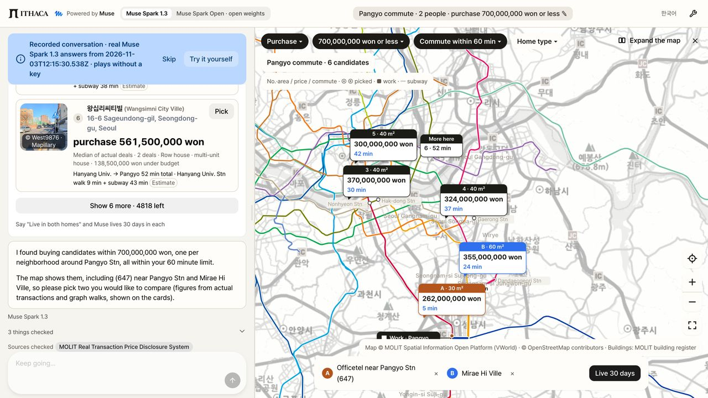
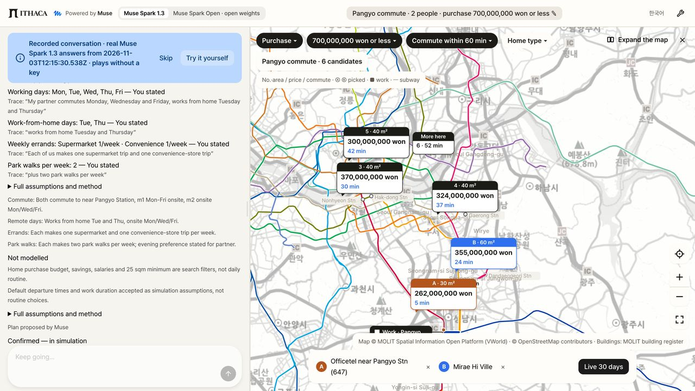
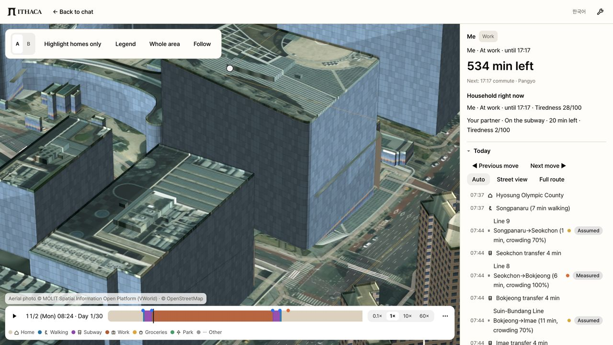
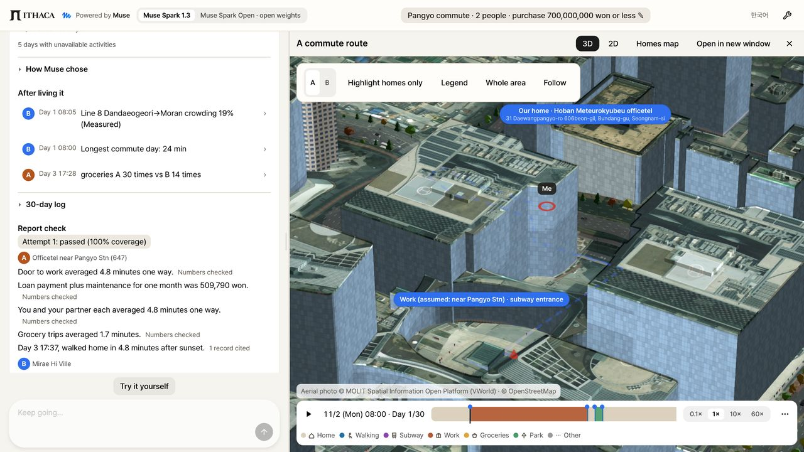

<h1 align="center">
  <picture>
    <source media="(prefers-color-scheme: dark)" srcset="briefs/img/ithaca-logo-light.svg">
    
  </picture>
</h1>

<h3 align="center">Before you sign, live the next 30 days.</h3>

<p align="center"><b>The pre-living agent for your next home</b><br>
Household simulation · Muse agent planning · Voice intake · Room-photo vision · Evidence-checked reports</p>

<p align="center">
  <a href="https://github.com/halo-sw/ithaca/actions/workflows/ci.yml"></a>
  
  <a href="#benchmarks-and-evaluation"></a>
  <a href="#benchmarks-and-evaluation"></a>
  <br>
  
  
  <a href="#6-who-built-what"></a>
  <a href="LICENSE"></a>
</p>

<p align="center">
  <b>Built with Meta AI:</b> Meta Model API (api.meta.ai): Muse Spark 1.3&nbsp;· Muse Voice&nbsp;· Muse Image&nbsp;· SAM 3.1<br>
  <b>Open weights:</b> Muse Spark Open (<code>meta-models/muse-spark-open-1026</code>) on Baseten ran the same household agent: <a href="docs/model-comparison.md">154 decisions, 0 fallbacks, same choice as Spark 1.3 at 120 of 139</a> (<a href="docs/evidence/README.md#what-is-not-here">served as published</a>)&nbsp;· <a href="#6-who-built-what">Code written by Muse Code</a>
</p>

<p align="center">
  <a href="https://halo-sw.github.io/ithaca/?lang=en"></a>
  &nbsp;
  <a href="https://www.youtube.com/watch?v=h_RUbIYWTKY"></a>
  &nbsp;
  <a href="https://halo-sw.github.io/ithaca/?replay=pangyo-reviewed-month&lang=en"></a>
  &nbsp;
  <a href="README.ko.md"></a>
  <br><sub>In the demo video, Halo narrates in English. The recorded month plays with no key.</sub>
</p>

<p align="center">
  <a href="#submission-overview">Overview</a> ·
  <a href="#0-quick-start">Quick&nbsp;start</a> ·
  <a href="#1-project-introduction">Introduction</a> ·
  <a href="#2-service-summary">Summary</a> ·
  <a href="#3-problem-definition">Problem</a> ·
  <a href="#4-how-the-muse-agents-work">How&nbsp;the&nbsp;Muse&nbsp;agents&nbsp;work</a> ·
  <a href="#where-the-models-run">Where&nbsp;the&nbsp;models&nbsp;run</a> ·
  <a href="#5-main-service-flow">Service&nbsp;flow</a> ·
  <a href="#screens">Screens</a> ·
  <a href="#benchmarks-and-evaluation">Benchmarks</a> ·
  <a href="#6-who-built-what">Who&nbsp;built&nbsp;what</a> ·
  <a href="#7-early-feedback-and-next-steps">Feedback&nbsp;and&nbsp;next&nbsp;steps</a> ·
  <a href="#8-conclusion">Conclusion</a>
</p>

<p align="center">
  
  <br><sub>A recorded month for two people commuting to Meta HQ. After 30 days in each home, 777 Hamilton averages a 14-minute one-way commute and 124 University Avenue 33 minutes, at $4,261 and $4,219 a month (ZIP estimates). Muse Spark 1.3 made the daily choices; code computed every number.</sub>
</p>

## Submission overview

| Criterion | Where to look |
|---|---|
| **Eligibility** | Meta Global AI Developer Hackathon · Track: **Indie Developer** · Problem statement: **Build for Your World**<br>Built from scratch since [October 28, 2026](https://github.com/halo-sw/ithaca/commit/7fec53140d26cc100392126fa76029909c0ff1a3) by **Halo, solo** · public repo, MIT |
| **Impact** | **The problem:** a home is the largest purchase most households make, yet it is chosen in a hurry, from photos and one short viewing. In Korea, **41,559** cases are officially recognized as deposit fraud, and **75.9 %** of those tenants are under 40. In the US, **45 %** of homeowners regret something about their purchase.<br>**What changes:** a household modeled on yours lives 30 days in each of two homes first, and you compare whole months, not only the commute. To Meta HQ, the door-to-door commute runs **28.7 min longer** than a listing-style figure on average.<br>**Early signal:** about 20 people around us tried it, and **80 %** said they would use it for real.<br>[Problem ↓](#3-problem-definition) · [Early feedback ↓](#7-early-feedback-and-next-steps) |
| **Use of Meta AI** | **Muse Spark 1.3 is the agent:** tool-using consultation, a plan for each member that you review, the daily choices (**134** in the month shown in the demo video, each saved with its options and reason), the report, and a separate Muse check of the report's sentences.<br>**Muse Spark Open** (open weights, on Baseten) can run the same agent. It makes the same choice as Spark 1.3 at **120 of 139** shared decision points.<br>**Muse Voice** turns speech into editable text, **Muse Image** draws one labeled diary moment and **SAM 3.1** finds windows in a room photo.<br>[How the agents work ↓](#4-how-the-muse-agents-work) · [Where each model runs ↓](#where-the-models-run) |
| **Technical depth and completeness** | **Muse chooses, code computes.** A guard admits only tool-computed numbers, a browser worker runs 30 days in each home, and the report is checked by code (numbers, evidence IDs) and by a Muse judge (sentences), with up to 3 tries.<br>3D neighborhoods are built from OpenStreetMap, building records and aerial photos, in parts of Seoul and Gyeonggi and along the Caltrain corridor to Meta HQ.<br>Report checks pass **3 of 3** on the first try. CI runs **3,765 JS** and **289 Python** tests and a Docker compose smoke test on every pull request.<br>**Muse Code wrote the product:** 99.87 % of the code lines added on `main` trace to its own edit records. [Who built what ↓](#6-who-built-what) |
| **Demo** | [Live app](https://halo-sw.github.io/ithaca/?lang=en) with live Muse under a shared daily limit · [a recorded month](https://halo-sw.github.io/ithaca/?replay=pangyo-reviewed-month&lang=en) that needs no key · [Meta HQ in Menlo Park](https://halo-sw.github.io/ithaca/?chat=I+work+at+Meta+HQ+in+Menlo+Park.+Two+of+us%2C+rent+up+to+%244%2C500+a+month.&lang=en)<br>[Demo video on YouTube, 2:57](https://www.youtube.com/watch?v=h_RUbIYWTKY) · [Screens ↓](#screens) · `docker compose up --build` ([quick start ↓](#0-quick-start)) |

## 0. Quick start

For judges and developers. Every path runs the same app as the public site.

| Path | You need | What you get |
|---|---|---|
| **No install** | A browser | The [live app](https://halo-sw.github.io/ithaca/?lang=en) with live Muse under a shared daily limit, or [a recorded month](https://halo-sw.github.io/ithaca/?replay=pangyo-reviewed-month&lang=en) that plays with no key |
| **[Docker](#run-with-docker)** | Docker | The public build on `localhost:8080` and its model relay on `localhost:8787` |
| **[From source](#run-from-source)** | Node 22 | The Vite dev server, with every feature the public site turns on |
| **[Rebuild&nbsp;the&nbsp;data](docs/development.md)** | Python 3.12, about 6 GB of raw data | The pipeline that builds each area from OpenStreetMap and building records |

**Keys are optional.** Without one, the header shows **Rule mode**: the engine still computes every number, and recorded months play in full. With your own `META_API_KEY`, the chat, plans, daily choices, report checks and voice run on Muse Spark 1.3 and Muse Voice, and the room-photo windows and diary picture call SAM 3.1 and Muse Image. Muse Spark Open runs only with your own Baseten key.

### Run with Docker

```bash
git clone https://github.com/halo-sw/ithaca.git && cd ithaca
cp .env.example .env      # optional: add your META_API_KEY
docker compose up --build
```

Open [http://localhost:8080](http://localhost:8080). The build downloads the runtime data the public site serves (about 130 MB, from the [`data-v1` release](https://github.com/halo-sw/ithaca/releases/tag/data-v1)). CI builds and starts these two containers without a key on every pull request. The relay reads area data from the public site unless you set `DATA_BASE_URL`. Like the public site, this build turns on the room-photo windows (SAM 3.1) and the diary picture (Muse Image).

### Run from source

```bash
git clone https://github.com/halo-sw/ithaca.git && cd ithaca
npm --prefix web ci
mkdir -p "$HOME/ithaca-data"
curl -L https://github.com/halo-sw/ithaca/releases/download/data-v1/runtime-data.tgz \
  | tar -xz -C "$HOME/ithaca-data"
set -a; . ./.env; set +a  # optional: load your keys (see .env.example)
ITHACA_DATA_DIR="$HOME/ithaca-data/data" VITE_SAM_PHOTO=1 VITE_MUSE_IMAGE=1 npm run dev
```

Open [http://localhost:5173](http://localhost:5173). The dev server answers the model routes itself, so no relay is needed, and the data stays outside the repo.

**Tests**

```bash
npm test                  # JavaScript, after the npm ci above
python3.12 -m venv .venv && .venv/bin/pip install -r requirements.txt
.venv/bin/pytest -q       # Python pipeline
```

Tests that need locally built area data skip themselves on a fresh clone, as they do in CI.

## 1. Project introduction

**A home is the largest purchase most households make, yet it is often chosen in a hurry.** A few photos, a floor plan, a price and one short viewing decide years of daily life. In Korea, rising prices add the fear of missing out (FOMO), and the deposit-fraud (전세사기) wave has made a deposit lease, the usual alternative to buying, feel unsafe. How the home fits the household shows up only after moving in.

**Ithaca's agents live there first.** A household modeled on yours lives the same 30 days in each of two candidate homes: work and remote days, errands, parks, school routes, evenings at home, commutes and money. Muse Spark 1.3 plans each member's routine and makes their daily choices among real, mapped options. Code computes every route, minute and won, and the report is checked against the saved record before you see it.

You then compare whole months of life side by side, not only the commute, and decide what to check at the viewing before you buy or sign. The decision stays yours.

**Who it is for.** First-job workers, couples about to marry, young families choosing between two homes, and new hires moving to a city they have never lived in, like a Meta engineer looking along the Caltrain corridor.

## 2. Service summary

| You provide | Ithaca returns |
|---|---|
| Household members, workplaces, budget and preferences | Candidate homes on a map, with historical transaction references |
| Two selected homes and reviewed routines | The same household simulated over the same 30-day window in both homes |
| Your questions and priorities | A whole-life comparison: time (commutes, evenings at home), money (monthly cost of buying, 전세 or 월세, with taxes and loan assumptions), daily needs within a 10-minute walk, saved decisions with reasons, and a report linked to its evidence |

Next to the 30 days, each Korean home shows deposit-lease (전세) warning signals with an official-source checklist and labeled mock-loss scenarios, support programs compared condition by condition, and official safety and school statistics with source and period. Homes are weighted only by your own priorities (**내 기준 점수**). Ithaca names no winner and never rules a deposit safe.

Current scenarios cover parts of Seoul and Gyeonggi, including Jamsil and Pangyo, and a separate Menlo Park / Meta HQ case. Plans can combine working adults, remote days, children, older members and pets. Missing or unsupported needs stay visible.

Historical transaction prices are reference data, not available listings. US rent inputs include ZIP-level estimates. Sources, assumptions and coverage limits are part of the comparison.

## 3. Problem definition

**People commit to a home for years without ever having lived in it.** How the home fits each person's day shows up only after moving in. A couple weighs two commutes, office and remote days, errands and time at home; a family adds school routes. A poor fit keeps costing time and money every month.

- **Korea: haste, FOMO and deposit fraud.** In June 2025 Seoul apartment prices rose 0.43 % in a single week, the largest weekly rise in 6 years and 9 months (Korea Real Estate Board, via [Newsis](https://www.newsis.com/view/NISX20250627_0003230658)). When prices climb, the pressure to buy before it is too late grows. Waiting in a deposit lease is no safe harbor either: since the victims' act took effect in June 2023, **41,559 cases have been officially recognized as deposit fraud (전세사기), and 75.9 % of the recognized tenants are under 40** (30s 50.7 %, 20s 25.2 %). 97.7 % had a deposit of 300,000,000 won or less (Ministry of Land figures, via [Herald, 2026-10-11](https://www.heraldk.com/article/2026101114382405541)). A day of traveling between neighborhoods may still end with pressure to decide.
- **US: you find out after moving in.** 45 % of US homeowners have at least one regret about buying their current home ([Bankrate, May 2025](https://www.bankrate.com/press-releases/nearly-half-of-homeowners-have-at-least-one-regret-about-the-purchase-of-their-current-home/)). Among people who bought in the past year, younger buyers more often regret the commute and the neighborhood ([Realtor.com, Nov 2025](https://www.stocktitan.net/news/NWS/realtor-com-as-market-cools-buyer-regret-does-grzvemhi8uiu.html)). The US market has slowed (a median of 63 days on market in October 2025, in the same study), so there the problem is less haste than deciding without having lived there.

**What is missing is a way to live there first.** A route search shows one trip, and a listing shows the unit. Neither shows how a household's schedules, errands and costs add up over a month, or how two homes compare under the same conditions. Ithaca turns that into an explicit, reviewable comparison and a set of questions to take to the viewing.

**What it does not do.** A 30-day simulation cannot certify a lease or stop deposit fraud. Ithaca shows public warning signals, an official-source checklist and labeled mock-loss scenarios next to the commute, the money and the 30-day record. It never rules a deposit or a landlord safe, forecasts prices or tells you to buy. Public transaction, building and transit data are inputs; they do not prove that a simulated month matches real life.

**Why I built this.** I'm Halo, and I have been looking for a home to start married life in. The deposit-fraud news made a 전세 feel risky, rising prices made waiting feel risky too, and two people with very different routines made every option hard to judge. How well we would sleep, how crowded the commute would be, what the neighborhood is really like: you meet these only after moving in. With that much money at stake, I wanted to live there first.

## 4. How the Muse agents work

**Muse proposes routines and makes bounded choices. Code computes the consequences. The report is checked against the saved run.**

How one conversation runs, top to bottom. Blue boxes are Muse, grey boxes are code, white boxes are you. Dotted arrows send work back.



Code: [relay](relay/handler.js) · [consult agent](web/src/consult/agent.js) · [tools](web/src/consult/tools.js) · [guard](web/src/consult/guards.js) · [household plan](web/src/consult/life-plan.js) · [live household loop](web/src/judge/household.js) · [browser worker](web/src/sim-worker.js) · [report](web/src/consult/report.js) · [checks](web/src/verify/compare.js). Chart source: [docs/agent-workflow.mmd](docs/agent-workflow.mmd).

| Role | What happens | What makes it inspectable |
|---|---|---|
| Consultation | Muse uses tools to extract the household profile and search recorded housing data | Stated inputs and missing information stay distinct |
| Planning | Muse proposes each member's working days, remote days, errands and supported routines | The user reviews assumptions; **Adjust my routine** sends a correction back to Muse before confirmation |
| Daily decisions | At a choice point, Muse receives the person's preferences, routine, recent choices and map-backed options | It returns an allowed choice and reason; the record retains the options and model or fallback source |
| Simulation | The browser worker applies fixed schedules and computes routes, elapsed time and costs | Values come from the engine and its inputs; background residents use rules |
| Report and checks | Muse writes from the saved record; code checks supported numbers and evidence IDs; a separate Muse call checks eligible claims against cited events | Failed claims return for revision. Missing or failed semantic checks remain **unverified**; unsupported items are not counted as passes |

**One recorded decision:** in the recorded Pangyo month (run `cmw0nibca873f`), the partner's options on a remote day were a park walk or staying home. Muse chose the park and saved the reason, “Matches evening park walk routine on remote workday.” The engine computed the 5.1-minute walk. In the demo video's run, Muse made the same choice, saying “Fits evening walk routine on remote workday.” This is an observed simulated choice, not evidence of what a real person would do. [Decision, options and run](docs/recording-v9.md#the-choice-shown-in-the-video) · [video run](docs/demo-script.md#exact-evidence-used-by-this-edit).

### Where the models run

The **browser** hosts the UI, 3D playback and simulation worker. A **relay server** on Vercel (or local Docker) makes runtime model calls. Hosted service keys stay in the relay's environment. An optional user-supplied key is sent with that user's request.

| Model | Job | Runs on | Evidence |
|---|---|---|---|
|  **Muse Spark 1.3** | Consultation, plans, daily choices, reports and evidence checks | Relay → Meta&nbsp;Model&nbsp;API | [code](web/src/judge/providers.js) · [recorded&nbsp;month](docs/recording-v9.md) |
|  **Muse Spark Open** | Open-weights alternative to Spark 1.3, selectable in the app | Relay → Baseten | [real&nbsp;calls](docs/evidence/muse-spark-open-2026-10-31.json) · [comparison](docs/model-comparison.md) |
|  **Muse Voice Transcribe 1.0** | Speech to editable text | Browser mic → relay → Meta&nbsp;Model&nbsp;API | [code](web/src/consult/voice.js) |
|  **Muse Image 1.0** | Draws one recorded activity | Relay → Meta&nbsp;Model&nbsp;API | [code](web/src/consult/diary-image.js) · [real&nbsp;calls](docs/evidence/muse-image-2026-11-03.json) |
| **SAM 3.1** | Finds windows in a room photo | Browser → relay → Meta&nbsp;Model&nbsp;API | [code](web/src/consult/windows.js) · [real&nbsp;call](docs/evidence/sam-3.1-2026-11-03.json) |
|  **Muse Code** | Wrote the product code, tests and pipelines | Developer machine, build time only | [briefs](briefs/) · [rules](AGENTS.md) |

API paths: Meta `api.meta.ai/v1/` + `chat/completions` (Spark 1.3), `asr/transcribe` (Voice), `images/generations` (Image), `responses` (SAM) · Baseten `inference.baseten.co/v1/chat/completions` (Spark Open). Muse Code has no runtime endpoint.

Muse Image outputs carry **“Illustration by Muse Image”** labeling; they are not photographs of the property. SAM reports boxes and their share of the image, not physical window dimensions or daylight performance. Its published call used an illustrated test room. These integrations are separate from the evidence for the 30-day comparison.

The app exposes its agent work through **“Plan proposed by Muse,” “Muse is choosing…”** and recorded choice sources. The recorded months used **Spark 1.3**; selecting Spark Open in the UI is not evidence that it produced them. Muse Code wrote the product code; Claude Code and Codex planned the stages and directed it ([who built what ↓](#6-who-built-what)). [Full architecture](docs/architecture.md) · [Verification rules](docs/verification.md) · [Model evidence](docs/evidence/README.md).

## 5. Main service flow

1. **Describe the household.** Enter or speak the people, budget, destinations and preferences.
2. **Pick two homes.** Inspect candidates, transaction references and map coverage.
3. **Review and adjust the plan.** Read each member's proposed routine. Use **Adjust my routine** to change a condition, review Muse's revision, then confirm.
4. **Run the month.** Muse chooses among allowed options while code computes the consequences. A live run may take a few minutes; the UI shows progress and any fallback state.
5. **Inspect the comparison.** Open costs, commutes, source tags and the actual report-check timeline. Follow a saved decision's journey in 3D.
6. **Prepare for the real viewing.** Use the differences and unresolved questions to guide what you check. The user makes the housing decision.

### Screens

All four are from the public site and need no key: 1, 2 and 4 from the recorded Pangyo month, 3 from the two-home demo in 3D.

<table>
  <tr>
    <td width="50%" valign="top"><br><b>1. Find homes.</b> Muse searches real transaction records and maps one candidate per neighborhood within the commute limit.</td>
    <td width="50%" valign="top"><br><b>2. Review the plan.</b> Each routine line shows where it came from, with a quote from your own words. You confirm the plan before the month runs.</td>
  </tr>
  <tr>
    <td width="50%" valign="top"><br><b>3. Live the month.</b> Follow a member through the 3D city. Each subway leg is tagged as measured or assumed.</td>
    <td width="50%" valign="top"><br><b>4. Read the checked report.</b> Code recomputes every number and Muse judges each claim against the cited record. This report passed on the first try.</td>
  </tr>
</table>

**Why 30 days?** About four weekly cycles repeat working days, remote days, weekends and errands under the same reviewed conditions in both homes. The UI compares **First 7 days** with the **Full period**, including when extra days add little information. Thirty days is a chosen comparison window, not a validated minimum or a forecast. Monthly housing costs use separate financial assumptions.

### What the recorded runs demonstrate

One illustrative Pangyo couple, run twice for real with Muse Spark 1.3. The [demo video](https://www.youtube.com/watch?v=h_RUbIYWTKY) shows run **`cmw0ygvgsa8c3`**, recorded on November 4. The [recorded month](https://halo-sw.github.io/ithaca/?replay=pangyo-reviewed-month&lang=en) in the app replays the earlier run **`cmw0nibca873f`** (v9). Commute and cost figures are the same in both runs; the decision records are separate.

| Metric | Home A | Home B |
|---|---:|---:|
| Average one-way commute | 4.8 min | 23.9 min |
| Monthly housing + recorded commute costs | ₩509,790 | ₩1,023,917 |
| Historical transaction area band | 25–35 m² | 55–65 m² |
| Muse choices / rule fallbacks, demo video run | 70 / 0 | 64 / 1 |
| Muse choices / rule fallbacks, replay run | 70 / 0 | 63 / 2 |

That makes **134 / 1** in the video run and **133 / 2** in the replay run. [Video-run evidence](docs/evidence/recording-presenter.json) · [replay-run evidence](docs/evidence/recording-v9.json).

The report's saved status is **pass** in both runs. This checks internal consistency with the record, not field accuracy. The transaction bands are not exact unit sizes; station-based workplaces, loan terms and maintenance are explicit assumptions. [Inputs, calculations and limits](docs/recording-v9.md).

A **separate four-person family run** records school-level routes. A missing middle-school route remains unavailable; school assignment and enrollment are not inferred. [Family evidence](docs/recording-v9.md#separate-four-person-family).

### Benchmarks and evaluation

Each result can be reproduced from files in this repo. None of them measures real-world accuracy; the field study in section 7 is the step for that.

| Evaluation | Setup | Result | Evidence |
|---|---|---|---|
| **Report check** | 3 recorded runs (Pangyo couple, Seoul engaged couple, Meta HQ), live Muse Spark 1.3 | **3 of 3 pass on the first try**, must and weighted coverage 100 %. The first Seoul run, before stage 29k, took 4 tries | [verification](docs/verification.md) · [recordings](web/public/recorded/) |
| **Model agreement** | Spark 1.3 vs Spark Open, same household, 154 decisions each | **Same choice at 120 of 139** shared decision points (86 %); 0 guard fallbacks on either; 3.7 s vs 2.7 s per call | [comparison](docs/model-comparison.md) |
| **Commute vs a listing-style figure** | 17 homes from the 3 recorded runs, 10 seeds, rule-based | Meta HQ: door-to-door is **26.0–31.6 min longer** (mean 28.7), mostly the last mile and the train wait. Pangyo: 0.2–2.6 min longer | [baseline](docs/baseline-commute.md) |
| **Recorded Pangyo month** | The same household run twice: `cmw0ygvgsa8c3` in the demo video, `cmw0nibca873f` in the replay | **134** and **133 Muse choices**, with 1 and 2 labeled rule fallbacks; report pass in both | [video run](docs/evidence/recording-presenter.json) · [recording v9](docs/recording-v9.md) |
| **Tests** | CI on every pull request | **3,765 JS** pass (42 skipped)<br>**289 Python** pass (18 skipped)<br>Docker compose smoke | [CI](https://github.com/halo-sw/ithaca/actions/workflows/ci.yml) |

Agreement between two models is not an accuracy score. A passing report check means the report agrees with its own saved record. The listing-style figure is our stand-in for the convention, not text from real listings.

## 6. Who built what

**Muse Code wrote the product. Claude Code and Codex planned it and told Muse Code what to write.** Halo worked with two orchestrators, Claude Code (Anthropic) and Codex (OpenAI). They split the work into stages, found the causes of problems and wrote a brief for each stage in [`briefs/`](briefs/), usually down to the `file:line` to change and the test that proves it. They also ran the full test suite and the build, captured screens and did the git work. Muse Code (Meta) wrote the product code, tests and pipeline scripts from those briefs. The rule is in [AGENTS.md](AGENTS.md).

| Who | Role and what they wrote |
|---|---|
| **Halo**<br>(human, solo) | **Role:** direction, product decisions, review<br>**Wrote:** the reference grader and its ground truth for the checklist test (`verify_checklist.py`, `ground_truth.json`) |
| **Claude Code**<br>(Anthropic)<br>**Codex**<br>(OpenAI) | **Role:** orchestrators. Plan stages, write briefs, diagnose, run tests and builds, git, captures<br>**Wrote:** briefs, docs and READMEs, recordings and evidence files, the English UI text tables, build and CI configuration |
| **Muse Code**<br>(Meta) | **Role:** implementation, as the agent mode of `muse-spark-1.3`<br>**Wrote:** the product code, tests and pipeline scripts |

**Authorship audit, November 4.** We compared every code line added on `main` with Muse Code's own session records: the patches its edit tools saved and the shell commands it ran. The audit covers 133,828 lines of JavaScript, JSX, CSS, Python, HTML and configuration from all non-merge commits. Muse's session records are local files on Halo's machine, so the audit cannot be rerun from the repo alone.

| Result | Lines | Share |
|---|---:|---:|
| In a patch Muse saved for the same file (132,835) or another file (213) | 133,048 | 99.42 % |
| Written by Muse in a tool call with no saved patch: shell `cat >>`, `sed` and Python rewrites | 610 | 0.46 % |
| **Written by Muse Code** | **133,658** | **99.87 %** |
| Not written by Muse (listed below) | 170 | 0.13 % |

The 170 lines:
- **Build and CI configuration (83), by the orchestrators:** `.gitignore`, dependencies in `package.json`, `.env.example`, `.github/workflows/ci.yml` and the feature-flag lines in `pages.yml`.
- **The reference grader Halo provided (44):** `tools/verify_checklist.py`, with one path line adapted by Claude Code.
- **Stage-number renames (19):** Claude Code renumbered stages `28a`–`28d` to `30a`–`30d` in comments and test names that Muse had written.
- **Third-party and generated files (17):** vendored Pretendard font CSS (11) and `web/src/astryx-themes.js`, generated by the Astryx CLI (6).
- **Recorded demo text (7), by Claude Code:** tour strings in `web/src/ui/demotour.js` and one recording title in `web/src/chat/recording.js`.

Also checked:
- Merge commits added 48 lines of their own. All 48 are in Muse's records.
- Of 13,097 deleted code lines, 96.9 % are in Muse's patches. Nearly all the rest were removed by Muse's shell commands (`rm`, `sed`, Python). The exceptions are one `git revert` of a Muse stage (29a12, the landing poster) and the recorded demo text above, both by Claude Code.
- **Text, not code:** the English UI text tables (`web/src/i18n/en*.js`, 3,146 lines of translation data) were written by Claude Code. Muse wrote the translator that applies them.
- Briefs point to causes and places to change. Only 0.4 % of the code lines Muse wrote also appear word for word in the brief that started its run.

## 7. Early feedback and next steps

### What early users told us

This was an informal check, not a study. About 20 people around us tried Ithaca, and **about 80 % said they would use it** for their own home search. What we heard most:

- **Realistic.** Many said the month felt very realistic, and that weighing a few more factors would make it even more useful when buying a home.
- **Five homes, not two.** People usually have about five candidates, so they want to compare that many.
- **Schools, crime and shops.** They want school districts, crime rates and nearby shops next to the commute and the costs.

### Next steps

The intended benefit is **less mental work when comparing homes, earlier discovery of routine mismatches, and clearer conversations about time and money**. These are goals to test, not measured customer outcomes.

| Next step | Why, and what to validate |
|---|---|
| **Up to five candidate homes** | Early users shortlist about five. Validate run time and whether a five-way comparison stays readable |
| **School districts, crime and nearby shops in the comparison** | Asked for by early users. Official statistics only, each with source, period, unit and geographic level; no composite safety or school score |
| Field study with 10–20 residents | Compare modeled journeys and costs with observed routines; record errors and whether the comparison changes the questions people ask |
| Broader route and data coverage | Improve missing destinations, workplace precision and transit assumptions; keep unresolved inputs visible |
| Photo-based assistance | Evaluate window detection on real room photos before adding physical measurements or environmental claims |

## 8. Conclusion

A home is chosen in a hurry and lived in for years. Ithaca lets the household live there first. In the month shown in the demo video, Muse Spark 1.3 made 134 daily choices across two homes, code computed every minute and won, and the report was checked against the saved record before anyone read it. All 3 recorded runs pass that check on the first try. The comparison shows what a listing leaves out: to Meta HQ, the door-to-door commute averages 28.7 minutes more than a listing-style figure. Early users called the month realistic, and about 80 % of the 20 or so we asked said they would use it.

Next come five homes at once, with school districts, crime statistics and nearby shops side by side. The decision stays with the household. Start with yours, inspect the assumptions and take better questions to the viewing before you sign.

---

[Architecture](docs/architecture.md) · [Features](docs/features.md) · [Planning and the 30-day window](docs/household-planning.md) · [Build log](docs/build-log.md) · [Local setup](docs/development.md) · [Recording script](docs/demo-script.md)

Code: [MIT](LICENSE). Data, imagery and fonts retain their own licenses; see [ATTRIBUTION.md](ATTRIBUTION.md).
