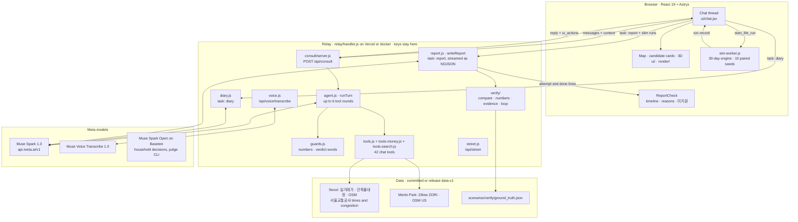
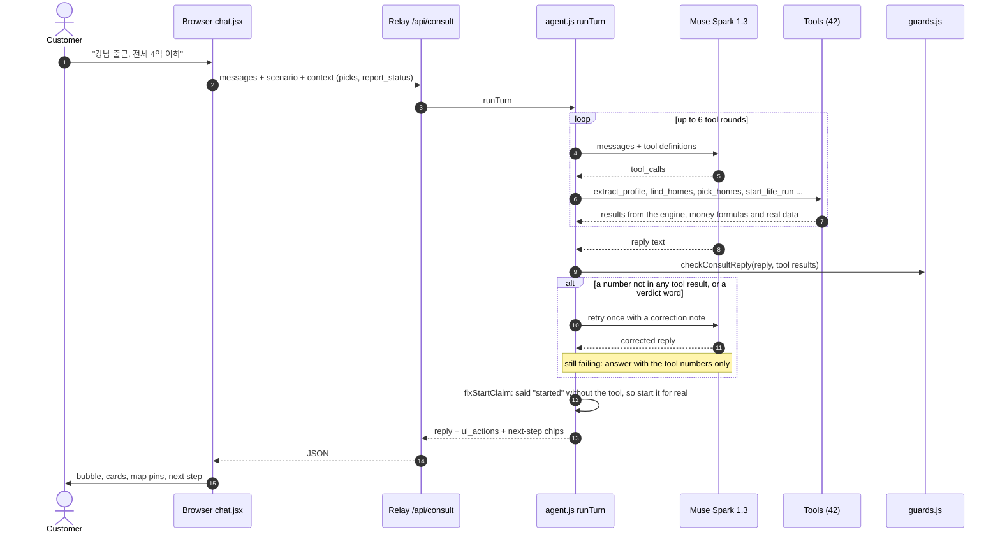
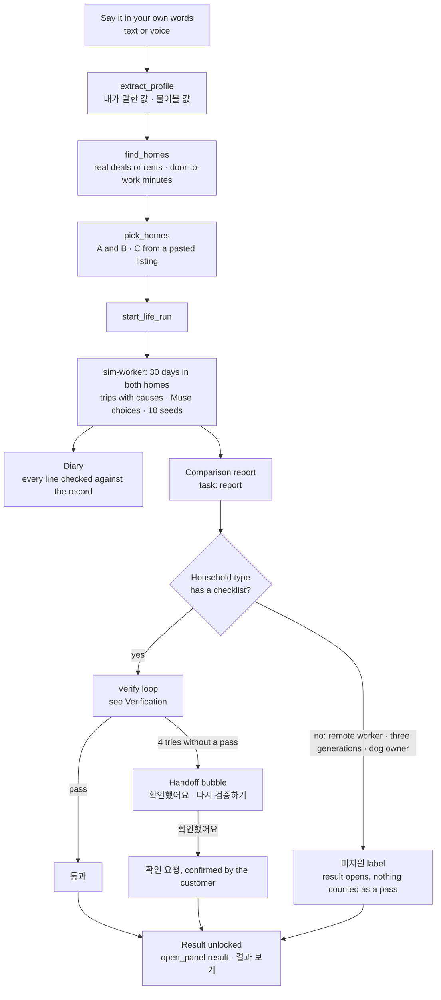
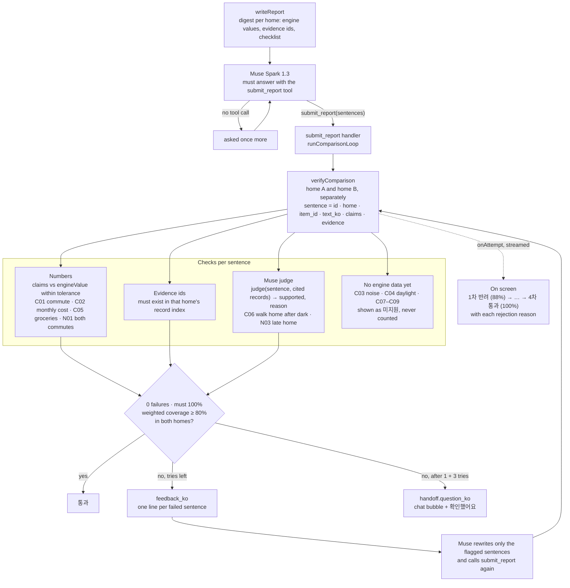

<p align="center"></p>

<p align="center"><sub>(formerly homeless-society-sim)</sub></p>

<p align="center"><b>The Pre-living Agent for Your Next Home</b><br><i>“We walk the odyssey. You just come home.”</i></p>

<p align="center"><b>Built with Meta AI:</b> Meta Model API (<code>api.meta.ai</code>) · Muse Spark 1.3 · Muse Spark Open · Muse Code · Muse Voice</p>

<p align="center">An AI household lives 30 days in each candidate home and finds the problems you only learn by living there,<br>the ones a listing photo, a map and a 30-minute viewing never show.</p>

<p align="center">
  
  
  
  
  
  <a href="https://github.com/halo-sw/ithaca/actions/workflows/ci.yml"></a>
  <a href="LICENSE"></a>
</p>

<p align="center">
  <a href="https://halo-sw.github.io/ithaca/"></a>
  &nbsp;
  <a href="#quick-start"></a>
  &nbsp;
  <a href="briefs/"></a>
  &nbsp;
  <a href="README.ko.md"></a>
</p>

<p align="center"><sub>Live site: <a href="https://halo-sw.github.io/ithaca/">https://halo-sw.github.io/ithaca/</a> — Muse and the VWorld map tiles run through a small relay that keeps every key server-side. If the relay is unavailable, the chat answers in rule mode and says so.</sub></p>

<p align="center">
  <a href="#summary">Summary</a> ·
  <a href="#start-here">Start here</a> ·
  <a href="#project-brief">Project brief</a> ·
  <a href="#meta-ai-usage">Meta AI usage</a> ·
  <a href="#architecture">Architecture</a> ·
  <a href="#how-it-works">How it works</a> ·
  <a href="#gallery">Gallery</a> ·
  <a href="#what-it-does">What it does</a> ·
  <a href="#meta-models">Meta models</a> ·
  <a href="#verification">Verification</a> ·
  <a href="#built-by-muse">Built by Muse</a> ·
  <a href="#quick-start">Quick start</a> ·
  <a href="#limits">Limits</a> ·
  <a href="#roadmap">Roadmap</a>
</p>

## Summary

- **What it is.** Ithaca lets an AI household live 30 days in each of two candidate homes before you sign, then shows what only living there reveals: the commute day by day, the money, the walk home after dark.
- **Who it is for.** First-job workers renting their first place, couples about to marry, and families with young children choosing between two homes.
- **How it works.**  **Muse Spark 1.3** runs the conversation and makes the household's everyday choices with reasons; **Muse Voice** takes spoken input; a deterministic engine computes every minute and every won; every diary sentence is checked against the run's record before you see it.
- **Try it.** Open <https://halo-sw.github.io/ithaca/> (English unless your browser is Korean, or add `?lang=en`). Where to begin for each situation is in [Start here](#start-here).
  - **Watch a recorded month** replays a real Muse Spark 1.3 session recorded on 2026-10-31, without any key: Meta HQ in Menlo Park, real apartments near 1 Hacker Way, two picked, 30 days in each, and the diary.
  - **I work at Meta HQ** runs it live: six real apartments on a map with aerial photos, Zillow ZIP rent estimates and bike/walk minutes. Say *"Save 1 and 2"*, then *"Live in both homes"* (type it, or tap the microphone).
  - No key is needed: the site calls Muse through our relay. If Muse is unavailable, the header shows **Rule mode** and the chat says so; the engine still computes every number. Locally, `docker compose up` runs the same app ([Quick start](#quick-start)).
- **Built by.**  Every line of product code and every test was written by **Muse Code** from stage briefs ([Built by Muse](#built-by-muse)).
- **Where the code is.** The app, engine and consult agent are in [`web/src/`](web/src/) (tests in [`web/tests/`](web/tests/)). The key-holding relay is in [`relay/`](relay/), the Python data pipeline in [`pipeline/`](pipeline/), and scenarios and recorded runs in [`scenarios/`](scenarios/). The Meta API base URL and key are defined once, in [`web/src/judge/providers.js`](web/src/judge/providers.js) ([Meta AI usage](#meta-ai-usage)).

**At a glance**

| Claim | Number | Where |
|---|---|---|
| Numbers never come from the model | Every minute and won is computed by the deterministic engine; replies with a number not in the tool results are rejected | [Verification](#verification) |
| Muse's choices are stable across models | Spark 1.3 and Spark Open made the same choice at **120 of 139** shared decision points (**86 %**) | [Meta models](#meta-models) |
| Guards hold on real runs | **154 of 154** decisions answered per model, **0** guard fallbacks | [Meta models](#meta-models) |
| Diary sentences are checked | Each sentence must cite a fact of the run; lines with an unrecorded number are sent back and rewritten. Live English run on 2026-10-31 (Pangyo, 2 homes): all 8 diary sentences matched the record, after 1 rewrite | [Verification](#verification) |
| Tested | **2,403** JavaScript and **266** Python tests, CI on every pull request and push to main | [CI](https://github.com/halo-sw/ithaca/actions/workflows/ci.yml) |

<p align="center">
  
</p>

<p align="center"><sub>Meta HQ in Menlo Park, replayed from a real Muse Spark 1.3 session: the checked diary and "Only living there tells you" on the left, six candidates with ZIP rent and door-to-work minutes on the map. Real GPU capture, 2026-10-31.</sub></p>

## Start here

Pick the row that sounds like you. Every link opens the live site; nothing to install and no key to bring.

| You want to… | Start with | What you get |
|---|---|---|
| **See the whole thing first** | [Watch a recorded month](https://halo-sw.github.io/ithaca/?replay=menlo-month&lang=en) · Korean: [기록된 한 달 보기](https://halo-sw.github.io/ithaca/?replay=seoul-couple&lang=ko) | A real Muse Spark 1.3 session replayed: homes on the map, two picked, 30 days in each, the checked diary. Plays without a key or a live model. |
| **Find a home near your work in Seoul / Gyeonggi** | Type one sentence on the [landing page](https://halo-sw.github.io/ithaca/?lang=ko), or start from an [example](https://halo-sw.github.io/ithaca/?chat=%ED%8C%90%EA%B5%90%EB%A1%9C+%EC%B6%9C%EA%B7%BC%ED%95%98%EB%8A%94+%EC%8B%A0%EC%9E%85%2C+%EC%97%B0%EB%B4%89+4%EC%B2%9C%2C+%EB%AA%A8%EC%9D%80+%EB%8F%88+5%EC%B2%9C%2C+%EC%A0%84%EC%84%B8+2%EC%96%B5+%EC%9D%B4%ED%95%98&lang=ko) | Live Muse. Candidates from real transactions in 11 areas, then 30 days in the two you pick. [Step by step ↓](#your-first-live-session) |
| **Commute to Meta HQ in Menlo Park** | [I work at Meta HQ](https://halo-sw.github.io/ithaca/?chat=I+work+at+Meta+HQ+in+Menlo+Park.+Two+of+us%2C+rent+up+to+%244%2C500+a+month.&lang=en) | Live Muse in English: real apartments near 1 Hacker Way, Zillow ZIP rent estimates, bike and walk minutes. |
| **Check a listing you already found** | [Paste a listing](https://halo-sw.github.io/ithaca/?chat=&listing=1&lang=en), then tap **Read it** | Only the values in the text are read. You see where the price sits among last year's real deals, and the home can join the comparison as home C. |
| **Talk instead of typing** | The microphone in the chat box | Muse Voice writes what you said into the box. Nothing is sent until you send it. |
| **Look around a neighbourhood in 3D** | [Guided tour](https://halo-sw.github.io/ithaca/?mode=sim&scenario=demo-two-homes&tour=demo) | The 3D neighbourhood with a household moving through its day. |
| **Run it on your own computer** | [Quick start → Docker](#quick-start) | The same app at `localhost:8080`. Without a Meta API key it runs in **Rule mode**; the engine still computes every number. |
| **Change the code or rebuild the data** | [Quick start → From source](#quick-start) | Python pipeline, simulation scripts and the Vite dev server. |

The live chat shares a daily Muse limit. When it runs out, or the relay is down, the header shows **Rule mode** and the chat says so.

### Your first live session

1. **Say it in one sentence**: who lives there, where you work, and your budget. For example *"판교로 출근하는 신입, 연봉 4천, 모은 돈 5천, 전세 2억 이하"*. Anything missing shows up as a chip (*Who with?*, *Deposit limit?*). Tap one to fill it in, or skip it.
2. **Read the candidates.** Each card and map pin shows the median of real deals and the door-to-work minutes. The pins show the same minutes as the cards.
3. **Save two.** Tap **Pick** on two cards, or say *"1번, 2번 담아 줘"* (*"Save 1 and 2"*).
4. **Let them live there.** Say *"두 집에서 살아 봐 줘"* (*"Live in both homes"*). The household lives 30 days in each home, and the chat shows each check while it runs.
5. **Read the result.** It shows your own 내 기준 점수, the monthly cost, the commute side by side, the checked diary, and *Only living there tells you*. No winner is named; the choice is yours.
6. **Ask more.** For example *"밤 10시 이후 귀가를 보여 줘"*. You can also set your own weights, or open the 3D view at the moment a sentence talks about.

Covered today: Seoul 성동 · 송파 · 강남 · 강동 · 위례 and 판교 · 성남 · 정자 · 분당 · 미금 · 수지, plus Menlo Park in the US.

## Project brief

**Why I built this.** I'm Halo, an office worker, and I have been looking for a home to start married life in. Between the deposit-fraud news and two people with very different daily routines, it was hard, and every change, like a new job, brings things you only meet after moving in. I can't know in advance how well I'll sleep, how crowded my commute will be, or what a neighbourhood is really like, so I wanted to simulate it first.

**The problem.** People make the most expensive decision of their lives from a few photos and a 30-minute viewing. For a first-job worker, a couple about to marry or a young family in Korea, that decision is also the riskiest: about 75 % of the victims of deposit fraud (전세사기) are in their 20s and 30s (press report of March 2025 citing Ministry of Land data). Everyone who has moved knows the feeling of finding out what a home is really like only after moving in.

**The idea.** An AI household moves in first. Tell it about your life, pick candidate homes from real transactions, and the household lives 30 days in home A and home B, side by side, in a 3D model of the real neighbourhood. Muse Spark makes the household's everyday choices and explains each one. A deterministic engine counts every minute and every won. The app then compares the two homes on the customer's own priorities, with a source or an "assumption" label on every number. It shows, explains and lets you decide. It never decides for you.

> Status (2026-10-31): work in progress. The hackathon runs 2026-10-27 → 11-05. The first commit is 2026-10-28, and nothing here predates the hackathon. Items marked *coming soon* are not built yet.

## Meta AI usage

Every call goes through one module, [`web/src/judge/providers.js`](web/src/judge/providers.js). It speaks OpenAI-style chat completions over `fetch`, and keys come from the server environment only (see [`.env.example`](.env.example)).

| Model | Endpoint | What it does here | Code | Evidence |
|---|---|---|---|---|
|  **Muse Spark 1.3** (`muse-spark-1.3`) | `https://api.meta.ai/v1` | The household's everyday choices with reasons; the consult agent with tool calls | [`judge/run.js`](web/src/judge/run.js) → [`providers.js`](web/src/judge/providers.js) `complete`; [`consult/agent.js`](web/src/consult/agent.js) → `completeWithTools` | [3 real calls](docs/evidence/muse-spark-1.3-2026-10-31.json), [154 recorded decisions](scenarios/decisions/compare-1029/) |
|  **Muse Spark Open** (`meta-models/muse-spark-open-1026`) | `https://inference.baseten.co/v1` (Baseten) | The same household decisions; one switch `--provider baseten` | same module | [3 real calls](docs/evidence/muse-spark-open-2026-10-31.json), 120 of 139 same choices as Spark 1.3 |
|  **Muse Code** (agent mode on `muse-spark-1.3`) | Muse Code CLI | Wrote every line of product code and every test in this repository from stage briefs | — | [`briefs/`](briefs/) (brief + result per stage) |
|  **Muse Voice Transcribe 1.0** (`muse-voice-transcribe-1.0`) | `https://api.meta.ai/v1/asr/transcribe` | Speak instead of typing in the chat (Korean and English, detected automatically); the transcript goes into the box for the customer to check | [`consult/voice.js`](web/src/consult/voice.js) via the relay `/api/voice/transcribe` | — |
| SAM 3.1 | — | Window area from listing photos | *coming soon* | — |

The server key is read from `META_API_KEY` (`MODEL_API_KEY` still works as a fallback); the base URLs are named constants, `META_API_BASE` and `BASETEN_API_BASE`, in [`providers.js`](web/src/judge/providers.js) and re-exported by [`relay/handler.js`](relay/handler.js).

Spark Open is served by Baseten as published. We compare the two served models; we did not fine-tune either one.

## Architecture

```text
ithaca/
├── pipeline/          Python: OSM extract, building register join, walking graph, subway network, terrain, 3D boxes
├── web/
│   ├── src/engine/    Pure JS life engine: routines, trips with causes, paired 30-day runs (deterministic, seeded)
│   ├── src/judge/     Muse calls: decision prompts, number guards, recorded decisions for exact replay
│   ├── src/consult/   Consult agent: tool calls (extract_profile, find_homes, pick_homes, start_life_run, …), reply guards, voice transcription
│   ├── src/verify/    Report checks: ground-truth checklist, number claims, retry loop
│   ├── src/money/     Payroll, 매매 / 전세 / 월세 formulas, real-transaction loader, public rentals
│   ├── src/transit/   Operator schedule and ride minutes
│   ├── src/render/    three.js scene: facades, terrain, roads, trees, vehicles, pedestrians, trains
│   ├── src/ui/        React 19 + Astryx (Meta's design system)
│   ├── scripts/       CLIs: simulate, money, judge, static server
│   └── tests/         node:test suites
├── relay/             Server that keeps keys off the browser: /api/consult, /api/voice/transcribe, map tiles (Vercel or docker compose)
├── scenarios/         Committed households, homes and recorded Muse decisions
├── tests/             Python tests for the pipeline
├── Dockerfile, docker-compose.yml, package.json, .env.example
└── briefs/            One brief + result per Muse Code stage
```

### System map

Where each part runs. The browser never holds a model key: every Muse call goes through the relay.



### Agent flow: one chat turn

The browser owns the conversation; the relay runs one turn and sends back the reply plus the screen actions (`ui_actions`) that move the map, open cards or start the run.



### From one sentence to a checked comparison



**Flow in words.**
1. **Profile.** The browser sends the chat to `/api/consult` (the dev server or the relay). The agent calls Muse with tools; tool results come from `web/src/engine` and `web/src/money`.
2. **Number check.** The reply guard (`web/src/consult/guards.js`) rejects a reply whose numbers are not in the tool results.
3. **30-day run.** The engine runs both homes in a browser worker (`web/src/sim-worker.js`).
4. **Diary.** Muse writes the diary from the run's record, and `web/src/consult/diary.js` checks every line against that record.
5. **Checked comparison.** Muse hands in the two-home comparison only through the `submit_report` tool; code and a Muse judge check it, and the result opens only after it passes, the customer confirms a handoff, or the household type is marked 미지원 (see [Verification](#verification)).
6. **Household decisions.** Muse makes them through the judge CLI (`web/scripts/judge.mjs`), and they replay exactly from the recorded files.

`npm test` at the root runs the JS suites, and `npm run test:py` runs the Python ones. CI runs both on every pull request and every push to `main`.

## How it works

| | Step | What happens | Status |
|---|---|---|---|
| 1 | **Say it in your own words** | "맞벌이 예비부부, 강남 출근, 전세 4억 이하, 59㎡ 이상". The consult agent turns this into a household profile. Every value the customer said is marked "내가 말한 값", and every gap is marked "물어볼 값". | built (text and voice) |
| 2 | **Get real candidate homes** | Candidates come from real transactions in 11 areas of south-east Seoul and Gyeonggi, with ride times from the operator's schedule and public rentals from the LH · 마이홈 API. They appear on a map with the subway lines, the workplace and the commute minutes. | built |
| 3 | **The household lives there for 30 days** | The household commutes, shops, walks in the park and visits clinics on the real walking graph, in both homes at once. Runs are paired over 10 seeds, so the gap between homes comes from the homes and not from chance. | built |
| 4 | **The report is checked before you see it** | The agent's checklist and report are scored against a ground-truth checklist. Numbers must match the engine, and every sentence must cite a simulation event. A failed report goes back to the agent up to 3 times, then to the customer. Each try and its reason show in the chat while it runs. | built (scorer, claim checks, Muse judge, retry loop, on-screen timeline) |
| 5 | **Compare with evidence** | Time, fatigue, money for 매매 / 전세 / 월세 / public rental, 전세 warning signs, support programmes, official safety and education figures, all weighted by the customer's own priorities. Each home gets a 0–100 **내 기준 점수**: a subjective score from the customer's own weights, with the formula one tap away. | built |

## Gallery

<table>
  <tr>
    <td width="50%"></td>
    <td width="50%"></td>
  </tr>
  <tr>
    <td><sub><b>Start with a sentence, or watch a recorded month.</b> One input, and three ways to try it now: a recorded month that plays without a key, Meta HQ live, Seoul live, with the run's own numbers (14 seconds to find 6 homes, 85 seconds to live 30 days in two, 8/8 diary sentences checked).</sub></td>
    <td><sub><b>The answer first.</b> After 30 days in each home: the customer's own 내 기준 점수 (computed with every weight at 보통 until they set their own), monthly housing cost and the one-way commute side by side, then moments and the checked diary. No winner is named.</sub></td>
  </tr>
  <tr>
    <td></td>
    <td></td>
  </tr>
  <tr>
    <td><sub><b>Follow one person.</b> The 3D neighbourhood built from building-register data: 나 on 신분당선 from 강남 to 판교, how this scene counts toward the result (오늘 출근 44분 = 걷기 14분 + 지하철 26분 + 기다림 4분), measured vs assumed crowding, and the day's trips.</sub></td>
    <td><sub><b>On a phone.</b> Chat and Map &amp; homes as two tabs: the checked diary, “Only living there tells you” and its sources, and map pins that show the same door-to-work minutes as the cards.</sub></td>
  </tr>
  <tr>
    <td colspan="2"></td>
  </tr>
  <tr>
    <td colspan="2"><sub><b>Two countries, one engine.</b> Seoul, in Korean: a couple commuting to 강남. The diary, '살아 봐야 아는 것' and sources on the left; six 전세 candidates with real-transaction prices and commute minutes over subway lines 2 and 신분당선 on the right.</sub></td>
  </tr>
</table>

Every image is a real GPU capture (Apple M4 Max, Metal) of the running app on 2026-10-31, saved in [`briefs/img/`](briefs/img/).

## What it does

| Area | What it does | Backed by |
|---|---|---|
| **3D neighbourhood** | Footprints, heights, floors, complexes, roads, terrain, parks and trees, for 60 station areas and a corridor map of 10,971 buildings. Vehicles, pedestrians and trains move procedurally, so scrubbing the timeline never drifts. | OpenStreetMap, 건축물대장 / GIS건물통합정보, DEM tiles |
| **30-day life** | 2 adults plus 60 simulated neighbours (labelled as simulated) live on the real walking graph. The same seed gives byte-identical output. | Deterministic engine, [`scenarios/criteria/kr-default.json`](scenarios/criteria/kr-default.json) |
| **Choices by Muse** | At each decision point the engine offers options, and Muse picks one and gives a reason. In one run Muse made 198 decisions, 50 of them different from the rule default. A guard rejects any answer that contains a number not found in a tool result. | Muse Spark 1.3 |
| **Commute** | Each home derives its own commute: walk, ride (per line, from the operator's schedule), transfers and walk. Fatigue comes from measured congestion per station, direction and 30-minute slot. | 서울교통공사 interstation times and congestion (출처: 서울교통공사 · 공공누리 제3유형(출처표시·변경금지)) |
| **Money** | Take-home pay from salary, then monthly housing cost for 매매, 전세, 월세 and public rental from real transactions of the same size over the last 12 months. Fares are distance-based, walking commutes are counted, and loans are capped. | 국토교통부 실거래가 |
| **Worth it over 5–20 years** | Total cash out, interest, locked cash, opportunity cost, rate stress and DSR. Price paths appear only as customer-chosen scenarios labelled "가정 시나리오, 전망 아님". | Customer inputs, stated formulas |
| **전세 safety check** | 전세-to-sale ratio, building-register signals, the official six-step checklist with links, and a mock deposit-loss simulation. Signals and next steps, never a verdict. | 실거래가, 건축물대장, 인터넷등기소, HUG |
| **Support programmes** | 버팀목, 디딤돌, 신혼부부·청년·신생아 products compared with the customer's numbers condition by condition, with the official link and date. Never says "eligible". | 주택도시기금 product pages (checked 2026-10-29) |
| **Check a real listing** | Paste a listing's text. The agent extracts only the values in the text and shows where the price sits among last year's real deals, then can live in it as home C. | 실거래가; private listing sites are never scraped |
| **Only living there tells you** | Under the result, what a listing never shows, counted from the 30-day record: walks (or bike rides) home after sunset, with how often, the average minutes and distance, where they start (work or the station) and that month's sunset time; on the subway, the mornings you got a seat (only where congestion is measured); and arrivals home after 22:00. A row appears only when the record has something to say. | The run's own trips and measured congestion, sunset tables for Seoul and Menlo Park |
| **Consult agent** | A floating chat with 20+ tools sets up the scenario, runs it, compares, explains, cites every source and moves the 3D view to the moment it is talking about. | Muse Spark 1.3 |
| **Plain words** | Every figure says what it means in everyday Korean and has "어떻게 계산했나요?". A test scans the UI for bare jargon. | [`docs/copy-guide.md`](docs/copy-guide.md) |

## Meta models

Each model has one job. Numbers never come from a model.

| Model | Job in the product | Status |
|---|---|---|
| **Muse Spark 1.3** | The household's everyday choices with reasons, the consult agent, and (as Muse Code) the coding agent that wrote this repository | built |
| **Muse Spark Open** (`meta-models/muse-spark-open-1026` on Baseten) | The same household decisions on an open-weight model; one switch (`--provider meta\|baseten`). Compared with Spark 1.3 below | built (comparison) |
| **Muse Spark 1.3 as a judge** | Reads each report sentence next to the simulation records it cites and answers supported or not, with a reason; a separate call from the writer | built |
| **Muse Voice Transcribe 1.0** | Spoken intake: tap the microphone and say your household and workplace; the transcript goes into the box, never sent on its own | built |
| SAM 3.1 | Measure rooms and window area from listing photos and floor plans | *coming soon* |

## Verification

The agent's work is checked by code before the customer sees it.



- **Ground truth.** [`scenarios/verify/ground_truth.json`](scenarios/verify/ground_truth.json) lists what must be covered for each household type: 9 common items (commute time, monthly housing cost and noise are *must*; daylight, groceries, the walk home at night, storage, defects and the morning rush are *should*) plus 5–6 items per household type.
- **One way in.** The comparison reaches the customer only through the `submit_report` tool. The chat agent never sees that tool, and `open_panel("result")` is refused until the report has passed, been confirmed by the customer, or been marked 미지원.
- **Two kinds of check.** *Deterministic* items must match the engine's value within a stated tolerance (commute minutes, monthly cost in won or dollars, minutes to groceries, each partner's commute). *Judge* items must cite a record from that home's run, and Muse, as a separate judge call, reads the sentence next to the cited records and answers `supported` with a reason. Two judge items are backed by engine trips today: the walk home after dark (C06: `dark_walk`, `late_home`) and getting home late (N03: `late_home`).
- **Pass rule.** Zero failures, every *must* item covered, and weighted coverage ≥ 80 % (*must* weighs 3, *should* 1), in both homes. A failed report goes back to Muse with one line per failed sentence, up to 3 times. Then the customer gets the open question in the chat with **확인했어요** and **다시 검증하기**.
- **Shown while it happens.** Each try streams to the chat as it finishes: `1차 반려 (88%) → 2차 반려 (88%) → 3차 반려 (88%) → 4차 통과 (100%)`, with the reason under every rejection (for example, the judge refused "걸어서" because the cited record has no travel mode, and a departure time that did not match the record). Each sentence carries its tag: 숫자 확인, 근거 n개 or 확인 필요.
- **Says only what it did.** If a reply says the 30-day run has started but the agent never called the tool that starts it, the claim is caught and the run is started for real, so the words and the screen agree.
- **Honest gaps.** An item the engine cannot back yet (noise, daylight, storage, defects, the morning rush) is shown as 미지원 and never counted as a pass. Newlywed couples, families with a young child and single first-jobbers get the checked comparison. For remote workers, three-generation families and dog owners the result opens with a 미지원 label and no model call is made for the report.
- **Field study** *(coming soon)*. Compare the simulator's findings with the real homes and real regrets of 10–20 residents and report the match rate.

Status: built and on screen (stages 16a–16b for the scorer and claim checks, 29j1–29k3 for `submit_report`, the Muse judge, the two-home loop and the on-screen timeline). Live runs on 2026-11-01, Seoul newlywed couple, real Muse Spark 1.3: the first run took four tries, and its rejection reasons exposed three of our own bugs (member ids the engine did not know, a number-free sentence counted as covered, walking records sent to the judge without their mode). After stage 29k the same household passes on the first try at 100 %, every sentence carrying an engine-checked number or a cited record.

## Built by Muse

<p></p>

Every line of product code, every test and every pipeline script in this repository was written by **Muse** (`muse-spark-1.3`, Muse Code agent mode). A human set the direction and checked every screen. **Claude (Anthropic)** was the orchestrator: it wrote the stage briefs, downloaded data, ran tests, captured screenshots on a real GPU and did the git work. This is also why GitHub lists `claude` among the contributors: Claude made the commits, so each one carries a `Co-Authored-By: Claude` line, and each commit message names the Muse brief that produced the code (`Written by Muse (Muse Spark) from briefs/…`). Two kinds of file are not Muse's, and we say so: the English phrase tables `web/src/i18n/en.js`, `en-table.js` and `en-words.js` (translation content, written by Claude; the translation engine `translate.js` is Muse's), and the verification ground truth `scenarios/verify/ground_truth.json` with its reference scorer `tools/verify_checklist.py` (written by the team, used to check Muse's scorer). Each stage has a brief and a result note in [`briefs/`](briefs/), and the rules are in [`AGENTS.md`](AGENTS.md).

| Layer | Where | Notes |
|---|---|---|
| Data pipeline (Python) | `pipeline/` | OSM extract, building join with the national register, walking graph, regions, subway network, terrain and scene boxes |
| Life engine (JS, pure) | `web/src/engine/` | Routines, decisions, trips with causes, paired runs, money timeline, criteria loader |
| Muse judgement layer | `web/src/judge/` | Decision prompts, number guards, recorded decisions for exact replay |
| Consult agent | `web/src/consult/` | OpenAI-style tool calls to the Meta API, server-side only (keys never reach the browser) |
| Money and prices | `web/src/money/` | Payroll table, tenure formulas, real-transaction loader, public-rental adapter |
| Transit | `web/src/transit/` | Operator schedule, ride minutes per leg, fares |
| 3D scene and motion | `web/src/render/`, `web/src/scene/`, `web/src/motion/` | three.js 0.170: PBR facades, terrain, road ribbons, trees, procedural vehicles, pedestrians and trains |
| UI | `web/src/ui/` | React 19 + **Astryx** (Meta's design system) |

**Spark 1.3 vs Spark Open on the same household** (2026-10-29, `reasoning_effort` low, files in [`scenarios/decisions/compare-1029/`](scenarios/decisions/compare-1029/)):

| | Spark 1.3 | Spark Open |
|---|---|---|
| Decisions (A + B) | 154, all answered, 0 guard fallbacks | 154, all answered, 0 guard fallbacks |
| Same choice where both met the same decision point | 120 of 139 (86 %) | |
| Different from the rule default (of 154) | 75 | 72 |
| Average latency per call | 3.7 s | 2.7 s |
| Output tokens (A + B) | 140k | 96k |

Where they differ, it is mostly which shop to stop at after work (15 of 19). Without a reasoning limit, Spark Open spent its whole 2,000-token budget thinking on 116 of 154 calls. With `reasoning_effort: low` it answered every one.

## Quick start

**Fastest: Docker.** No key is needed.

```bash
cp .env.example .env    # optional: fill in META_API_KEY for live Muse (MODEL_API_KEY also works)
docker compose up       # web on http://localhost:8080, relay on :8787
```

- The image builds the same static site as the public one and adds the prebuilt runtime data from the [`data-v1` release](https://github.com/halo-sw/ithaca/releases/tag/data-v1).
- Without a key, the header shows **Rule mode** and the chat says so once. The engine still computes every number.
- `npm test` at the root runs the JS tests.

**From source.** Requirements: Node 20+, Python 3.12, and about 6 GB of disk for raw data.

```bash
# 1. Python pipeline
python3.12 -m venv .venv && .venv/bin/pip install -r requirements.txt
# put south-korea-latest.osm.pbf (Geofabrik) in data/raw/ and the
# GIS건물통합정보 shapefiles in data/raw/buildings/<region>/  (see ATTRIBUTION.md)
.venv/bin/python -m pipeline build --all
.venv/bin/python -m pipeline.validate --all

# 2. Simulation runs
cd web && npm install && cd ..
node web/scripts/simulate.mjs --scenario scenarios/demo-two-homes.json --home both --out data/build/sim/
node web/scripts/money.mjs   --scenario scenarios/demo-two-homes.json --out data/build/sim/

# 3. App (the consult agent and live decisions need a Meta API key in the server environment)
cd web && META_API_KEY=... npm run dev
```

Useful URLs (add to `/?mode=sim&scenario=demo-two-homes`):

| URL | Shows |
|---|---|
| `&tour=demo` | 3-minute guided tour |
| `&home=A&day=1&t=08:50&follow=1` | Follow the commute |
| `&tab=money` | Living costs |
| `&tab=listings&fill=example` | Check a listing, with a labelled example |
| `&tab=money&share=1` | Result card |
| `&tab=criteria` | Criteria |

`/` opens the chat entry, and `/?area=seongsu&shot=3&time=18:30` is a scenic tour.

Raw and built data are never committed; the scripts above regenerate them. Real-transaction CSVs, the public-housing snapshot and the subway congestion file are fetched by the operator and stay local, as their terms require.

## Limits

**What it deliberately does not do.** No price forecasts (price paths appear only as customer-chosen scenarios labelled as assumptions). No buy-or-don't-buy or sign-or-don't-sign advice. No eligibility verdicts for loans or support programmes. No "safe / unsafe" verdict on a property or landlord. No composite safety or school-quality score, no demographic profiling, no default "best home" ranking (the only score is the customer's own subjective 내 기준 점수) and no straight-line commute claims. When a value is assumed, the app says so. Nothing here is legal or financial advice.

**Known issues.**
- Only two household types have full scenarios. The engine has no events yet for noise, deliveries, storage or elevator waits, so those checklist items show as 미지원.
- 신분당선 has no public congestion data, so it uses a stated 70 % assumption.
- `?q=high` renders black on Apple GPUs (ANGLE Metal). The app detects this and falls back to medium.
- Some payroll rates and ownership costs (취득세, 중개수수료, 재산세…) are marked `needs_confirmation` and listed as "아직 계산에 넣지 않은 것" until filled from official pages.
- 성남시 crime statistics are city-level, while Seoul's are district-level. The app shows the level next to every figure.
- Public-housing notices have no deadline field in the API, so the app lists "recent notices" and links to the original.

## Roadmap

Deadline: 2026-11-05 11:00 KST.

**For this submission**

| Date | Plan |
|---|---|
| 10-30 ✓ | Verification loop (16), 내 기준 점수 up front, painted look, the customer's own homes end to end with a candidate map (17–18) |
| 10-31 ✓ | English UI, recorded-month replay for judges, Menlo Park (Meta HQ) homes, voice input, "Only living there tells you", link previews |
| 11-01 → 11-02 | Verification on screen, demo video draft |
| 11-03 | Polish, then feature freeze at night |
| 11-04 | 3-minute video and final README |
| 11-05 | Submit by 09:00 KST |

**Coming soon** (not in this submission): measuring rooms and windows from listing photos and floor plans (SAM 3.1), household agents on Spark Open, a field study with real residents, life events such as elevator waits and noise between floors, and scenarios for remote workers, three-generation families and dog owners.

<details>
<summary><b>Example output</b> (demo couple; inputs are placeholders)</summary>

<br>

| | Home A · 잠실 레이크팰리스 59.97㎡ | Home B · 판교 백현마을 84.82㎡ |
|---|---|---|
| Real-transaction median (last 12 months) | buy 26.5억 / 전세 9.8억 / 월세 4억 + 200만 | buy 25.2억 / 전세 9.5억 / 월세 4.5억 + 200만 |
| 전세로 살면 매달 집에 드는 돈 | 260만 원 | 250만 원 |
| 월급에서 집에 나가는 비율 | 36 % | 35 % |
| 보증금이 집값의 몇 %인지 (전세가율) | 37 % | 37.7 % |
| How they get to work (workplace near 판교역, assumed) | walk → 2호선 → 신분당선 → walk | walk |
| Time on trains in 30 days | 44 h | 0 |
| Time walked in 30 days | 27.8 h | 38.0 h |
| How tired on arrival at work (stated model, 0–100) | 25.3 | 5.7 |
| Most crowded leg | 2호선 93 % (measured) | — |
| Evenings at home in 30 days (18–24 h) | 323 h | 343 h |
| Park visits / errands in 30 days | 10 / 33 | 26 / 17 |

Assumed inputs: gross salaries of 6,000만 and 5,000만 원, cash of 2억 원 and a loan rate. All are labelled as assumptions on screen. These numbers are from before stage 15, which compares homes of the same size and counts walking commutes. The table shows differences; which matters more is the customer's call.

</details>

<details>
<summary><b>Progress log</b> (what Muse built, stage by stage)</summary>

<br>

| Stage | What Muse built | Brief → result |
|---|---|---|
| 1–2 | Data pipeline, 3D scene, building-register lookups | [`briefs/01…02b`](briefs/) |
| 3 | Deterministic 30-day life engine | [`03-RESULT`](briefs/03-RESULT.md) |
| 4 | Muse judgement layer (198 real decisions, number guards) | [`04-RESULT`](briefs/04-RESULT.md) |
| 5 | Astryx UI, consult agent, PBR rendering | [`05a`](briefs/05a-RESULT.md), [`05b`](briefs/05b-RESULT.md) |
| 6 | Salary-based living costs, real transactions, public rental | [`06-RESULT`](briefs/06-RESULT.md) |
| 7 | Now card, causes, highlighting, criteria, shadow fix | [`07-RESULT`](briefs/07-RESULT.md) |
| 8 | Journey view, corridor map, congestion fatigue (+8b/8c fixes) | [`08-RESULT`](briefs/08-RESULT.md) |
| 9a | Personas, customer priorities, official safety and education figures | [`09a-RESULT`](briefs/09a-RESULT.md) |
| 9b | Worth-it finance, 전세 safety check, mock deposit loss, support programmes | [`09b-RESULT`](briefs/09b-RESULT.md) |
| 9c | Per-home commute, the ride as a trip, calmer cards | [`09c-RESULT`](briefs/09c-RESULT.md) |
| 10 | Plain words, floating Astryx agent, listing check, public notices, share card, demo tour | [`10-RESULT`](briefs/10-RESULT.md) |
| 10b | Fix: React snapshot loop, tour NaN, render smoke test | [`10-RESULT`](briefs/10-RESULT.md#stage-10b--whole-ui-react-loop--tour-nan-muse) |
| 11–11b | Agent panel placement, full labels, share card with A/B numbers, look table, ride base map | [`11-RESULT`](briefs/11-RESULT.md) |
| 12a–12a2 | 11 areas, customer numbers, real candidate homes, schedule ride times on 9 lines | [`12a`](briefs/12a-RESULT.md), [`12a2`](briefs/12a2-RESULT.md) |
| 12b | Question-first entry, conversation, home previews, day timeline | [`12b-RESULT`](briefs/12b-RESULT.md) |
| 13d–13e | Layout without overlaps, guided intake, candidate cards, Seoul/Gyeonggi orb | [`13d`](briefs/13d-RESULT.md), [`13e`](briefs/13e-RESULT.md) |
| 14–14b | Terrain (DEM), road ribbons, OSM trees for 60 station areas; procedural vehicles, pedestrians and trains | [`14`](briefs/14-RESULT.md), [`14b`](briefs/14b-RESULT.md) |
| 15 | Engine integrity: paired runs over 10 seeds, household costs, walking commutes counted, distance fares, same-size comparison, loan cap | [`15 brief`](briefs/15-engine-integrity.md) |
| 16a–16b | Built-in verification: checklist scorer with Python parity, claim checks on door-to-door engine values, retry loop | [`16a-RESULT`](briefs/16a-RESULT.md) |
| 17–17d | Ithaca name, 내 기준 점수 up front, moments, painted look (warm light, outlines, lit night, time-aware exposure) | [`17-RESULT`](briefs/17-RESULT.md) |
| 18–18g | The customer's own homes end to end (own money doc, score and share card), no dead ends, readable results, one commute number, candidate map with subway tracks | [`18-RESULT`](briefs/18-RESULT.md) |
| 19–19j | UI overhaul: two-column chat with one run button over the map, a light basemap with roads and price pills, scannable candidate rows, the result as an A·B table, a constant-size train pin, people named 나 / 배우자, a landing that shows the three steps; fixes for an invisible dialog that ate clicks, moment links and fractional minutes | [`19a`](briefs/19a-chat-layout.md) … [`19j`](briefs/19j-float-remain.md) |
| 20a–20g | The 3D view, rebuilt from user feedback: no crawling when the camera moves (full-res pass, MSAA/FXAA, gentle Kuwahara, one road layer); names on buildings, complexes and daily places with a 건축물대장 hover card; the hero says how this scene counts toward the result ("오늘 출근 44분 = 걷기 14분 + 지하철 26분 + 기다림 4분"); real VWorld aerial photos on the ground and roofs through a no-store dev proxy, credit on screen; follow mode you can zoom and orbit, 동네 전체 / 따라가기, the route and destination on the ground, now-first panel, whole numbers | [`20a`](briefs/20a-no-shimmer.md) … [`20g`](briefs/20g-wheel-delta.md) |
| 21a–21c | A first-time user's own sentence works end to end: 강남역으로 parsed (으로 before 로), housing kind honoured (오피스텔), nothing asked twice and one question at a time, no run without a workplace (station autocomplete, or 출근 안 해요), no false "같아요", commute sentence from the shown numbers, lot-number names readable, map pills never stack, station names, the map fits close candidates | [`21a`](briefs/21a-first-user-flow.md) … [`21c`](briefs/21c-map-fit.md) |
| 22a–22c | Public site on GitHub Pages: base-aware data URLs and links, a static mode with no /api calls (model and VWorld keys never reach the browser), runtime data shipped as a release asset (never committed), and a fix for the chat's run worker that was not bundled in production builds | [`22a`](briefs/22a-github-pages.md) … [`22c`](briefs/22c-chat-worker-build.md) |
| 23–25 | A relay that keeps every key server-side (Vercel or docker compose); the English UI (i18n core, whole-sentence translation, units); a light basemap | [`23a`](briefs/23a-relay.md) … [`25a`](briefs/25a-map-basemap.md) |
| 26a–26z2 | A US area around Meta HQ in Menlo Park: scene, real homes, chat search, bike commutes in the engine, US map sources and heights; phone layout, aerial thumbnails, the Ithaca name, English Muse replies | [`26a`](briefs/26a-us-area.md) … [`26z2`](briefs/26z2-phone-tray.md) |
| 27a–27j2 | Chat first: a streaming agent, Muse writes the diary, map pins, neighbourhood scenes, Muse recovers after a failed tool call | [`27a`](briefs/27a-chat-first.md) … [`27j2`](briefs/27j2-reply-counter.md) |
| 28a–28g | Design tokens, Powered by Muse, the landing page | [`28a`](briefs/28a-design-doc.md) … [`28g`](briefs/28g-landing-finish.md) |
| 29a1–29a14 | Judge path: a recorded month that replays without a key, English trust pass, the landing's try panel, US sources (Zillow ZORI, OSM US), internal ids kept out of answers, map pins that match the card, link previews | [`29a1`](briefs/29a1-english-trust.md) … [`29a14`](briefs/29a14-og-image.md) |
| 29b–29b2 | Voice input with Muse Voice Transcribe 1.0 through the relay | [`29b`](briefs/29b-voice-input.md), [`29b2`](briefs/29b2-mic-style.md) |
| 29c1–29c1d | "Only living there tells you": walks and bike rides home after sunset, seated mornings, late arrivals | [`29c1`](briefs/29c1-life-events.md) … [`29c1d`](briefs/29c1d-dark-bike.md) |
| 29g1–29g3, 29m1 | No false "it has started", replay loads the map data, `META_API_KEY` with named endpoint constants | [`29g1`](briefs/29g1-start-claim-guard.md), [`29g2`](briefs/29g2-replay-map-data.md), [`29m1`](briefs/29m1-meta-api-key.md) |
| 29h1–29h5 | Chat insets, the next step as chips in the thread, one shared ZIP rent said once, street photos first with their credit, no ellipsis in the header | [`29h1`](briefs/29h1-chat-insets.md) … [`29h5`](briefs/29h5-street-credit-fit.md) |
| 29k1–29k3 | The report passes only on real numbers (member ids match the engine, no number-free sentences, cited records say how and when, no padding); map pins lead with the commute when every home shares one ZIP rent | [`29k1`](briefs/29k1-report-members-no-empty-pass.md), [`29k2`](briefs/29k2-pins-commute-first-check-tags.md), [`29k3`](briefs/29k3-report-no-padding.md) |
| 29L1–29L6 | The 3D view and maps read cleanly: the route stays on the street (hidden part dashed), aviation lights only after dark, labels sized by the text they show and kept inside the frame and off people, a toolbar, credit and timeline that fit a phone, English names that read like names (Daeha Building, Donga Palace Villa), no doubled station names over the VWorld basemap, English report labels | [`29L1`](briefs/29L1-scene-route-beacons-night-follow.md), [`29L2`](briefs/29L2-scene-chrome-labels-phone-en.md), [`29L2b`](briefs/29L2b-no-ellipsis-station-pin.md), [`29L2c`](briefs/29L2c-label-paint-box-en-names.md), [`29L2d`](briefs/29L2d-today-list-en.md), [`29L3`](briefs/29L3-map-station-labels-obstacles.md), [`29L4`](briefs/29L4-report-english-labels.md), [`29L5`](briefs/29L5-basemap-names-today-badge.md), [`29L6`](briefs/29L6-en-building-names-label-width-phone-header.md) |
| 29j1–29j4 | Checked comparison: C06/N03 backed by engine trips, the Muse judge, `submit_report` with the two-home verify loop, the on-screen timeline with each rejection reason, handoff and 미지원 | [`29j1`](briefs/29j1-verify-core-judge.md) … [`29j4`](briefs/29j4-report-voice-reasons.md) |
| 30a–30h | Docker workspace, honest rule mode without a key, CI for docker, the landing's judge buttons, theme module | [`30a`](briefs/30a-docker-workspace.md) … [`30h`](briefs/30h-theme-module.md) |
| 31a–31n | Chat hierarchy and the map: markers, controls, filters, candidate tabs, hit testing, phone polish, map fit | [`31a`](briefs/31a-chat-hierarchy.md) … [`31n`](briefs/31n-map-fit-chrome.md) |

</details>

<details>
<summary><b>Data sources</b></summary>

<br>

OpenStreetMap (ODbL, via Geofabrik) · GIS건물통합정보 and 건축물대장 (국토교통부 / VWorld / 건축HUB) · 국토교통부 실거래가 공개시스템 · 공공주택 데이터 API (LH · 마이홈) · 서울교통공사 지하철혼잡도정보 (공공누리 3유형) and interstation times · 경찰청 범죄 발생 지역별 통계 (2025) · 주택도시기금 product pages (nhuf.molit.go.kr, checked 2026-10-29) · official 전세 checklist sites (인터넷등기소, 정부24, HUG 안심전세포털, 국세청). Full terms are in [`ATTRIBUTION.md`](ATTRIBUTION.md).

</details>

## License

Code: [MIT](LICENSE). Data, photos and fonts keep their own licences, listed in [`ATTRIBUTION.md`](ATTRIBUTION.md).
