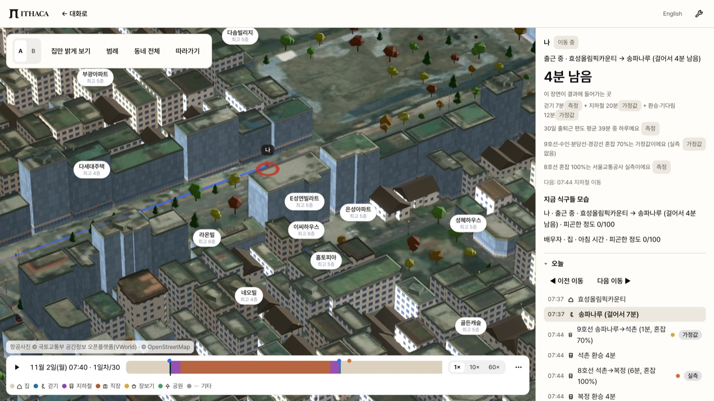
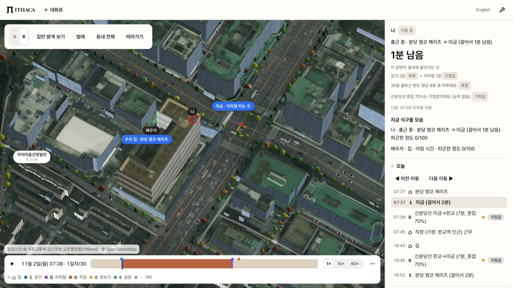
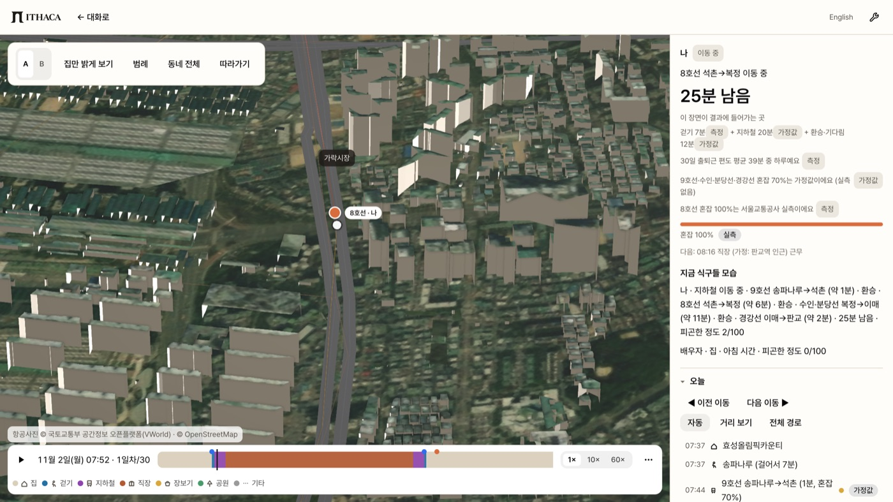
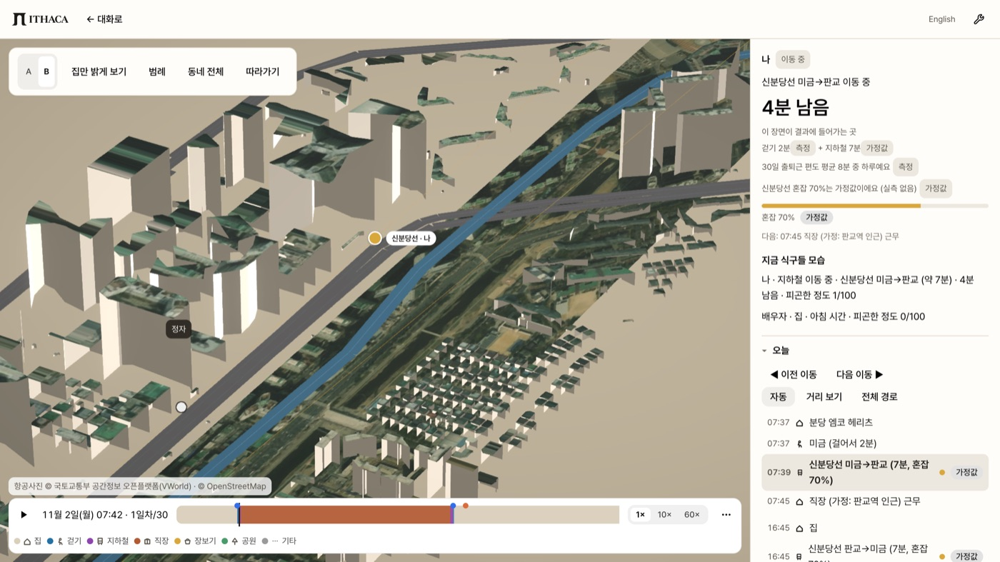
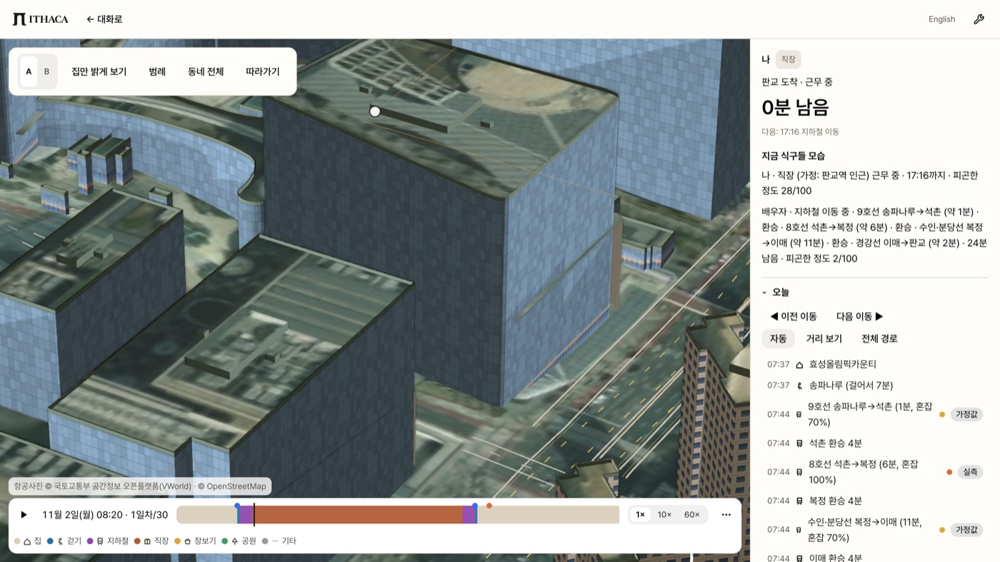
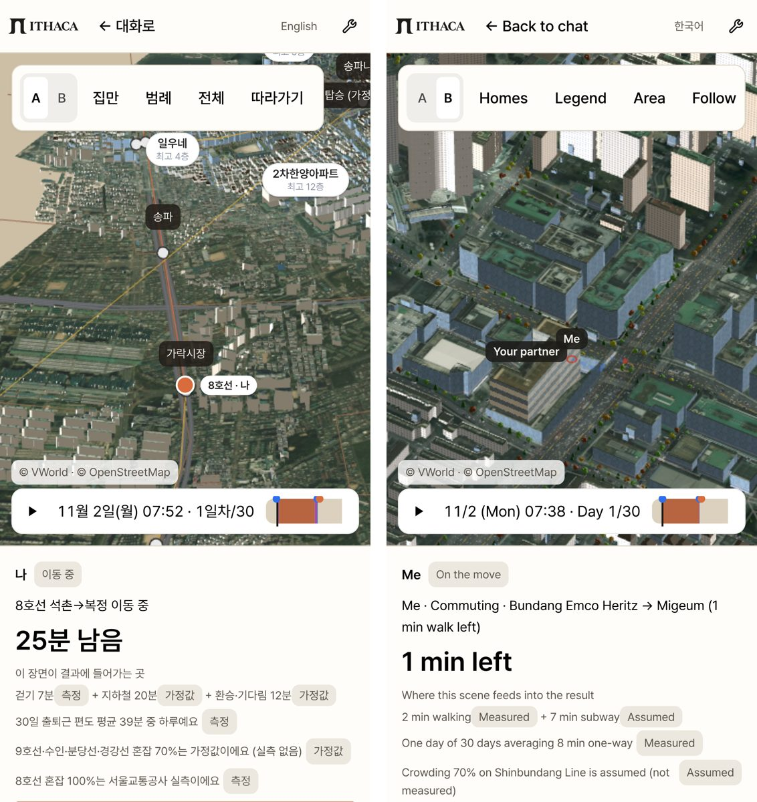

# 3D 동네는 실제 도시와 얼마나 같나요

[English](3d-fidelity.md)

갤러리의 "한 사람을 따라가요" 장면을 하나씩 뜯어 봤어요. 확인한 것은 집 건물, 걷는 길, 지하철 구간, 땅과 지붕 사진이 실제 자료와 맞는지예요. 맞지 않는 곳도 그대로 적었어요.

- **확인한 날짜:** 2026-11-01
- **본 장면:** 기록된 한 달 `demo-two-homes`. 판교로 출근하는 맞벌이 부부(연봉 6천·5천, 모은 돈 2억)가 7억 이하 집을 사는 경우예요.
  - A 집은 송파구 방이동 효성올림픽카운티(아파트 56.22 ㎡)예요.
  - B 집은 성남시 분당구 구미동 분당 엠코 헤리츠(오피스텔 61.18 ㎡)예요.
- **화면:** 실행 중인 앱을 실제 GPU(Apple M4 Max, Metal)로 1440×810 @2x와 폰 390×844 @3x로 캡처했어요.
- **숫자 출처:** 모두 빌드 산출물과 엔진 코드에서 읽었어요.
  - 빌드 산출물: `data/build/<장면>/buildings.json`, `data/build/region/*`, `data/build/sim/demo-two-homes-*.json`.
  - 집값: 국토교통부 실거래가 공개시스템(rt.molit.go.kr) 2025-11 ~ 2026-10 거래예요.

## 왜 이 두 집인가요

예전 데모의 A 집은 잠실 레이크팰리스였어요. 이 부부의 연봉과 모은 돈으로는 맞지 않는 집이었어요. 그래서 실거래가로 다시 골랐어요. 조건은 7억 이하, 50 ㎡ 이상, 판교 출근이에요.

| | A 효성올림픽카운티 | B 분당 엠코 헤리츠 |
|---|---|---|
| 실거래 중간값 | 6억 2,500만 원 (5건, 지번+이름 일치) | 5억 8,700만 원 (5건, 이름 일치) |
| 집 종류 | 아파트 (대장 공동주택) | 오피스텔 (대장 업무시설) |
| 취득세 | 1.1667% (6억~9억 구간 계산식, 지방세법 제11조 제1항 제8호) | 4% (지방세법 제11조 제1항 제7호 나목) |
| 매달 집에 드는 돈 | 207만 9,245원 | 199만 522원 |
| 출근 | 송파나루 → 판교, 지하철 4개 노선 | 미금 → 판교, 신분당선 두 정거장 |

## 3D는 무엇으로 만드나요

| 층 | 자료 | 쓰는 곳 |
|---|---|---|
| 건물 바닥 모양 | OpenStreetMap 건물 + GIS건물통합정보(국토교통부) | 3D 건물, 집 찾기 |
| 건물 높이 | ① OSM `height` ② OSM 층수 × 3 m ③ 건축물대장 높이 ④ 대장 층수 × 3 m ⑤ 건축HUB 표제부 ⑥ 없으면 추정(종류·면적 규칙) | 3D 높이 |
| 걷는 길 | OpenStreetMap 도로·보행로 그래프 | 걷기 시간·거리 |
| 지하철 노선 | OpenStreetMap 노선 관계(ODbL) | 노선 경로·km |
| 운행 시간 | 서울교통공사 역간거리 및 소요시간(OA-12034, 공공누리 1유형) | 1~8호선 구간 분 |
| 혼잡도 | 서울교통공사 지하철 혼잡도(30분 단위) | 1~8호선 실측 혼잡 |
| 땅·지붕 사진 | VWorld 항공사진(국토교통부 공간정보 오픈플랫폼). 화면을 열 때마다 실시간으로 받고, 저장하지 않아요 | 동네 장면, 직장 장면, 노선 사이 지도 |

## 1. 건물 높이는 어디서 왔나요

| 장면 | 건물 | 대장 높이·층수 | 건축HUB | OSM 높이·층수 | 추정 | 추정 비율(동 수) | 추정 비율(바닥 면적) |
|---|---:|---:|---:|---:|---:|---:|---:|
| 송파나루역 인근 (A 집) | 3,917 | 2,910 | 27 | 693 | 287 | 7.3% | 4.5% |
| 미금역 인근 (B 집) | 1,230 | 558 | 0 | 223 | 449 | 36.5% | 12.0% |
| 판교역 인근 (직장) | 1,204 | 249 | 136 | 152 | 667 | 55.4% | 6.4% |
| 노선 사이 간략 지도 (송파나루→판교) | 11,071 | 8,460 | – | – | 2,611 | 23.6% | – |
| 노선 사이 간략 지도 (미금→판교) | 1,489 | 922 | – | – | 567 | 38.1% | – |

추정 높이는 대부분 작은 건물이에요. 추정 건물의 바닥 면적 중앙값은 판교 14.1 ㎡, 미금 19.5 ㎡, 송파나루 47.5 ㎡예요. 그래서 동 수로는 미금과 판교의 추정 비율이 높지만, 바닥 면적으로 보면 4.5~12%예요.

## 2. 우리 집 건물

| 항목 | A 효성올림픽카운티 | B 분당 엠코 헤리츠 |
|---|---|---|
| 3D 건물 | OSM way 677796358 | OSM way 465862686 |
| 고른 방법 | 실거래 지번(방이동 51-4)의 대장과 이름 일치. 실거래 지점에서 4 m | 시나리오 좌표가 건물 바닥 안에 있음(`point-in-footprint`) |
| 대장 용도 | 공동주택 | 업무시설(오피스텔) |
| 층수 | 지상 18층 = 3D 18층 | 지상 12층 = 3D 12층 |
| 높이 | 대장 54.05 m, 3D 54.0 m | 대장 58.6 m, 3D 59.0 m |
| 사용승인 | 2003-09-30 | 2014-01-06 |
| 바닥 면적 | 696 ㎡ | 2,797 ㎡ |

## 3. 출근길

**A: 효성올림픽카운티 → 송파나루 → 석촌 → 복정 → 이매 → 판교**

| 구간 | 3D 장면 값 | 근거 |
|---|---|---|
| 집 → 송파나루역 걷기 | 544 m · 7분 (직선 440 m) | OSM 보행 그래프 |
| 9호선 송파나루 → 석촌 | 0.822 km · 1.2분 | 추정: 노선 거리 × 1.43분/km. 9호선은 서울교통공사 표에 없어요 |
| 8호선 석촌 → 복정 | 4.228 km · 6분 | 서울교통공사 운행시간표 |
| 수인·분당선 복정 → 이매 | 7.705 km · 10.9분 | 추정 (노선 거리 × 1.43분/km) |
| 경강선 이매 → 판교 | 1.498 km · 2.1분 | 추정 (노선 거리 × 1.43분/km) |
| 환승 3번 (석촌·복정·이매) | 4분씩 12분 | 가정값 |
| 혼잡 (07:30~08:00) | 8호선 100% 실측. 9호선·수인·분당선·경강선 70% 가정값 | 서울교통공사 혼잡도는 1~8호선만 있어요 |

**B: 분당 엠코 헤리츠 → 미금 → 정자 → 판교**

| 구간 | 3D 장면 값 | 근거 |
|---|---|---|
| 집 → 미금역 걷기 | 133 m · 2분 (직선 94 m) | OSM 보행 그래프 |
| 신분당선 미금 → 판교 | 4.63 km · 6.6분 | 추정 (노선 거리 × 1.43분/km). 신분당선은 서울교통공사 표에 없어요 |
| 혼잡 | 70% 가정값 | 신분당선 실측 자료가 없어요 |

**30일 결과:**
- 출퇴근 편도 평균은 A 40분, B 9분이에요.
- 한 달 동안 걸은 시간은 A 13시간 28분, B 5시간 43분이에요.

화면은 지하철 시간을 "공식"이라고 쓰지 않아요. 모든 구간이 운행시간표에서 왔을 때만 "공식"이라고 써요. A의 지하철 20분은 그래서 "가정값"으로 표시돼요.

## 4. 이번에 고친 것

| 문제 | 고친 커밋 |
|---|---|
| 8호선·5호선·7호선 하선·경강선 등 9개 노선 패턴의 선이 거꾸로 저장돼 있었어요. 그래서 8호선을 탄 표시가 북쪽 천호로 가고, 경강선 구간에서는 여주로 튀었어요. 분 계산은 맞았지만 그림이 틀렸어요 | 5384d71 |
| 걷기는 OSM 역 노드에서 끝나고 지하철은 노선 자료의 정거장에서 시작해서, 따라가기 표시가 역에서 튀었어요 | 6a2484b |
| 한 구간만 시간표인데 지하철 전체를 "공식"이라고 표시했어요 | 395ce2e |
| B 집이 근처 빌라로 잡혔어요. 오피스텔이 대장에 업무시설로 올라 있어서 집 후보에서 빠졌던 거예요 | 925b576 |
| 판교 직장 장면에 땅과 사진이 없이 검게 나왔어요 | 925b576 |
| 노선 사이 지도에 사진이 없었어요 | aca5eeb, bf8ce61 |
| "측정" 표시 하나가 걷기·지하철·기다림 전체에 붙어 있었어요 | 58b903d |
| 집 이름이 두 번 나왔어요("분당 엠코 헤리츠 분당 엠코 헤리츠") | dff0b2f |
| 혼잡 줄이 어느 노선의 값인지 말하지 않았어요 | dff0b2f |
| 역 원이 40px 넘게 커지고 '나' 표시의 점이 노선에서 48px 떨어져 있었어요. 카메라가 움직이기 전에 크기와 위치를 계산했고, 표시 전체의 가운데를 그 지점에 맞췄기 때문이에요 | 36c97f6 |
| 공공임대 목록이 직장 거리를 출발역(송파나루)에서 쟀어요 | 36c97f6 |
| 영어 화면에서 항공사진 출처가 한국어로 남았어요 | 6a2484b |
| 영어 폰에서 출처가 화면 밖으로 잘렸어요 | e26b489 |
| 폰 영어 도구 줄이 잘렸어요 | 925b576 |

## 5. 아직 다른 점

1. **지하철 분은 대부분 추정이에요.** A의 4개 노선 중 서울교통공사 운행시간표에 있는 건 8호선뿐이에요. 9호선, 수인·분당선, 경강선, 신분당선은 노선 거리에 1~8호선 중앙값 1.43분/km를 곱했어요.
2. **환승은 재지 않았어요.** 환승은 한 번에 4분으로 가정했어요. 실제 걷는 거리, 계단, 열차 간격은 넣지 않았어요.
3. **혼잡도 실측은 1~8호선만 있어요.** 나머지 노선은 70%로 가정해요.
4. **노선 사이 지도는 간략해요.** 건물 높이의 24~38%가 추정이에요. 사진은 지붕과 땅에만 입혀요. 사진은 노선을 따라 띠 모양으로만 덮어서, 띠 밖은 베이지 땅으로 남아요.
5. **출구 번호 자료가 없어요.** 걷기는 OSM 역 노드까지 재요. 실제로 쓰는 출구와는 다를 수 있어요.
6. **미금 장면은 추정 높이가 많아요.** 동 수로 36.5%예요. 대부분 작은 건물이고, 바닥 면적으로는 12.0%예요.
7. **채팅의 2D 지도는 사진이 아니에요.** 같은 VWorld 자료지만, 가격 핀과 노선을 읽기 쉽게 하려고 회색 백지도(`white` 층)를 써요. 3D 장면에서는 항공사진을 써요.
