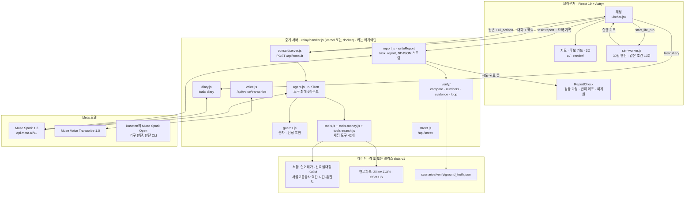
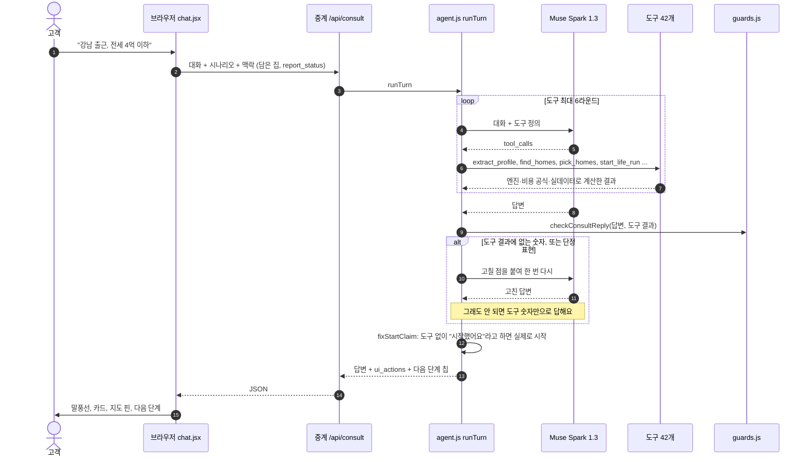
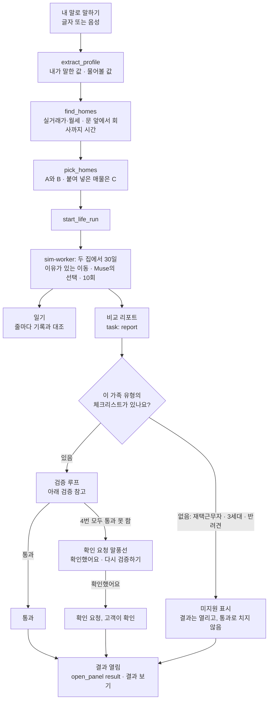

# 구조

[← README](../README.ko.md) · [English](architecture.md)

```text
ithaca/
├── pipeline/          Python: OSM 추출, 건축물대장 결합, 보행 그래프, 지하철망, 지형, 3D 상자
├── web/
│   ├── src/engine/    순수 JS 생활 엔진: 일과, 이유가 있는 이동, 짝지은 30일 실행(결정적, 시드 고정)
│   ├── src/judge/     Muse 호출: 판단 프롬프트, 숫자 가드, 정확히 다시 보기 위한 기록
│   ├── src/consult/   상담 에이전트: 도구 호출(extract_profile, find_homes, pick_homes, start_life_run …), 답변 가드, 음성 받아쓰기
│   ├── src/verify/    보고서 검사: 정답 체크리스트, 숫자 주장, 재시도 루프
│   ├── src/money/     급여, 매매·전세·월세 공식, 실거래가 로더, 공공임대
│   ├── src/transit/   운영사 시간표와 구간 분
│   ├── src/render/    three.js 장면: 외벽, 지형, 도로, 나무, 차량, 보행자, 열차
│   ├── src/ui/        React 19 + Astryx(Meta 디자인 시스템)
│   ├── scripts/       CLI: simulate, money, judge, 정적 서버
│   └── tests/         node:test 묶음
├── relay/             키를 브라우저에 보내지 않는 서버: /api/consult, /api/voice/transcribe, 지도 타일(Vercel 또는 docker compose)
├── scenarios/         커밋된 가구·집·기록된 Muse 판단
├── tests/             파이프라인 Python 테스트
├── Dockerfile, docker-compose.yml, package.json, .env.example
└── briefs/            Muse Code 단계마다 지시서 + 결과
```

## 시스템 지도

각 부분이 어디서 돌아가는지 보여 줘요. 브라우저는 모델 키를 갖지 않아요. Muse 호출은 모두 중계 서버를 거쳐요.



## 에이전트 흐름: 채팅 한 번

대화는 브라우저가 갖고 있어요. 중계 서버는 한 턴을 돌리고, 답변과 함께 지도를 옮기거나 카드를 열거나 살아 보기를 시작하는 화면 동작(`ui_actions`)을 돌려줘요.



## 한 문장에서 검증된 비교까지



**말로 정리한 흐름**
1. **조건 정리.** 브라우저가 대화를 `/api/consult`(개발 서버 또는 중계 서버)로 보내요. 에이전트가 도구와 함께 Muse를 부르고, 도구 결과는 `web/src/engine`과 `web/src/money`가 계산해요.
2. **숫자 검사.** 답변 가드(`web/src/consult/guards.js`)는 도구 결과에 없는 숫자가 든 답을 돌려보내요.
3. **30일 살아 보기.** 엔진이 브라우저 워커(`web/src/sim-worker.js`)에서 두 집을 함께 돌려요.
4. **일기.** Muse가 실행 기록으로 일기를 쓰고, `web/src/consult/diary.js`가 줄마다 그 기록과 대조해요.
5. **검증된 비교.** Muse는 두 집 비교를 `submit_report` 도구로만 낼 수 있어요. 코드와 Muse 판정자가 확인하고, 통과하거나, 고객이 확인 요청에 답하거나, 미지원 가족 유형일 때만 결과가 열려요([검증](verification.ko.md) 참고).
6. **가구 판단.** Muse는 판단 CLI(`web/scripts/judge.mjs`)로 가구의 선택을 내리고, 기록된 파일로 똑같이 다시 볼 수 있어요.

루트에서 `npm test`는 JS 테스트를, `npm run test:py`는 Python 테스트를 돌려요. CI는 PR마다, 그리고 main에 푸시할 때마다 둘 다 돌려요.

## 층

| 층 | 위치 | 내용 |
|---|---|---|
| 데이터 파이프라인(Python) | `pipeline/` | OSM 추출, 건축물대장 결합, 도보 그래프, 지역, 지하철망, 지형과 장면 상자 |
| 생활 엔진(JS, 순수 함수) | `web/src/engine/` | 생활 규칙, 판단, 원인이 붙은 이동, 짝 실행, 돈 흐름, 기준 불러오기 |
| Muse 판단 층 | `web/src/judge/` | 판단 프롬프트, 숫자 검사, 똑같이 다시 재생하기 위한 판단 기록 |
| 상담 에이전트 | `web/src/consult/` | Meta API로 보내는 OpenAI 방식 도구 호출. 서버에서만 실행해서 키가 브라우저에 가지 않아요 |
| 돈과 가격 | `web/src/money/` | 급여 표, 계약 형태별 계산식, 실거래 불러오기, 공공임대 연결 |
| 대중교통 | `web/src/transit/` | 운영사 시간표, 구간별 탑승 시간, 요금 |
| 3D 장면과 움직임 | `web/src/render/`, `web/src/scene/`, `web/src/motion/` | three.js 0.170: PBR 외벽, 지형, 도로, 나무, 규칙으로 움직이는 차·사람·열차 |
| 화면 | `web/src/ui/` | React 19 + **Astryx**(Meta의 디자인 시스템) |
