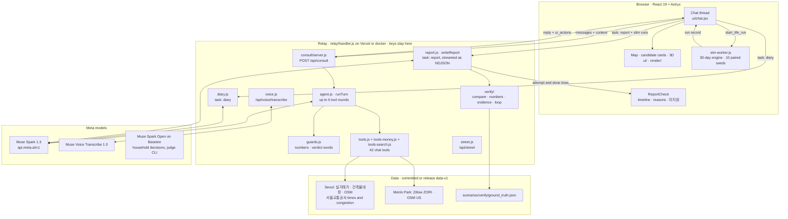
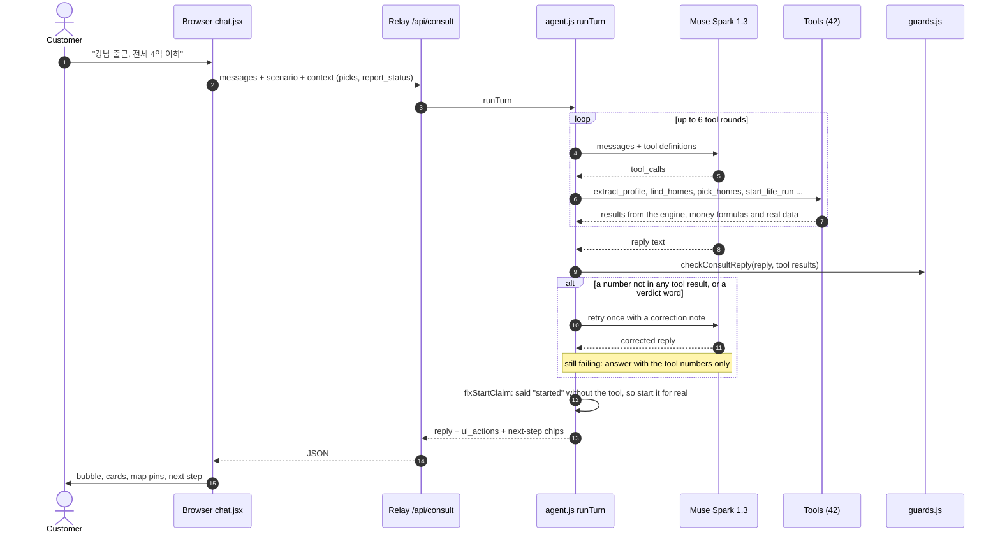
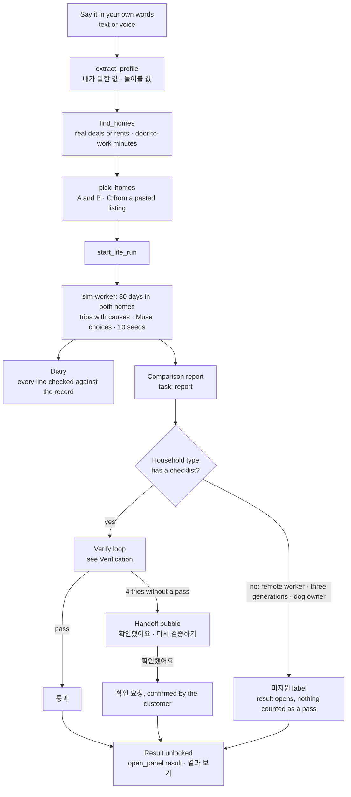

# Architecture

[← README](../README.md) · [한국어](architecture.ko.md)

```text
ithaca/
├── pipeline/          Python: OSM extract, building register join, walking graph, subway network, terrain, 3D boxes
├── web/
│   ├── src/engine/    Pure JS life engine: routines, trips with causes, paired 30-day runs (deterministic, seeded)
│   ├── src/judge/     Muse calls: decision prompts, number guards, recorded decisions for exact replay
│   ├── src/consult/   Consult agent: tool calls (extract_profile, find_homes, pick_homes, start_life_run, …), reply guards, voice transcription
│   ├── src/verify/    Report checks: ground-truth checklist, number claims, retry loop
│   ├── src/money/     Payroll, 매매 / 전세 / 월세 formulas, real-transaction loader, public rentals
│   ├── src/transit/   Operator schedule and ride minutes
│   ├── src/render/    three.js scene: facades, terrain, roads, trees, vehicles, pedestrians, trains
│   ├── src/ui/        React 19 + Astryx (Meta's design system)
│   ├── scripts/       CLIs: simulate, money, judge, static server
│   └── tests/         node:test suites
├── relay/             Server that keeps keys off the browser: /api/consult, /api/voice/transcribe, map tiles (Vercel or docker compose)
├── scenarios/         Committed households, homes and recorded Muse decisions
├── tests/             Python tests for the pipeline
├── Dockerfile, docker-compose.yml, package.json, .env.example
└── briefs/            One brief + result per Muse Code stage
```

## System map

Where each part runs. The browser never holds a model key: every Muse call goes through the relay.



## Agent flow: one chat turn

The browser owns the conversation; the relay runs one turn and sends back the reply plus the screen actions (`ui_actions`) that move the map, open cards or start the run.



## From one sentence to a checked comparison



**Flow in words.**
1. **Profile.** The browser sends the chat to `/api/consult` (the dev server or the relay). The agent calls Muse with tools; tool results come from `web/src/engine` and `web/src/money`.
2. **Number check.** The reply guard (`web/src/consult/guards.js`) rejects a reply whose numbers are not in the tool results.
3. **30-day run.** The engine runs both homes in a browser worker (`web/src/sim-worker.js`).
4. **Diary.** Muse writes the diary from the run's record, and `web/src/consult/diary.js` checks every line against that record.
5. **Checked comparison.** Muse hands in the two-home comparison only through the `submit_report` tool; code and a Muse judge check it, and the result opens only after it passes, the customer confirms a handoff, or the household type is marked 미지원 (see [Verification](verification.md)).
6. **Household decisions.** Muse makes them through the judge CLI (`web/scripts/judge.mjs`), and they replay exactly from the recorded files.

`npm test` at the root runs the JS suites, and `npm run test:py` runs the Python ones. CI runs both on every pull request and every push to `main`.

## Layers

| Layer | Where | Notes |
|---|---|---|
| Data pipeline (Python) | `pipeline/` | OSM extract, building join with the national register, walking graph, regions, subway network, terrain and scene boxes |
| Life engine (JS, pure) | `web/src/engine/` | Routines, decisions, trips with causes, paired runs, money timeline, criteria loader |
| Muse judgement layer | `web/src/judge/` | Decision prompts, number guards, recorded decisions for exact replay |
| Consult agent | `web/src/consult/` | OpenAI-style tool calls to the Meta API, server-side only (keys never reach the browser) |
| Money and prices | `web/src/money/` | Payroll table, tenure formulas, real-transaction loader, public-rental adapter |
| Transit | `web/src/transit/` | Operator schedule, ride minutes per leg, fares |
| 3D scene and motion | `web/src/render/`, `web/src/scene/`, `web/src/motion/` | three.js 0.170: PBR facades, terrain, road ribbons, trees, procedural vehicles, pedestrians and trains |
| UI | `web/src/ui/` | React 19 + **Astryx** (Meta's design system) |
