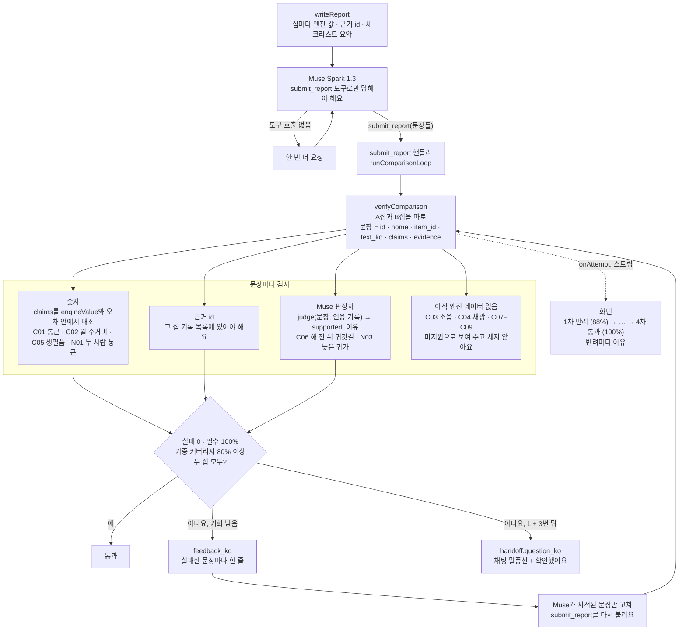

# 검증 자세히

[← README](../README.ko.md) · [English](verification.md)

에이전트가 만든 결과는 고객에게 보여 주기 전에 코드가 먼저 확인해요.

- **정답 기준.** [`scenarios/verify/ground_truth.json`](../scenarios/verify/ground_truth.json)은 가족 유형마다 꼭 다뤄야 할 항목 목록이에요. 공통 9개(통근·통학 시간, 월 주거비 총액, 소음은 *필수*, 채광, 생필품 접근성, 귀갓길 안전, 수납, 하자, 아침 동선은 *권장*)와 유형별 5~6개로 되어 있어요.
- **들어오는 길은 하나.** 비교 리포트는 `submit_report` 도구로만 고객에게 가요. 채팅 에이전트는 이 도구를 볼 수 없고, 리포트가 통과하거나, 고객이 확인하거나, 미지원으로 표시되기 전에는 `open_panel("result")`가 거절돼요.
- **두 가지 검사.** *결정적* 항목(통근 시간, 원·달러 월 주거비, 생필품까지 시간, 두 사람 각자의 통근)은 엔진이 계산한 값과 정해 둔 오차 안에서 맞아야 해요. *판정* 항목은 그 집 실행 기록을 근거로 달아야 하고, Muse가 따로 판정자로 불려 문장과 인용 기록을 나란히 읽고 `supported`와 이유를 답해요. 지금 엔진 이동 기록으로 뒷받침되는 판정 항목은 2개예요. 해 진 뒤 귀갓길(C06: `dark_walk`, `late_home`)과 늦은 귀가(N03: `late_home`)예요.
- **통과 기준.** 두 집 모두 실패 0개, *필수* 항목을 모두 다루고, 가중 커버리지 80% 이상(*필수* 3점, *권장* 1점). 통과하지 못하면 실패한 문장마다 한 줄씩 이유를 붙여 최대 3번 Muse에게 돌려보내요. 그래도 안 되면 채팅에 남은 질문과 **확인했어요**, **다시 검증하기** 버튼을 보여 줘요.
- **과정을 그대로 보여 줘요.** 시도가 끝날 때마다 채팅에 바로 떠요. `1차 반려 (88%) → 2차 반려 (88%) → 3차 반려 (88%) → 4차 통과 (100%)`, 반려 아래에는 이유가 붙어요(예: 인용 기록에 이동 수단이 없어서 판정자가 "걸어서"를 받아 주지 않음, 출발 시각이 기록과 다름). 문장마다 숫자 확인, 근거 n개, 확인 필요 태그가 붙어요.
- **한 일만 말해요.** 에이전트가 30일 살아 보기를 시작하는 도구를 부르지 않고 "시작했어요"라고 답하면, 그 말을 잡아내고 실제로 시작시켜서 말과 화면이 어긋나지 않게 해요.
- **모르는 건 모른다고 해요.** 엔진이 아직 근거를 댈 수 없는 항목(소음, 채광, 수납, 하자, 아침 동선)은 미지원으로 보여 주고 통과로 치지 않아요. 신혼부부, 미취학 자녀 가족, 사회초년생 1인 가구는 검증된 비교를 받아요. 1인 재택근무자, 3세대 가족, 반려견 가구는 리포트용 모델을 부르지 않고, 결과에 미지원 표시를 달아 열어요.
- **실제 거주자 비교** *(준비 중)*. 실제 거주자 10~20명의 집과 살아 보고 알게 된 불편을 시뮬레이터 결과와 비교해서 일치율을 낼 거예요.

상태: 완료, 화면에도 보여요(채점기·숫자 검사는 16a–16b 단계, `submit_report`·Muse 판정자·두 집 루프·검증 과정 화면은 29j1–29k3 단계). 2026-11-01 실제 실행(서울 신혼부부, 실제 Muse Spark 1.3): 첫 실행은 네 번 만에 통과했고, 반려 이유 덕분에 우리 쪽 버그 3개를 찾았어요(엔진이 모르는 구성원 id, 숫자 없는 문장을 다룸으로 침, 이동 수단이 빠진 걷기 기록을 판정자에게 보냄). 29k 단계 뒤에는 같은 가족이 첫 시도에 100%로 통과하고, 문장마다 엔진이 확인한 숫자나 인용 기록이 붙어요.
