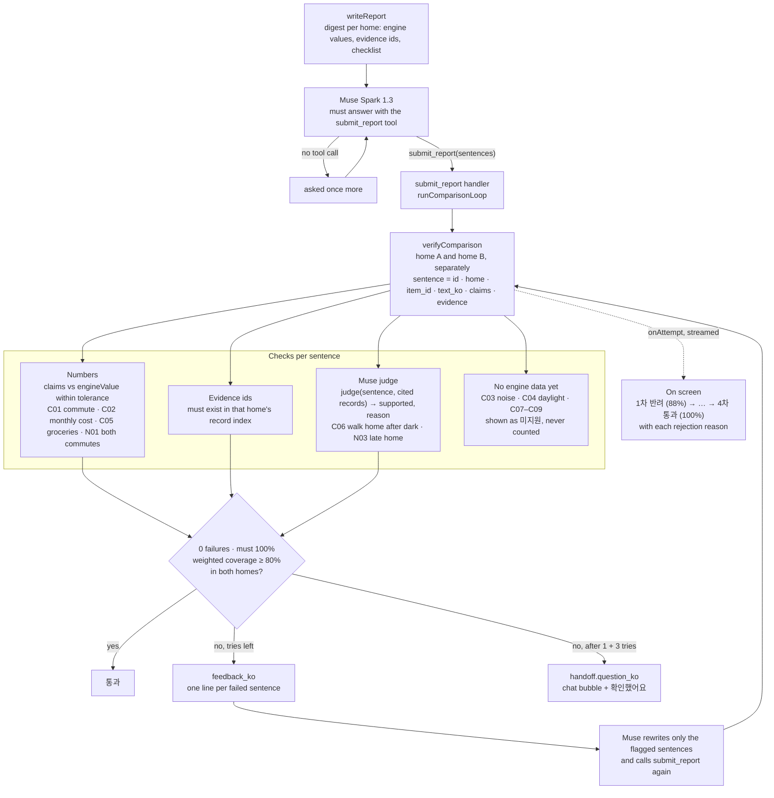

# Verification in detail

[← README](../README.md) · [한국어](verification.ko.md)

The agent's work is checked by code before the customer sees it.

- **Ground truth.** [`scenarios/verify/ground_truth.json`](../scenarios/verify/ground_truth.json) lists what must be covered for each household type: 9 common items (commute time, monthly housing cost and noise are *must*; daylight, groceries, the walk home at night, storage, defects and the morning rush are *should*) plus 5–6 items per household type.
- **One way in.** The comparison reaches the customer only through the `submit_report` tool. The chat agent never sees that tool, and `open_panel("result")` is refused until the report has passed, been confirmed by the customer, or been marked 미지원.
- **Two kinds of check.** *Deterministic* items must match the engine's value within a stated tolerance (commute minutes, monthly cost in won or dollars, minutes to groceries, each partner's commute). *Judge* items must cite a record from that home's run, and Muse, as a separate judge call, reads the sentence next to the cited records and answers `supported` with a reason. Two judge items are backed by engine trips today: the walk home after dark (C06: `dark_walk`, `late_home`) and getting home late (N03: `late_home`).
- **Pass rule.** Zero failures, every *must* item covered, and weighted coverage ≥ 80 % (*must* weighs 3, *should* 1), in both homes. A failed report goes back to Muse with one line per failed sentence, up to 3 times. Then the customer gets the open question in the chat with **확인했어요** and **다시 검증하기**.
- **Shown while it happens.** Each try streams to the chat as it finishes: `1차 반려 (88%) → 2차 반려 (88%) → 3차 반려 (88%) → 4차 통과 (100%)`, with the reason under every rejection (for example, the judge refused "걸어서" because the cited record has no travel mode, and a departure time that did not match the record). Each sentence carries its tag: 숫자 확인, 근거 n개 or 확인 필요.
- **Says only what it did.** If a reply says the 30-day run has started but the agent never called the tool that starts it, the claim is caught and the run is started for real, so the words and the screen agree.
- **Honest gaps.** An item the engine cannot back yet (noise, daylight, storage, defects, the morning rush) is shown as 미지원 and never counted as a pass. Newlywed couples, families with a young child and single first-jobbers get the checked comparison. For remote workers, three-generation families and dog owners the result opens with a 미지원 label and no model call is made for the report.
- **Field study** *(coming soon)*. Compare the simulator's findings with the real homes and real regrets of 10–20 residents and report the match rate.

Status: built and on screen (stages 16a–16b for the scorer and claim checks, 29j1–29k3 for `submit_report`, the Muse judge, the two-home loop and the on-screen timeline). Live runs on 2026-11-01, Seoul newlywed couple, real Muse Spark 1.3: the first run took four tries, and its rejection reasons exposed three of our own bugs (member ids the engine did not know, a number-free sentence counted as covered, walking records sent to the judge without their mode). After stage 29k the same household passes on the first try at 100 %, every sentence carrying an engine-checked number or a cited record.
